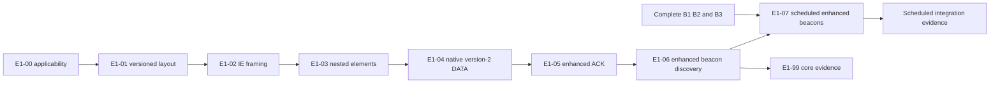

# IEEE 802.15.4 version-2 frames and Information Elements plan

> **Kind:** design · **Status:** draft · **Seal:** none · **Owns:** — · **Stands on:** [802154-implementation-plan.md](802154-implementation-plan.md), [802154-superframe-gts-plan.md](802154-superframe-gts-plan.md), [planning.md](../../doc/project/rule/planning.md), [testing.md](../../doc/project/rule/testing.md)

Plan revision: 2026-11-16, approved draft 4, execution in progress. Checkout: `/home/miguel/workspace/inet-ieee802154-standard`, baseline `efced47d1f952dc0094c09a4b17696c58365e4a8`. Approval: the user's 2026-11-16 instruction, “Execute the plan. Don't stop until finished. Then, push,” authorizes implementation, verification, commits and final publication to `origin/feat/inet-802154-standard`. New capabilities and their checks remain NOT_RUN until their owning implementation and recorded execution complete. Preserve the unrelated AGENTS.md edit. The [original roadmap](802154-implementation-plan.md#6-later-feature-series-and-their-gates) remains the package index.

## 1. Intended result and support boundary

Two explicitly configured native peers exchange an unsecured version-2 DATA frame, including a legal omitted sequence number or PAN-ID layout, and receive the corresponding enhanced ACK. A coordinator answers an Enhanced Beacon Request with a real enhanced beacon carrying the requested supported Information Elements (IEs). Unknown well-formed elements retain their identity, order and bytes but do not turn on a feature. A malformed IE cannot make the MAC acknowledge or deliver bytes past its enclosing frame boundary.

E1 is not permission to reuse the version-0/1 layout for version 2. It adds a version-aware layout, a bounded IE grammar and the corresponding production DATA/ACK/beacon paths. Keep the M1/M2 default version, wire bytes, public interface names, 127-byte O-QPSK PSDU bound and upper-layer protocol-selection policy. There is no EtherType or generic MacAddress conversion added to the wire.

| Delivery gate | Required capability | Dependencies and limits |
| --- | --- | --- |
| E1 core, through E1-06 | Version-2 Beacon/DATA/ACK/Command structural formats, sequence suppression, Header/Payload/Nested IE grammar, unsecured operational DATA/Enh-Ack and one-shot Enhanced Beacon Request/response | M1/M2 only; no beacon scheduler dependency. Operational address/context combinations are explicitly catalogued, not implied by structural decoding. |
| E1 scheduled integration, E1-07 | Enhanced beacons supply the same real superframe/GTS state used by B1–B3; tracking and scheduled exchanges work through those IEs | Complete B1/B2/B3. This single integration commit includes GTS code/tests and cannot land from E1 core or B1/B2 alone. |

Out of scope: AES/security processing, key/device tables, replay protection, TSCH/DSME semantic IEs and scheduling, association/join security, ranging, Multipurpose/Fragment/Extended frame formats, new PHYs, new FCS widths and later amendments. Representing a protected header does not implement S1. Parsing a TSCH-shaped byte string does not establish TSCH synchronization or capability.



E1-99 closes the independent core after E1-06. Its scheduled evidence is updated with E1-07 when that dependency exists; the earlier result must say scheduled integration NOT_RUN, not mark E1-07 completed.

## 2. Verified current behavior and affected consumers

The [frame codec](../../src/inet/linklayer/ieee802154/Ieee802154FrameCodec.cc) checks a legacy minimum length, reads the sequence number at octet two and returns UNSUPPORTED for every version-2 frame. Legacy PAN compression uses the existing address/equality assumptions. The [frame chunk](../../src/inet/linklayer/ieee802154/Ieee802154Frame.msg) has a mandatory-looking `dsn`, fixed PAN-ID value members and one payload array; it has no sequence-suppression or IE-list representation. Its rawBytes/decodeStatus preserve unsupported input.

The [native MAC](../../src/inet/linklayer/ieee802154/Ieee802154StandardMac.cc) constructs version-1 DATA and version-0 immediate ACKs. Its receive/ACK paths currently rely on codec rejection to exclude modern layouts. The fixed 544-us post-DATA ACK allowance and five-byte immediate-ACK assumptions cannot simply be reused for variable-length enhanced ACKs. A newly successful decode must not accidentally activate those old protocol paths before their later E1 commits.

The [DATA request](../../src/inet/linklayer/ieee802154/Ieee802154MacDataRequest.h) has no modern format/IE selection. Its indication already uses optional `dsn`, wire-carried `sourcePanId` and separate `effectiveSourcePanId`, with an effective destination PAN. Confirmation has no DSN field. The gate adapter and [service tags](../../src/inet/linklayer/ieee802154/Ieee802154MacServiceTag.h) copy these records by value. Reuse that native presence/context contract; the missing optional views are on the frame/layout side, not a reason to break the existing indication API.

The [beacon request](../../src/inet/linklayer/ieee802154/Ieee802154MacBeaconRequest.h) contains an enhanced flag but the MAC rejects it. Current `transmitBeacon()` prepends the legacy beacon body; that is not a valid substitute for enhanced-beacon IEs. The [legacy beacon codec](../../src/inet/linklayer/ieee802154/Ieee802154BeaconCodec.h), [command codec](../../src/inet/linklayer/ieee802154/Ieee802154CommandCodec.h), serializer, dissector and printer are the actual wire consumers to extend. Generic packet/capture infrastructure is reused without edits to the sealed common/packet subtree.

Existing `Ieee802154FrameWire_1.test`, `Ieee802154Fcs_1.test`, `Ieee802154Capture_1.test`, `serializer_ieee802154.test` and the ReceiveSecurity/Admission/DataAck/SequenceWrap protocols remain controls. They validate legacy behavior and unsupported outcomes. No existing fixture establishes an operational version-2/IE/enhanced-ACK exchange. The baseline [execution report](../../doc/project/evidence/model/ieee802154/results.md) must not be relabelled as E1 evidence.

## 3. Normative sources and edition-specific decisions

Use the pinned [IEEE 802.15.4-2024 PDF](../../doc/project/evidence/standard/ieee802154/source.md), SHA-256 `851d81127297f898c956fdd1ce92929324d68cd696fd338d1e876f6a372f22d3`. These are normative references retrieved for this draft; physical PDF pages are one-based. Canonical node IDs use `ieee802154-2024:` followed by the suffix below.

| Canonical suffix | PDF pages | E1 obligation |
| --- | --- | --- |
| `clause:7.2`, `clause:7.2.2.6`, `table:7-2`, `table:7-3` | 78–83 | Field order, version-specific PAN presence and address modes |
| `clause:7.2.2.7`, `clause:7.2.2.8`, `clause:7.2.3` | 81–82 | Sequence suppression, IE-present bit and sequence field |
| `clause:7.2.8`, `clause:7.2.9`, `clause:7.2.10`, `clause:7.2.11` | 83–84 | Auxiliary-header boundary, IE/payload/FCS coverage |
| `clause:7.4.1`, `table:7-6` | 96–97 | Header/Payload termination inclusion matrix |
| `clause:7.4.2.1`, `clause:7.4.2.4`, `clause:7.4.2.5` | 97–100 | Header descriptor and HT1/HT2 |
| `clause:7.4.3.1`, `clause:7.4.3.3`, `clause:7.4.3.4`, `clause:7.4.4.1` | 100–102 | Payload, MLME container, termination and short/long nested descriptors |
| `clause:6.6.2`, `clause:6.6.3.3`, `clause:6.6.3.4`, `clause:7.3.3`, `figure:7-16` | 70–73, 91–92 | Receive/ACK eligibility, enhanced ACK field copying, response timing, retries and unknown IE handling |
| `clause:6.6.1`, `table:8-31` | 69, 146–148 | Independent DSN/BSN/EBSN ownership and received enhanced-ACK content in DATA.confirm |
| `clause:6.5.2`, `clause:7.5.3`, `clause:7.4.4.2` | 67–68, 106, 108–109 | Enhanced Beacon Request, requested elements and filtering |
| `clause:10.2.8.1`, `clause:10.25.8.1` | 190–191, 389–390 | Optional scheduled integration's simplified superframe/GTS IEs |
| `clause:9.2`, `clause:9.4` | 160, 173 (entry nodes) | Follow auxiliary-header children/references during E1-00; no operational cryptography claim |

Raw retrievals and the corpus linter report are retained at `/home/miguel/workspace/.codex-artifacts/ieee802154-followup-plans-20261115/`. The local corpus was rebuilt for the task. It has extraction warnings and four unresolved references outside the selected E1 procedures; do not call it warning-free. The outgoing 7.2.2.6 references resolve to Table 7-2. Its physical PDF pages 80–81 were visually inspected, including the continuation and footnote. The B1–B3 plan records the shared source-retrieval procedure; the ignored corpus is not a deliverable.

**Important edition decision:** the literal 2024 Table 7-2 footnote a states a zero compression value iff PAN identifiers are identical when both addressing fields are present and either is short. The adjacent legacy-version prose uses the familiar different rule. Do not silently copy the legacy equality shortcut or an older table into version 2. This draft selects the literal pinned-2024 rule for automatic version-2 emission, with the footnote called out in E1-00's interpretation record and independent vectors. Structural decoding follows transmitted field presence. If verified IEEE corrective material changes the decision, pin that evidence and revise the encoder policy/tests before implementation; do not assume an erratum exists. Interoperability with another edition is a separate claim.

Other settled design constraints:

- Table 7-2 includes PAN-only and omitted-PAN layouts; full extended source/destination addresses do not imply the legacy PAN-field arrangement. Expand its generic “present” rows to both short/extended modes. Reserved address modes and version 3 remain invalid. Version-2 types outside the selected four remain opaque unsupported, not parsed as normal DATA.
- Absence of DSN or PAN ID is not the numeric value zero or 0xffff. Expose optional wire-field views computed by the versioned layout. Resolve implicit/local PAN context at the MAC separately, preserving whether a field was transmitted. Promiscuous/raw inspection must not inherit an invented on-wire identity.
- A Header IE descriptor has a 7-bit length and 8-bit element ID; a Payload IE descriptor has an 11-bit length and 4-bit group ID. Nested short/long descriptors have their own grammar, not the Header IE layout. All lengths remain bounded by their enclosing region and the actual PSDU, even when their bit fields permit larger values.
- Apply all eight Table 7-6 presence combinations. Header-only, no-MSDU frames need not contain a termination. HT1 switches to a Payload IE list; HT2 switches directly to MAC data. A Payload Termination is required when payload IEs precede data, optional in the allowed no-data case. Neither “always add terminators” nor “scan until an unknown ID” is correct.
- Security-enabled frames may have an auxiliary header before Header IEs. Parse only the bounded structural fields needed to locate those regions; preserve protected payload as opaque and maintain the unsupported-security outcome. Do not interpret encrypted bytes as Payload IEs or compute authenticated state changes without S1.
- Enhanced ACKs copy the required suppression/compression and addressing relationships from the triggering frame; the ACK's own AR is zero. An unknown well-formed ACK IE does not make an otherwise valid transmission fail. Use 6.6.3.3's allowed response-start timing and an explicit ACK-length bound, not the old fixed minimum-ACK timeout or advance knowledge of the remote receiver's eventual IE content.
- An Enhanced Beacon Request is the Beacon Request command with frame version 2 and no command content. Its requested IE IDs/filter are IEs, not a new proprietary command number or legacy payload extension.

E1-00 must finish the applicable-reference and service mapping before dependent source work, including suppression-related DSN allocation under 6.6.1, legal ACK matching/address combinations, source/destination PAN inference conditions, version selection on native requests, exact IE IDs/termination values, auxiliary-header lengths and active-scan/enhanced-beacon parameters. The plan specifies the owners and tests now; those source-derived tables are mandatory implementation inputs, not assumptions delegated to the current legacy code.

## 4. Component design and compatibility

Apply [AR-EXT-REUSE](../../doc/project/rule/architecture.md#ar-ext-reuse), [AR-CFG-INFER](../../doc/project/rule/architecture.md#ar-cfg-infer), [AR-MOD-COMPOSITION](../../doc/project/rule/architecture.md#ar-mod-composition) and [QR-DESIGN-MINIMAL](../../doc/project/rule/quality.md#qr-design-minimal). This package adds no second MAC, general-purpose parser framework, crypto engine, global IE registry or new PHY owner.

| Proposed owner / surface | Responsibility | Reason for the boundary |
| --- | --- | --- |
| `Ieee802154FrameLayout.{h,cc}` | Pure field-presence/order calculation from frame type, version, address modes and control bits; optional wire PAN/sequence views | Current legacy `headerLength` arithmetic cannot describe version 2. Reuse the address value and PHY/FCS limits. Derive presence instead of maintaining duplicate boolean state. |
| Existing `Ieee802154Frame.msg` and frame codec | Preserve FCF suppression/IE bits, auxiliary structural bytes, IE lists, MSDU and correct FCS; expose versioned layout views | Keep one standard MPDU chunk and serializer. Unsupported/malformed bytes retain the existing raw representation. A capability gate protects operational consumers during the staged rollout. |
| `Ieee802154InformationElement.{msg,h}` and `Ieee802154InformationElementCodec.{h,cc}` | Protocol-local value representation and bounded Header/Payload/Nested parsing, encoding and unknown preservation | Existing beacon content and command payload vectors cannot distinguish the regions. An IE contains its ID and content bytes; typed semantic views are parsed/encoded at consumers, not stored as a second conflicting copy of the same bytes. |
| Existing MAC and service/tag adapter | Validate requested format/options, resolve receive PAN context, own frame lifetime and handle actual DATA/ACK/beacon exchanges | Codec success is structural, not admission or receive authorization. Keep existing dispatch and ownership rather than introducing a bypass to the upper gate. |
| `Ieee802154AckPolicy.{h,cc}` if extraction is needed | Pure ACK-format, expected-peer/sequence and timing description consumed by the existing ACK owner | Replace growing legacy/modern predicates without creating another ACK timer/state machine. Existing MAC owns PHY requests, retries and native terminals. |
| Existing serializer, dissector, printer and beacon/command helpers | Present optional fields and IE boundaries truthfully, distinguish legacy and enhanced beacons | No sealed generic packet/capture changes are anticipated. Do not print a fabricated DSN or decode enhanced beacon bytes as the four-byte legacy body. |

Extend the native DATA request with explicit frame-version selection, sequence-suppression selection and copied IE values; retain version 1/no suppression/no IEs as defaults. Reject IE/suppression options on versions 0/1. Refusal/accepted-semantic-error ownership and IDs remain the existing contract. Admission counts every encoded auxiliary/header/IE/termination/data/FCS byte against 127; retries retain the chosen bytes/identity and do not consume another DSN. E1-00 defines whether/how suppressed transmissions advance macDsn from the standard, and the interleaving tests enforce that decision.

Expose `enableEnhancedFrames=default(false)` on StandardInterface and forward it to the native MAC as the legacy-only versus enhanced-capable profile selection. This is separate from a request's wire-version selection: a legacy-only provider rejects modern transmission/reception explicitly. The parameter preserves the existing profile's supported receive formats and random-stream consumption; for example, EBSN initialization belongs only to the enhanced-capable profile. The codec-only stages additionally keep unfinished operational paths gated internally; a user setting the parameter cannot enable code that has not landed. Do not add a separate switch per intermediate commit. It does not enable security, TSCH/DSME or their semantic IE consumers. New public enum/code values must be explicitly assigned without renumbering existing values.

Populate the existing optional indication DSN from the new frame-layout view: engaged for transmitted sequence fields and absent for suppressed ones. Preserve the existing source-PAN/effective-PAN distinction and by-value tag copying. No DSN type migration, invented confirmation DSN or major-release gate is required. Document the additive request options and any genuine compatibility effects in their owning commits. Optional wire PAN/sequence accessors may be calculated from stored values and layout; do not store a second resolved PAN on the wire chunk. A legal but unsupported implicit-address operating combination returns a documented unsupported result, never MALFORMED solely because the model has no context for it.

The new IE walker consumes at least each descriptor's two bytes before advancing, checks lengths before indexing, and never reads past the Header/auxiliary/Payload/FCS boundary. Unknown IDs keep order, duplicates and body bytes where legal; they do not terminate parsing or acquire semantics. The MLME payload group supports the standard short/long nested forms with a bounded parent region; arbitrary recursive nesting is not introduced. Unsupported ESDU/feature semantics remain explicit even though their bytes can be preserved.

For unsecured operational reception, run the existing FCS/filter/address/ACK/security decision order with version-aware fields. Match an enhanced ACK to the single outstanding exchange using every applicable source/destination/PAN/sequence condition and timing/channel context in the audited matrix. Sequence suppression must neither be treated as sequence zero nor turn any in-window ACK into success. Cases without a standard-supported unambiguous context stay explicitly unsupported at local admission until their interpretation is closed. Protected traffic retains existing unsupported-security notification/visibility rules; structural decoding is not permission for ordinary delivery or a security-derived state update.

The MAC obtains enhanced-ACK content from supported IE values selected by the receive context and upper configuration; no generic producer registry is required. Check total length and PHY readiness before promising a response; observe the actual PPDU start/end. Preserve the permitted minimum-turnaround policy in and out of CAPs. Incoming unknown ACK IEs are ignored semantically while a valid ACK still completes SUCCESS. Copy the actual received Header IE list, Payload IE list and ACK payload into an optional native enhanced-ACK-content value on DATA.confirm, following Table 8-31. Exclude termination IEs/FCS, distinguish an actual empty enhanced ACK from no enhanced ACK, and leave the existing confirmation's DSN-free contract intact. This is additive metadata, not a packet pointer or another wire representation. Beacon IE construction uses supported requested fields/filter criteria, not arbitrary promises of TSCH/DSME/security capability.

The originator cannot know an arbitrary receiver's eventual ACK IE length in advance. The proposed packet-level wait policy therefore uses the PHY's maximum legal PSDU length as a conservative enhanced-ACK length bound, plus the allowed response-start delay and twice the existing MAC `maxPropagationDelay` parameter. This parameter already bounds one-way propagation in the legacy ACK wait (`Ieee802154StandardMac.cc`, TX-confirm handling); reuse it without a new timeout/propagation parameter. Require its configured value to bound the selected topology's actual one-way propagation; legacy immediate-ACK bounds remain format-specific. In a scheduled exchange, cap that deadline at the last legal ACK completion that leaves the required IFS inside the current CAP/GTS. This is an explicit model wait policy, not a new IEEE timing constant. The receiver omits optional ACK IEs if they would exceed its valid window; mandatory content that cannot fit cannot be transmitted across a reservation boundary. Initial CAP admission follows the standard's minimum-ACK fit rule, while the receiver's actual serialization still has to fit. E1-00 records this policy alongside any more specific timing provision discovered through the selected PHY/mode references.

A conservative completion deadline does not authorize a late response start. Check the received PPDU start independently against the legal AIFS/backoff-boundary response times and the corresponding outstanding exchange, allowing their arrival envelope of zero through `2 * maxPropagationDelay` after the sender's TX end. The originator uses this configured bound, not knowledge of a remote peer's actual receive time or a zero-delay assumption. Bound the scheduled receive duty as well, so waiting for a maximum-length ACK cannot hold the radio into another reservation or trigger an off-window retry.

E1 core remains nonbeacon-compatible. E1-07 later maps typed simplified superframe/GTS IEs to B1/B3's same validated schedule/grants. The controller must receive one normalized schedule description whether the beacon was legacy or enhanced. It must not have two independent PIBs, clocks or allocation tables. If either feature branch changes a shared contract first, rebase and revalidate this plan's source links and corresponding fixtures before editing the shared owner.

## 5. Future commits and direct verification

All implementation paths below are under `src/inet/linklayer/ieee802154/` unless specified otherwise. Every new behavior fixture runs through native services, actual serialization/radio reception and receiver-owned indication metadata with `seed-set=0`, typed/raw representations, one-metre scalar-radio peers and -110 dBm noise. An observer can inspect actual lower frames and native terminals; a mirrored test parser or helper-only call cannot establish production behavior.

Every protocol commit must write the named reviewer document in the same commit, associating this plan, ID and subject with exact tests. Explain original/planned-parent behavior, topology, stimulus, on-wire/native observations, positive/negative assertions and limits. Include field-layout, exchange or timing diagrams as needed; check rendering when implementation creates the companion. These are explicit tasks, not a generic promise to add documentation later.

### E1-00 — `doc: change: close enhanced frame applicability`

Depends on M1/M2. Extend the standard catalog and English checks for selected version-2 frame/IE/ACK/beacon obligations; create `doc/project/evidence/model/ieee802154/enhanced-frame-profile.md`. Separate structurally decoded, emitted and operational combinations. Record the 2024 footnote decision, complete Table 7-2/7-6 matrices, ACK match/timing conditions, auxiliary boundary/security limitations, IE semantic ownership and additive service compatibility. Inventory every direct chunk/service user and all concrete management clients before adding fields or callbacks.

This is a source-grounded documentation prerequisite, not a protocol behavior change. No protocol companion applies. Validate primary-source locators/continuations, cross-references, links and `git diff --check`; all future runtime checks remain NOT_RUN. A design-critical unresolved table row blocks its dependent code rather than being silently treated as legacy.

### E1-01 — `ieee802154: add: version-aware MAC frame layouts`

Depends on E1-00. Add FrameLayout, control-bit representation and optional wire-field views. Update codec minimum/length/address/PAN/sequence handling for the four selected version-2 frame types, while adding an explicit native operational capability check before ACK/delivery. Codec success must not activate unsupported MAC paths. Legacy encoding and forensic raw preservation stay intact. Native format controls continue to default to legacy until E1-04.

**Write tests:** `tests/unit/Ieee802154FrameLayout_1.test` expands all 14 Table 7-2 rows to the concrete short/extended mode combinations, all legal suppression choices and reserved modes/version. Independent octets must cover both-extended compression 0/1, PAN-only layouts, 0xffff-present versus absent, and the shortest suppressed frame with/without FCS. Extend `Ieee802154FrameWire_1.test` with fixed version-0/1 controls. Add `tests/protocol/ieee802154/Ieee802154EnhancedFrameGate.test`: inject actual valid version-2 frames into an operationally disabled native receiver; require forensic visibility but no normal DATA indication or ACK. The protocol case is a compatibility control that can already pass on the parent; the unit/serializer before-state is UNSUPPORTED, not an invented runtime DATA failure. New-type fixtures do not compile unchanged on the baseline.

**Write reviewer document:** `tests/protocol/ieee802154/enhanced-frame-gate.md`, E1-01. Explain structural versus operational acceptance and the absence/presence matrix. Verify the exact new unit/protocol selectors and existing ReceiveSecurity/Fcs controls.

### E1-02 — `ieee802154: add: bounded header and payload IE codecs`

Depends on E1-01. Add protocol-local IE values, auxiliary structural-boundary handling and Header/Payload IE codec integration with Frame/serializer/dissector/printer. Implement all termination combinations, unknown-ID preservation and exact MSDU extraction after termination. Parse the required auxiliary-header control/key-ID/counter extents from the audited layout, while retaining opaque protected payload and unsupported-security outcomes. No cryptographic API or key store belongs in this commit.

Retain one typed Frame callback in the production dissector and expose regions through a computed codec view over its authoritative payload. Invoke shared inspection on both raw decoding and the typed fast path. The callback has no named-region operation, so no packet-region classes or generic callback extension are required. Use byte offsets from the MPDU start and call the initial region the fixed MHR prefix: the full MHR also includes the auxiliary header and Header IEs. A registered-dissector callback test receives the actual typed frame and compares the computed boundaries/ordered values against independent expectations. Separate value-encoding unit vectors are still required; replay of authoritative payload octets alone does not prove IE value encoding. Protected payload/MIC remains one opaque region without invented plaintext boundaries.

**Write tests:** `tests/unit/Ieee802154InformationElements_1.test` and `tests/serializer/serializer_ieee802154_enhanced.test` use independently authored byte vectors for every Table 7-6 row, empty/maximum legal content, HT1/HT2, optional/required payload termination, unknown/duplicate IDs, descriptor-type transitions, FCS modes and every truncation offset. Include declared lengths larger than remaining bytes and malformed nonzero termination content. Extend EnhancedFrameGate with a real-radio IE vector whose production dissector must report the correct regions, and malformed/security-enabled vectors that must never reach normal delivery or generate ACKs. Parent's opaque version-2 handling cannot provide those structured IE observations; ordinary delivery is still deliberately disabled.

**Write reviewer document:** `tests/protocol/ieee802154/enhanced-ie-framing.md`, E1-02. Include MHR/Header-IE/Payload-IE/MSDU/FCS boundaries and termination cases. Verify named unit/serializer cases, the extended EnhancedFrameGate selector and existing capture/legacy serializer controls. A serializer round trip is representation evidence, not operational MAC success.

### E1-03 — `ieee802154: add: nested MLME IE framing`

Depends on E1-02. Add standard short/long Nested IE handling inside MLME Payload IEs, preserving unsupported sub-IDs as values. Keep typed feature-specific interpretation out of the generic parser. This separates a reusable nested grammar from operational DATA/ACK changes.

**Write tests:** `tests/unit/Ieee802154NestedElements_1.test` covers both descriptor forms, mixed lists, zero-length unknown entries, duplicate IDs, maximum enclosing size and declared-length under/overrun at every boundary. Extend the enhanced serializer vectors and EnhancedFrameGate's real-radio observation with an MLME group containing unknown short/long sub-IEs followed by a separate MSDU; require byte-preserving order and no payload bleed. Parent E1-02 preserves the group as opaque content but cannot expose nested views; that is the before/after claim, not TSCH interpretation.

**Write reviewer document:** `tests/protocol/ieee802154/enhanced-nested-ies.md`, E1-03. Show enclosing versus nested lengths and list the still-unsupported semantic consumers. Verify the new unit selector, enhanced serializer and EnhancedFrameGate cases. No recursive arbitrary container or registry is needed.

### E1-04 — `ieee802154: add: native version-2 data services`

Depends on E1-03 and E1-00's closed service/DSN/context tables. Add explicit request options and version-aware receiver filtering/admission, and populate the existing optional indication metadata from the new layout. Copy new request values through the native gate tag without changing the indication's DSN type. Enable unsecured version-2 DATA without ACK first; acknowledge-requested modern transmission remains explicitly unsupported until E1-05. Resolve omitted PANs only using a declared applicable local/peer context. Preserve current version-1 request defaults and document the additive options in this commit.

Copy Table8-32's received Header/Payload IE lists, excluding termination/FCS, through the
existing indication and its result tag as well. Keep the native packet's original-MSDU-only
binding explicit beside the separate copied lists; the standard's Msdu parameter includes
Payload IEs. Prove actual callback/tag values rather than relying on an RF observer that
cannot reveal service information loss. Resolve required peer context after mandatory expiry
retirement and its receive-epoch guard, before protocol state updates; test a peer removal
coincident with the final received symbol and a still-bound control.

Add default-legacy format options to the production `src/inet/applications/ieee802154/Ieee802154ManagementApp` and its NED declaration, and an explicit enhanced-interface example configuration. The application chooses native request metadata; the MAC/codec still validate and encode it. Any IE configuration uses typed protocol-local values through existing NED value facilities, not a new ad-hoc string grammar. Keep the old example's requests unchanged.

**Write protocol tests:** `tests/protocol/ieee802154/Ieee802154EnhancedData.test`. Send addressed unicast/broadcast DATA with short/EUI combinations, explicit/implicit PAN fields, sequence present/suppressed and Header/Payload/unknown IEs. Observe receiver MSDU bytes and optional native sequence/source metadata independently of sender tags. Include two peers whose EUIs share the low 48 bits, foreign PAN/peer context, unsupported no-address combinations, invalid legacy+IE options, and 127/128-byte total-MPDU boundaries including all IE/auxiliary/termination bytes. Interleave legacy and suppressed transfers around DSN rollover according to the audited allocation rule. Require refusal/semantic-error packet ownership, one terminal, no unexpected ACK and no fabricated absent field. Parent has structural support but keeps operational version-2 delivery disabled; this commit changes the service and receive decision that produce real delivery.

**Write reviewer document:** `tests/protocol/ieee802154/enhanced-data.md`, E1-04. Explain wire PAN presence versus inferred context and the existing optional metadata's new population cases. Verify the new selector plus existing Admission/NativeGate/SequenceWrap/ReceiveSecurity controls. Valid layouts outside the selected operational profile must be listed as unsupported, not quietly accepted or labelled malformed.

### E1-05 — `ieee802154: add: enhanced ACK exchanges`

Depends on E1-04. Implement the audited response format, field copying, peer/sequence matching and variable-length timing in the existing MAC ACK owner, extracting AckPolicy if needed. Add the Table 8-31 enhanced-ACK-content value to DATA.confirm and copy it through the native tag; update concrete clients/fixtures in this commit. Preserve immediate-ACK behavior for versions 0/1. Support the selected legal suppression/address combinations; do not equate missing DSN with zero. Reset/stop/unavailable PHY must still destroy original packets before exactly one terminal.

**Write protocol tests:** `tests/protocol/ieee802154/Ieee802154EnhancedAck.test`. Two modern peers exchange acknowledged DATA with and without DSN where legal, and with enhanced-ACK IEs of different lengths. Inject wrong sequence, peer, PAN, addressing mode, suppression/compression copy, channel and early/late timing; lose the first/all ACKs; include a well-formed unknown ACK IE and malformed/truncated ACK IE. Require actual Enh-Ack version/AR/address fields, AIFS-based PPDU start, correct variable-length receive deadline, success despite an unknown IE, retries preserving original identity, and no completion from a foreign ACK. Check timeout equality and one tick either side. Stop/reset at RX-ready, TX-ready, actual ACK TX and ACK wait, including inline restart. Parent explicitly refuses modern AR requests; a compatible fixture observes that missing exchange rather than claiming a parent packet-matching bug.

Keep the originator unaware of the receiver's optional IE choice in one case, so the test detects any invalid dependence on sender-side knowledge of the eventual ACK length. E1-07 owns the scheduled variants: optional-IE omission near window end, a peer's permitted later CAP response start and timeout/retry deferral without holding the radio into an unrelated reservation. They are required for scheduled integration, rather than conditional evidence that could be skipped by both branches.

Include nonzero actual propagation and set the existing `maxPropagationDelay` to a valid one-way bound. Assert the resulting round-trip allowance and the response-start check using sender/receiver PPDU timestamps, so a valid ACK is not rejected merely because the link has propagation delay. Keep the zero-propagation control and exact-deadline boundary cases.

Include Header IEs, Payload IEs and ACK payload in a real enhanced ACK and assert the native confirmation/tag contains exactly those received values, excluding terminators/FCS. Verify absence on failure/no ACK and distinguish a valid empty enhanced-ACK-content record. This tests the standard service consumer as well as wire parsing.

**Write reviewer document:** `tests/protocol/ieee802154/enhanced-ack.md`, E1-05. Include legacy versus enhanced field/timing diagrams and the suppressed-sequence matching cases. Verify the new selector and existing DataAck/Lifecycle/PhyLifecycle/InterframeSpacing controls. Point to E1-07's required CAP/GTS-boundary extension, which uses the same derived exchange timing; no second hard-coded timeout implementation is allowed.

### E1-06 — `ieee802154: add: enhanced beacon request and response`

Depends on E1-05. Enable one-shot enhanced beacon generation and Enhanced Beacon Request/response handling with supported requested Header/Payload/Nested IEs and the audited Enhanced Beacon Filter. Reuse the Beacon Request command identity with version 2. Add authoritative `macEbsn` PIB state and initialization/reset/GET/SET behavior from 6.6.1 and the applicable PIB table; enhanced beacons must not consume `macBsn` or `macDsn`. Initialize its random value only for the enhanced-capable profile, preserving RNG consumption for default legacy-only instances; retain it on nondefault reset and redraw it on default reset in that profile. Its exposure follows the selected profile rather than returning an invented initialized zero. Extend native beacon request/notification and scan descriptors to carry the actual IE lists/status instead of filling a legacy beacon-content structure with invented fields. Respect macBeaconAutoRespond: return a real notification to the upper client when automatic response is disabled.

Extend `Ieee802154MacScanRequest.h` with an explicit legacy-default beacon-request format and the requested IE/filter values mapped by E1-00 to the standard scan service. Active enhanced scanning then emits a version-2 Beacon Request through the same production scan path; it is not a fixture-only injection API. Extend the managed application's discovery policy and example in this commit so a user can run the request/response without test-library code.

**Write protocol tests:** `tests/protocol/ieee802154/Ieee802154EnhancedBeacon.test`. A requester sends EBRs with no filter, matching/nonmatching filter and supported/unknown requested IE IDs to a coordinator. Exercise automatic and upper-directed response, short/extended identities, specific/broadcast PAN, bad FCS/IE boundaries, protected unsupported input and oversized generated response. Observe the real command version/AR, the actual enhanced-beacon IE lists, native indication and scan descriptor; require no legacy four-byte beacon-body prefix, no forbidden response on filter mismatch and one terminal on failed generation. Also exercise a native enhanced scan/request service through the production path, not an observer decoding a hand-built packet. Parent has the enhanced flag but rejects it; this path must now produce the wire response and descriptor.

Interleave legacy and enhanced beacons with DATA/commands while setting DSN, BSN and EBSN near rollover. Assert the separate counter changes, byte-carried sequence values, reset retention/redraw behavior and the audited no-sequence-field cases. Existing legacy-only seeded controls must not consume an added EBSN random draw.

**Write reviewer document:** `tests/protocol/ieee802154/enhanced-beacon.md`, E1-06. Include EBR/filter/response and AutoRespond-false sequences. Verify the new selector plus existing Discovery/PassiveScan/Broadcast/PanConflict controls. This completes E1 core; reception of these discovery beacons does not establish periodic scheduling or TSCH joining.

### E1-07 — `ieee802154: add: scheduled enhanced beacon integration`

Depends on E1-06 and completed B1/B2/B3. Add typed simplified superframe/GTS IE views/producers under their protocol owners. Feed B1's existing epoch/window controller and B3's grants from the normalized received information; generate outgoing IE content from the same PIB/schedule/allocation owners. Select legacy versus enhanced periodic beacons explicitly and retain the configured timestamp boundary. Add no parallel schedule or GTS database. Keep E1 core independently releasable; do not introduce a partial E1-07 whose GTS imports or fixtures depend on an absent B3 implementation.

**Write protocol tests:** `tests/protocol/ieee802154/Ieee802154EnhancedSuperframe.test`. Repeat actual synchronization, CAP DATA and both GTS directions with enhanced beacons, loss/reacquisition, descriptor changes and one foreign/unknown IE. Compare the required schedule with the legacy-beacon profile, while allowing the longer beacon to change actual CAP start and frame-fit decisions. Require real IE-derived schedule/grants, no legacy-body interpretation, correct ACK behavior and no scheduled state update from malformed/protected-unsupported content. Parent E1 core has only one-shot discovery, and the B1/B3 branch knows legacy beacon content; this integration supplies the missing semantic bridge.

Extend `Ieee802154EnhancedAck.test` in this commit with the scheduled cases deferred by E1-05: variable-length ACKs and optional-IE omission at CAP/GTS boundaries, permitted later CAP response starts, lost ACK timeout/retry deferral and no receive duty extending into another reservation. Run its selector alongside EnhancedSuperframe and document these cases in `enhanced-superframe.md`. Both CAP and GTS cases are required by this commit's acceptance gate.

**Write reviewer document:** `tests/protocol/ieee802154/enhanced-superframe.md`, E1-07. Include shared schedule ownership and variable beacon-length timelines. Verify the new selector, B1–B3's applicable scheduled cases and the legacy controls. If B3 has not landed, leave E1-07 unstarted and all scheduled integration claims NOT_RUN.

### E1-99 — `doc: change: publish enhanced frame support evidence`

Depends on E1-06 for core closure, and on E1-07 only for scheduled claims. Update user/migration guidance, final example settings, field/version/IE support matrices and model results with source/configuration/seed/artifact identity. Application implementation ships with E1-04/E1-06, and release fragments belong in each behavior/API commit above; this closure does not postpone missing code or tests. Keep protected/unknown-feature semantics and excluded frame types visible. No new protocol reviewer document applies to this documentation/configuration commit; each behavior companion is already assigned.

## 6. Verification and release criteria

All proposed test targets remain NOT_RUN during planning. Follow [run-the-gates.md](../../doc/project/guide/run-the-gates.md), build a fresh matching debug library, verify exact selection, then run the owning category. For example, after E1-05 creates its fixture:

```sh
source setenv -q
make MODE=debug -j6
opp_run_protocol_tests --load . -p inet -m debug --no-build \
  -w '^tests/protocol/ieee802154$' -f 'Ieee802154EnhancedAck\.test$'
```

Unit selectors use `opp_run_unit_tests --load . -p inet -m debug --no-build -f 'Ieee802154<exact-name>_1\.test$'`. From `tests/serializer`, the proposed serializer command is `opp_run_opp_tests --load ../.. -p inet -m debug --no-build -f 'serializer_ieee802154(_enhanced)?\.test$'`. The combined new protocol selector is `Ieee802154Enhanced(FrameGate|Data|Ack|Beacon|Superframe)\.test$`; omit only the explicitly unavailable scheduled target when closing core and record that limit.

Exact proposed protocol `-f` selectors are `Ieee802154EnhancedFrameGate\.test$` for E1-01/E1-02/E1-03, `Ieee802154EnhancedData\.test$` for E1-04, `Ieee802154EnhancedAck\.test$` for E1-05, `Ieee802154EnhancedBeacon\.test$` for E1-06 and `Ieee802154EnhancedSuperframe\.test$` for E1-07. Select only the implemented/extended cases of the shared gate fixture at each commit; its companions state which observations are new versus unchanged controls.

The wire oracle is an independently written field/presence table and fixed octet vectors, not encode-then-decode alone. Cover every legal selected layout, every truncation offset in representative frames, terminator combinations, lengths at zero/max/enclosing-boundary, and malformed reserved combinations. This is a finite deterministic matrix; extra random seeds cannot establish parser correctness. An optional bounded property/fuzz campaign may supplement it but is not required for the claimed production exchanges and must not replace those cases.

Keep captures with and without FCS and independently decode modern fields where the external decoder supports them. Record decoder/version/unsupported fields; partial decoding is not complete validation. Unknown payload bytes and protected content must survive raw round trips without being delivered as ordinary MSDUs. Run legacy unit/module/protocol selectors named in each commit and stored IEEE802154Power/Coexistence trajectory checks, including the existing visual check. Preserve default legacy fingerprints; new enhanced-frame trajectories are new evidence, not an excuse to update unrelated baselines.

Before publication, compile release, run scoped architecture/naming/interface, link/seal/release checks and verify the IEEE802154 feature disabled. Verify existing native clients retain their optional sequence/address contract and new request defaults preserve legacy behavior. E1-07 also exercises the actual clock/feature combinations selected by the B1 plan. Keep global inherited failures separate. Baseline replacement and any unexpected sealed-core edit require their own existing project procedure/permission.

Core closure requires actual v2 DATA/Enh-Ack/EBR exchanges and receiver-owned payload/context evidence, not just a parser returning OK. Scheduled closure additionally requires the real shared B1/B3 schedule/grant observations. Neither closure establishes cryptographic authentication, TSCH/DSME operation, modern UWB or support for every IE semantics.

## 7. Planning review and risk record

Review loop completed on 2026-11-16 for draft 4: the final author and independent read-only review passes found no remaining actionable inconsistencies, vague commitments or unnecessary mechanisms in this draft and its roadmap links. Plan link checks (11 files, zero broken links), seal checks (20 documents) and whitespace/commit-ID/fence checks pass. This is a planning verdict; E1-00's source tables and all implementation/runtime gates remain open.

This review paragraph records planning-time evidence: source/standards inspection was executed, while implementation tests/builds were NOT_RUN at that time. Current per-unit implementation, review and executed outcomes are maintained in the [follow-on execution record](../../doc/project/evidence/model/ieee802154/followup-results.md). The Mermaid dependency graph is source-checked; rendering remains unverified while the CLI is unavailable. Preparing the plan itself changed no source, fixture or baseline.

The largest risks are field-presence ambiguity, the pinned edition's compression-footnote policy, accidental activation of modern frames by an earlier codec commit, absence represented as an ordinary DSN/PAN value, security-boundary confusion and ACK matching without DSN. E1-00 closes their source tables before implementation; the later commits assign direct failure cases to each risk. If that audit changes supported behavior or public-contract ownership, revise the affected entries before editing code. Keep the plan's protocol-local parser scope; do not expand into a generic sealed packet parser or S1 security implementation without a separately concrete change.
