# IEEE 802.15.4 beacon, slotted-access and GTS implementation plan

> **Kind:** design · **Status:** draft · **Seal:** none · **Owns:** — · **Stands on:** [802154-implementation-plan.md](802154-implementation-plan.md), [planning.md](../../doc/project/rule/planning.md), [testing.md](../../doc/project/rule/testing.md)

Plan revision: 2026-11-16, approved draft 4, execution in progress. Checkout: `/home/miguel/workspace/inet-ieee802154-standard`, baseline `efced47d1f952dc0094c09a4b17696c58365e4a8`. The unrelated modified AGENTS.md is outside this work. Approval: the user's 2026-11-16 instruction, “Execute the plan. Don't stop until finished. Then, push,” authorizes implementation, verification, commits and final publication to `origin/feat/inet-802154-standard`. New capabilities and their checks remain NOT_RUN until their owning implementation and recorded execution complete; approval alone is not evidence of completion.

## 1. Intended result and package boundaries

A coordinator advertises a repeating superframe. A child wakes for its beacon, sends ordinary traffic only through a valid contention access period (CAP), and sleeps during the inactive portion unless another valid radio duty requires reception. Once a guaranteed timeslot (GTS) is allocated, the owner and coordinator exchange short-addressed data in that reservation without contention. Missing a beacon suspends GTS use for that superframe; losing synchronization removes the allocations. These are observable radio exchanges, not just PIB flags or populated beacon descriptors.

| Package | Completion criteria | Explicit limits |
| --- | --- | --- |
| B1 | Periodic legacy beacons, correct BO/SO timing, START-SUPERFRAME and SYNC services, tracking/loss/reacquisition, incoming/outgoing coordinator timing and realignment | Clock/timing core can land before B2. Full managed beacon operation closes only after the CAP integration below. |
| B2 | Slotted CSMA-CA, two-clear-CCA contention window, battery-life-extension rules, CAP fit/defer, and M2 management traffic over the real CAP | No PCA, ALOHA, TSCH, DSME or new throughput/fairness claim. |
| B3 | Real GTS request/decision/advertisement, both data directions, deallocation, repacking and expiration | Conventional GTS between a PAN coordinator and directly associated children. No DSME allocations or extended-address GTS data. |

Retain the M1/M2 unsecured 2.4-GHz O-QPSK PHY, page 0/channels 11–26, computed two-byte FCS, full native identity and packet-level radio abstraction. B1–B3 use legacy frame versions 0/1 and do not depend on E1 or S1. Security requests retain explicit unsupported outcomes. Enhanced beacons and simplified superframe/GTS IEs belong to [E1](802154-enhanced-frames-plan.md) and subsequent semantic packages.

The timing foundation of B1 must precede B2, but complete beacon-mode management cannot use the current unslotted backend. Therefore B1-04, which includes coordinator realignment, follows B2-02. B2-03 then closes managed operation. This refines the roadmap's package-level ordering without making an unsafe intermediate implementation claim. Before B2-02, B1 is an opt-in timing/synchronization capability: contention DATA/commands in a synchronized beacon PAN return an explicit unsupported result, and fixtures set AutoRequest false so no unsupported automatic poll is silently attempted. BO=15 operation remains unchanged.

```mermaid
flowchart LR
    A[B-00 applicability] --> B[B-01 timing owner]
    B --> C[B1-02 periodic beacons]
    C --> D[B1-03 synchronization]
    D --> E[B2-01 access context]
    E --> F[B2-02 slotted CAP]
    F --> G[B1-04 coordinator reconfiguration]
    G --> H[B2-03 managed beacon PAN]
    H --> I[B3-01 GTS representation]
    I --> J[B3-02 allocation]
    J --> K[B3-03 CFP exchange]
    K --> L[B3-04 deallocation and repacking]
    L --> M[B3-05 expiration]
    M --> N[B-99 release evidence]
```



E1 can proceed on a separate branch from the same M1/M2 base. The two plans share the existing MAC/codec and must coordinate those edits; their independent dependency graphs do not authorize concurrent edits to the same files.

## 2. Verified starting point

The [native MAC](../../src/inet/linklayer/ieee802154/Ieee802154StandardMac.cc) owns the accepted packet, one primary transaction, immediate ACK work, management requests and PHY operation IDs. `startData()` and `startAccess()` send every current primary exchange through the [unslotted provider](../../src/inet/linklayer/ieee802154/Ieee802154UnslottedAccess.cc). `transmitBeacon()` creates a single version-0 beacon with BO/SO both 15 and uses that same access path. It increments BSN when constructing the frame; it has no periodic scheduler or transmit-time anchor. Discovery beacon behavior must survive the new bypass path for periodic beacons.

The [START request](../../src/inet/linklayer/ieee802154/Ieee802154MacStartRequest.h) contains PAN ID and channel only. [Beacon requests](../../src/inet/linklayer/ieee802154/Ieee802154MacBeaconRequest.h) select one-shot transmission; enhanced beacons and SO other than 15 are rejected. [PIB SET](../../src/inet/linklayer/ieee802154/Ieee802154MacPib.cc) currently accepts macBeaconOrder only at 15. The management roles have neither SYNC nor GTS request methods, although SYNC-LOSS notifications already exist. The DATA request has no GTS selection.

The [beacon codec](../../src/inet/linklayer/ieee802154/Ieee802154BeaconCodec.h) already preserves the superframe specification, GTS direction bits, opaque three-byte descriptors and pending-address list. This is representation support, not GTS allocation. The pending store owns indirect frames and must remain the sole store for that mechanism; a GTS send is not an indirect poll transaction.

The [PHY service contract](../../src/inet/physicallayer/wireless/ieee802154/contract/IIeee802154PhyServiceProvider.h) already provides timed readiness/transmission and receive PPDU timing. Receive timing currently arrives at PPDU end, so its PPDU-start value is historical. The [clock API](../../src/inet/clock/contract/IClock.h) converts only current/future simulation times; it cannot convert that historical start at delivery. The PHY already subscribes to the radio's reception-start/end notifications, which provide the actual start event and stable transmission identity. B-01 adds a protocol-local direct start callback and correlation field rather than a generic historical-clock API. The [existing lifecycle repair](../../doc/project/evidence/model/ieee802154/phy-availability.md) distinguishes PHY availability from MAC lifecycle and preserves abort-before-reset-confirm ordering. Every new asynchronous owner must participate in that ordering.

Current executed evidence is in [results.md](../../doc/project/evidence/model/ieee802154/results.md). Existing UnslottedAccess, DataAck, InterframeSpacing, ReceiverEnable, Indirect, Association, Orphan, Lifecycle and PhyLifecycle protocol fixtures are regression controls, not evidence of beacon/slotted/GTS behavior. No dedicated production fixture for those new capabilities exists at this baseline.

## 3. Normative basis and interpretation gates

Use the pinned [IEEE 802.15.4-2024 source](../../doc/project/evidence/standard/ieee802154/source.md), SHA-256 `851d81127297f898c956fdd1ce92929324d68cd696fd338d1e876f6a372f22d3`, without subsequent amendments. The following are normative sources retrieved for this draft. PDF pages are physical, one-based pages. Canonical IDs have the prefix `ieee802154-2024:`; ranges below name the individual subclauses, not a new aggregate corpus node.

| Source and canonical ID suffix | PDF pages | Planned obligation |
| --- | --- | --- |
| `clause:10.2.1`, `clause:10.2.2.1`, `clause:10.2.2.2` | 182–184 | Superframe geometry, first beacon PPDU symbol as slot-zero origin, CAP and IFS fit |
| `clause:10.2.2.5`, `clause:10.2.2.6` | 184–185 | Incoming/outgoing timing, overlap handling and coordinated PIB updates |
| `clause:10.2.3`, `clause:10.2.4`, `clause:10.2.5`, `clause:10.2.6`, `clause:10.2.7` | 185–190 | Start/realignment, beacon priority, tracking, loss and transmit search/fallback |
| `clause:10.2.3.2`, `figure:10-3`, `clause:7.5.4` | 185–187, 109 | Old-beacon FP, broadcast realignment, next-beacon activation and AR=0 |
| `clause:10.2.9.2`, `table:10-1`, `clause:10.2.9.3` | 191–194 | START-SUPERFRAME request/confirmation and parameter conditions |
| `clause:10.2.10.2`, `clause:10.2.10.3`, `table:10-5` | 194–197 | SYNC, SYNC-LOSS and superframe PIB |
| `clause:10.11`, `figure:10-127` | 319–321 | Slotted NB/BE/CW, alignment, residual countdown, renewed backoff and BLE |
| `clause:6.3.1`, `clause:6.3.2.1`, `clause:6.5.3`, `clause:6.6.2`, `clause:6.6.3.3`, `clause:6.6.3.4` | 62–73 | IFS/access, timestamps, receive filtering, permitted ACK timing and retry deferral |
| `clause:6.4.1.1` | 64–65 | Suspend beacon transmission during scanning and recommence afterward |
| `clause:10.25.1` through `clause:10.25.7` | 383–389 | GTS allocation, use, removal, relocation, lifetime and CAP maintenance |
| `clause:10.25.9.1`, `clause:10.25.10.2` through `clause:10.25.10.4`, `table:10-121` | 390–393 | GTS wire command, services and descriptor persistence |
| `clause:7.3.1.5`, `table:8-35` | 88–89, 151–152 | Beacon GTS fields and common MAC constants |
| `figure:7-9`, `figure:7-10`, `table:8-36`, `figure:10-167` | 88–89, 152–156, 388–389 | GTS Permit, seven-descriptor advertisement bound and staged relocation persistence |
| `table:8-31` | 146–148 | DATA.confirm outcomes, including an exchange too large for an entire CAP/GTS |

The corpus was rebuilt from the local PDF for this task. Its linter reports four unresolved references outside these selected procedures, plus extraction warnings; it is not described as warning-free. Outgoing references inspected for 10.11 and 7.2.2.6 resolve; 10.25.7 has no extracted outgoing references. Raw retrievals/lint are retained at `/home/miguel/workspace/.codex-artifacts/ieee802154-followup-plans-20261115/`. Figure 10-127 was visually checked on PDF page 320, and the exponent in GTS expiration on page 389 was checked against the PDF. No older edition or simulator algorithm substitutes for these sources.

B-00 must close the complete applicable-reference inventory before coding: remaining children of 10.2/10.25, common receive/ACK/retry rules, START confirmation statuses, realignment/security refusal paths and all referenced constants/PIB access permissions. Source-dependent choices must be recorded with their conditions, not inferred from the current nonbeacon implementation.

Specific rules already resolved for the proposed design:

- For the ordinary active superframe, `BI = 960 × 2^BO` symbols, `SD = 960 × 2^SO` symbols and each of 16 slots lasts `60 × 2^SO` symbols. Use 16-us symbols for the selected PHY. BO=15 disables periodic beacons and normalizes SO to 15. Table 10-1 also permits SO=15 with BO<15: treat that as the distinct beacon-only case, with no invented active CAP/CFP or `960 × 2^15` active duration.
- The slot origin is the first transmitted beacon PPDU symbol, not the MAC request time or the end of the beacon. CAP starts after the actual beacon; its closing slot comes from Final CAP Slot. Ordinary CAP traffic must finish its DATA/command, any required ACK and applicable IFS before the CAP closes. Periodic beacons bypass CSMA and have priority over other radio duties.
- 10.11 distinguishes two deferrals with BLE disabled. A backoff countdown that exceeds available CAP periods pauses and resumes its remaining count. If the countdown finishes but the rest of the exchange cannot fit, the next CAP applies another random backoff. With BLE enabled, countdown and TX start are limited to the specified early full periods after beacon IFS; inability to finish the count or remaining exchange there requires a further random delay next CAP, rather than carrying a residual count. Do not reset NB/BE/CW or consume an extra draw outside these conditions or real channel-busy rules.
- The selected ACK policy can retain transmission exactly AIFS after receive end; 6.6.3.3 permits this in a CAP. It must not accidentally become a contended ACK or be forced to the next backoff boundary. ACK readiness, timeout, airtime and IFS are distinct quantities.
- An originator must also accept a peer's permitted CAP ACK start at a backoff boundary within the stated AIFS range. Separate that receive allowance from this model's chosen response-start policy. Retries remain in the same portion of the superframe under 6.6.3.4: a CAP retry waits for a later CAP when needed, and a GTS retry waits for the corresponding GTS rather than borrowing another owner's slot.
- Beacon timestamps use a consistent implementation-selected symbol boundary. For the enabled superframe clock profile, select the first PPDU symbol and `macSyncSymbolOffset=10`: the selected O-QPSK SHR is ten symbols, so this boundary is ten symbols before the first symbol past SFD named by Table 8-36. The table defines a nonnegative distance, not a signed convention. Offset zero denotes the post-SFD boundary, not PPDU start. Preserve offset zero and the existing M2 post-SFD timestamp when the superframe profile is disabled. Keep scheduling epochs at full clock precision; convert to the SAP's 24-bit symbol representation only at the boundary. Timestamp rollover is not loss of synchronization. This source-verified correction was made during B-00 execution, before dependent source work.
- `aMaxLostBeacons=4`, `aMinCapLength=440` symbols, and `aGtsDescPersistenceTime=4` superframes. The temporary CAP-shortening exception applies to descriptor maintenance, not arbitrary payload growth or permanent over-allocation.
- A GTS is identified by owner and direction relative to that device. Its DATA uses short addresses. An allocation remains valid when its temporary advertisement disappears after four superframes. For inactivity, use `2*n` superframes, where `n=2^(8-BO)` for BO 0–8 and `n=1` for BO 9–14. Receive-GTS use without ACK cannot establish inactivity by missing ACKs.

## 4. Ownership and compatibility design

Follow [AR-MOD-COMPOSITION](../../doc/project/rule/architecture.md#ar-mod-composition), [AR-ORG-CONTRACTS](../../doc/project/rule/architecture.md#ar-org-contracts), [AR-COM-DIRECT](../../doc/project/rule/architecture.md#ar-com-direct) and [QR-DESIGN-MINIMAL](../../doc/project/rule/quality.md#qr-design-minimal). Add explicit owners instead of extending the current unslotted state machine with every scheduled mode.

| Owner / proposed artifact | Responsibility and consumer | Reuse decision |
| --- | --- | --- |
| Existing `Ieee802154StandardMac` | Own accepted packets, DSN/BSN, PHY operations, ACK exchange and native request completions. Consume schedule/access decisions. | Retain one radio owner; scheduler/access/GTS code must not directly transmit through a second PHY client. |
| New `Ieee802154SuperframeController.{h,cc,ned}` | Own beacon epochs, acquisition/tracking state and boundary/wake timers, including distinct incoming/outgoing superframes. Notify MAC through paired `contract/IIeee802154Superframe{Provider,Client}.{h,ned}` roles. | Existing one-shot beacon counter and receiver window cannot represent recurring coordinator/child timing. Controller holds schedule state, not a second PIB or an MSDU queue. |
| Existing `ClockUserModuleMixin<SimpleModule>` and `IClock` | Schedule current/future local-clock epochs and sample the clock at the actual first-symbol event. | Reuse `src/inet/common/clock/ClockUserModuleMixin.h`; default `clockModule=""` uses simulation time, including builds without Clock. Never feed past receive times to the conversion API. No new oscillator, polling loop or global counter. |
| New `Ieee802154SlottedAccess.{h,cc,ned}` | Own one NB/BE/CW attempt, residual backoff and backoff ClockEvents on the same device clock as the controller, and consume immutable CAP windows. MAC performs its CCA and transmission requests. | Reuse the existing clock mixin and paired access roles after B2-01's additive window contract. Keep `Ieee802154UnslottedAccess` as the nonbeacon/search-fallback implementation. No second clock instance or timer broker. |
| New `Ieee802154ExchangeTiming.{h,cc}` | Pure calculation of remaining readiness/CCA, frame airtime, ACK and IFS reservation from the actual PHY and frame. | Extract the existing MAC calculations rather than duplicate hard-coded O-QPSK totals inside access and GTS code. No timers or protocol state. |
| New `Ieee802154GtsManager.{h,cc}` | Value/helper owner for coordinator allocations, device grants, descriptor lifetimes and activity counters. MAC calls it on actual command/beacon/data/ACK events. | Current pending transactions represent polling, not scheduled reservations. A contained helper suffices; do not add another radio-owning module. |
| Existing PIB and codecs | Store validated attributes and format actual beacon/command fields. | Extend typed GTS descriptors and command codec; retain native address/member lookup and existing FCS/serializer/dissector. |

The interface adds optional beacon-controller and slotted-access composition. Preserve existing module names and default unslotted behavior. Keep both access providers instantiated when scheduled operation is enabled so a legal BO=15 transition or beacon-search fallback does not require runtime NED replacement. The MAC chooses the provider from actual current synchronization/configuration. An unslotted provider receiving a CAP-only request refuses it; it must not silently ignore a window.

Use `enableSuperframe=default(false)` on StandardInterface, with proposed `superframeController` and (from B2-02) `slottedAccess` submodules when enabled. Forward the same optional `clockModule=default("")` to the controller and slotted provider; both reuse `ClockUserModuleMixin<SimpleModule>` and bind the same device clock. The MAC receives default-empty superframe/slotted-provider bindings; the compound supplies actual sibling paths. Existing `access` remains the unslotted provider. New services require management enabled and the corresponding implemented component; a capability flag alone never changes BO or starts transmission. This gives a concrete composition/configuration surface while preserving existing consumers.

Add a distinct native `submitStartSuperframe` request/confirmation corresponding to 10.2.9, plus `submitSync`. Do not overload the existing nonbeacon START request. Copy optional new request fields with legacy-preserving defaults, update every concrete role implementer and test client together, and preserve monotonically increasing IDs. IEEE SYNC has no SYNC.confirm: the native binding will explicitly define a local configuration-installed completion to satisfy its exactly-once request contract, followed by ongoing beacon/SYNC-LOSS indications without retaining that request as pending forever. Name and document that completion as local, not an IEEE primitive.

Assign any new externally exposed enums/status values explicitly and preserve existing values. Add BEACON_LOST/SUPERFRAME_OVERLAP to the native reason mapping from the audited standard rather than mixing them with local admission/abort reasons. Define direct role methods and their copied/borrowed value lifetimes in the preparation commit, with named units for clock time, simulation time and symbols.

Only a validated service commit changes BO/SO/role/channel atomically. A preparatory PIB commit must not make scheduled operation accidentally usable. Compute window geometry from the authoritative configuration and current beacon rather than storing independent copies of every derived duration. StartTime for a child coordinator uses the tracked incoming beacon and the required backoff rounding. A PAN coordinator ignores StartTime. A nonzero child StartTime without tracking produces TRACKING_OFF. Detect incoming/outgoing overlap and stop outgoing beacons with SUPERFRAME_OVERLAP.

For receive clock anchors, extend `physicallayer/wireless/ieee802154/contract/IIeee802154PhyServiceClient.h` with a direct receive-start notification containing a copied reception token, physical PPDU start and expected end. The existing transmission ID scoped to this receiver is sufficient; it is neither a new counter nor a service request ID. The native PHY forwards this notification from its existing radio reception-start hook, and the MAC forwards it to the controller. At a genuine first-symbol start (`ppduStart == simTime()`), the controller samples `getClockTime()` now and keeps `{token, physicalStart, localStart, expectedEnd}` whenever reception can produce a timestamp-bearing beacon indication. This includes acquisition/tracking, scan PAN descriptors and BEACON-NOTIFY, including scans that suspend tracking. A reception first attempted after its PPDU start has no first-symbol sample and cannot establish a beacon clock anchor; do not substitute a fabricated scan/notification timestamp for a missing sample.

At the radio reception-end hook, the PHY places the same token in its existing packet-ID quality record alongside received power; the final native receive indication carries the token. The MAC consumes the controller's sample into a local value for every delivered packet before parsing or client callbacks. Only a valid applicable beacon uses that value to update tracking/timestamps; nonbeacon and malformed packets also consume their samples. TX anchors use the existing actual transmit-start callback. Neither path guesses a past clock value from the later delivery time.

Reception abandonment can omit the radio's reception-end notification. Prune inert samples with `expectedEnd < simTime()` at each new start, packet consumption and existing acquisition/tracking/scan-dwell deadline; strict inequality preserves same-time delivery. Clear retired samples on synchronization replacement/loss, scan finish/cancel, reset, MAC stop/crash and PHY unavailability. At pruning points the collection is bounded by nonexpired starts. During idle silence an expired copied entry may remain until the next existing event or reset; it cannot be used stale or grow without a new start, which prunes first. It retains no reception/transmission/packet pointer and creates no extra cleanup timer. It must tolerate configurable concurrent receptions. Keep clock configuration and clock samples out of the PHY: it supplies physical events/correlation only. This bounded-silence clarification was validated against the actual B-01 receive-start path during implementation.

The MAC retains one primary packet while access is deferred across CAPs. Deferral does not create another admission, allocate a new DSN or emit a failure. Window-change notifications are direct behavior-driving calls. Signals report actual state/transmissions only. Use existing operation IDs and schedule epochs to reject stale work; add no generic generation counter unless a concrete reachable stale callback requires it.

B-01's source trace established a concrete inbound-retirement case: a promiscuous or synchronization-loss callback can synchronously RESET and return with ordinary started/available flags true again, while the receiving call still holds a pre-reset local anchor. Retain one inbound-retirement identity, changed only by accepted RESET, MAC stop/crash or PHY availability-down, and check it after actual callback-bearing continuations before old receive work proceeds. Ordinary SET must not retire a receive. This identity protects the live receiving call; it adds no per-packet map, timer or speculative concurrency guard.

CAP origin/bounds and the slotted backoff grid are `clocktime_t` values on that shared clock; the window identity is unitless. The nominal 20-symbol backoff period is 320 microseconds of local clock time for the selected PHY. In contrast, PHY observations, CCA/turnaround/airtime/propagation durations, ExchangeTiming results and PHY `startAt` are `simtime_t`. Select grid indices by ceiling from the sampled local origin so no target precedes the current clock time or actual readiness. Use the existing clock's conversion/rounding for current or future grid targets and CAP end, then perform the entire exchange-fit comparison in simulation time. Never cast a clock duration into a physical duration or reconvert a historical origin. If no eligible target fits or the CAP has expired, use the applicable deferral branch rather than scheduling in the past. The supported drift profile is fixed-rate with clock settings unchanged across an accepted attempt, including CAP deferrals; midattempt clock adjustment is outside this profile. Record simulation resolution and configured clock granularity/rounding in the tests and derive expected representable targets independently.

Use ordinary radio duty arbitration for beacon prewake, active CAP, receive GTS and existing RX-ENABLE/ACK/scan work. BO<15 changes the meaning of RxOnWhenIdle to idle time in the incoming CAP, not continuous reception in the inactive portion. Prewake for actual PHY readiness; a logical window end does not turn the radio off under a higher-priority valid duty. Unavailable PHY skips actual transmissions, never reports an invented beacon TX, and invalidates tracking according to observed missed beacons.

GTS allocation state is separate from the temporary descriptor advertisement list. Coordinator records use the existing PAN/full-EUI membership identity and its current short-address binding; on-wire GTS identity remains short address plus direction. This prevents a reassigned short address from inheriting another member's grant. Device grants are learned from received beacons, not from shared coordinator memory. Reserve short-addressed GTS DATA separately from indirect queues and pending-address advertisements.

The advertisement ledger has at most seven entries independently of the seven active-grant limit. Derive capacity from the union of active owner/direction keys and retained removal/denial advertisement keys, counting a key once. Active keys retain a maintenance reservation after their positive advertisements age out; this prevents denial records from consuming space needed for mandatory removal. No third reservation store is needed. Reserve a free union slot synchronously before admitting a new allocation procedure; keep every admitted decision and applicable four-superframe advertisement obligation. When no slot is available, the MAC closes allocation admission through authoritative `macGtsPermit=false`, reflected in the next beacon. A stale-permit requester can still arrive: ACK a valid command under the ordinary receive rules, but do not admit a new allocation or manufacture a denial descriptor without space. That requester reaches the existing four-superframe NO_DATA result. This is the selected overload policy based on GTS Permit's “accepting requests” meaning, not a guarantee that closing admission prevents arrivals or permission to discard an admitted decision. No pending-allocation FIFO is added.

Reopening requires an explicit higher-layer SET true after a union slot becomes available; SET true while no slot is available returns the documented local refusal without changing the PIB. Capacity becoming free never overrides an administrative disable, and no pressure-cause flag, automatic-reopen timer or second permit value is needed. Coordinator removal and required maintenance remain operable while allocation admission is closed: update the reserved active key's record for removal or relocation instead of appending competing old/new records, and restart its applicable persistence. Mandatory capacity maintenance removes newest grants first, so each affected grant's reserved entry becomes its zero-start descriptor and no lower grant needs relocation. PIB reset follows its existing owner; ordinary capacity changes do not reset the permit.

The GTS helper returns reservation intervals through the MAC to the existing superframe controller, which owns their boundary/prewake events. Replacing or removing a grant retires those events before installing the new intervals; the helper creates no independent timers. Attribute DATA/ACK activity to the actual received frame's reservation/epoch, not the later upper callback time after ACK processing. Recheck a MAC transmission against the current window immediately before PHY submission so delayed readiness cannot consume an expired access grant.

Every behavior commit handles cancel/reset/stop/crash and PHY-only unavailability immediately. Cancel timers through their owner, detach accepted work and release packet ownership before callbacks, drain native completions before RESET confirmation, and tolerate callbacks that stop/restart/reconfigure the module. Keep reusable timers alive across ordinary stop/start. On MAC restart, require a fresh START-SUPERFRAME/SYNC to establish timing; do not replay stale epochs. A received missed-beacon/loss event suspends/removes GTS state as specified. Already emitted waveforms retain the documented packet-medium abort limit.

## 5. Future commits and direct checks

All source paths in this section are under `src/inet/linklayer/ieee802154/` unless stated otherwise. A `.test` or companion named here does not exist yet unless explicitly called an existing control. Each protocol scenario runs through production management/DATA services and the real radio, with typed/raw representations, `seed-set=0`, a one-metre scalar-radio link and -110 dBm background noise. A scripted interferer/peer may inject or lose a specific frame; it must not implement the algorithm being tested. The exact observation and proposed parent comparison are part of each entry.

For every applicable behavior commit below, write its named reviewer `.md` beside the tests in the same commit. Each document must associate this plan, stable commit ID and subject; explain setup, stimulus, expected before/after behavior, assertions and limits; and include beacon/CAP/CFP timing or exchange diagrams where relevant. Validate rendering at implementation time. This is an explicit artifact task under [TR-PLAN-PROTOCOL](../../doc/project/rule/testing.md#tr-plan-protocol), not a later documentation phase.

### B-00 — `doc: change: close legacy superframe applicability`

Depends on completed M1/M2. Extend the standard catalog and protocol English checks with the selected 10.2/10.11/10.25 obligations and conditions. Add `doc/project/evidence/model/ieee802154/beacon-profile.md` for implementation choices, field/status mapping, service lifetimes, BO/SO special cases, realignment, priority and clock/PHY timing. Record beacon-only and non-PAN-coordinator cases separately. Map the GTS constants and the temporary CAP exception. Reconcile every reference that changes a timer, field or acceptance criterion before dependent code starts.

This is a documentary prerequisite; no protocol correction or runtime test is claimed, so a protocol reviewer document does not apply. Verify source identity, clause/table continuations, normative versus informative references, catalog links and `git diff --check`. Existing M1/M2 execution results remain unchanged, not rerun as evidence for these new requirements.

### B-01 — `ieee802154: add: superframe clock and schedule contracts`

Depends on B-00. Add the paired schedule roles, controller, pure timing values and optional interface composition. Wire them without enabling periodic transmission. Implement the receive-start sampling/correlation contract above in the native PHY client role, `Ieee802154PhyService.{h,cc}`, its primitives and all concrete clients/fixtures; extend the existing packet-quality handoff rather than changing generic Radio or IClock. Introduce clock/SAP timestamp conversion and the additional PIB values with their specified access permissions; keep scheduled configuration gated until B1-02. The controller owns its events and clock samples; the MAC remains the PHY client.

Write `tests/unit/Ieee802154SuperframeTiming_1.test` for every ordinary `(BO,SO)` pair with `0<=SO<=BO<=14`, BO=15, SO=15 beacon-only, invalid pairs, 24-bit timestamp wrap and long full-precision epochs. Write `tests/module/Ieee802154SuperframeController_1.test` with real native PHY/controller/clock and a minimal MAC client for boundary order, nonzero clock offset with both ±40-ppm fixed rates, and stop/start/crash. Assert the sampled first-symbol clock time survives nonzero PPDU duration. Cover two coincident starts, abandonment/replacement, failed reception followed by silence through the search deadline, malformed packet consumption, late reception attempts without an anchor and reset/PHY stop between start and delivery. Require empty retired sample state and no stale synchronization update. Extend the real native-composition PassiveScan module fixture for production MAC timestamp/reset/PHY-loss and callback-reentry paths. The parent lacks the new clock roles/start record; do not claim a fabricated executable parent timing failure.

**Write protocol test:** `tests/protocol/ieee802154/Ieee802154BeaconClock.test`. Observe an actual received beacon and the resulting native scan/BEACON-NOTIFY timestamp with the enabled local clock/first-PPDU boundary. Include synchronous RESET from a promiscuous callback: no old-frame notification after RESET confirmation, then a fresh beacon succeeds. An ordinary SET-only callback must preserve normal processing. Keep exhaustive geometry/sample-storage checks in their unit/module fixtures. This is an IEEE service capability, even though the frame format is unchanged; the implementation-time source trace supersedes the original structural-only exemption.

**Write reviewer document:** `tests/protocol/ieee802154/beacon-clock.md`, B-01, in this commit. Explain the actual radio/native-service path, chosen symbol offset, raw/typed observations, old/new service behavior, reset callback ordering, direct checks and modeling limits. Verify `Ieee802154BeaconClock[.]test$`, the new unit/module selectors and existing DataAck/Lifecycle controls. Periodic scheduling remains unavailable until B1-02.

### B1-02 — `ieee802154: add: periodic PAN coordinator beacons`

Depends on B-01. Extend management roles and implement START-SUPERFRAME for the PAN coordinator, validation/atomic state update, BO=15 shutdown and the SO=15 beacon-only case. Periodic beacons use a scheduled PHY path that bypasses CSMA; discovery beacons retain their existing path. Prepare the radio before the deadline, sample pending addresses/payload at actual construction, and update macBeaconTxTime only from actual TX start. Preserve documented BSN allocation and never replay a missed beacon as an overdue burst.

Expose the optional read-only macBeaconTxTime attribute here with the actual-transmit callback, covering existing one-shot discovery as well as periodic beacons. B-01 leaves this dynamic attribute unsupported until that consumer exists. Test GET after a one-shot beacon transmitted at nonzero time, not only after the new scheduled path.

Implement the outgoing coordinator's basic receive duty with this first periodic consumer: after actual beacon completion, receive through the ordinary CAP end, or through the BLE interval measured from beacon completion plus its applicable IFS and configured backoff periods. SO=15 creates no CAP duty. Retire that duty at its deadline and on shutdown/reset/stop; do not require macRxOnWhenIdle=true to obtain CAP reception. B2-03 later integrates this existing duty with managed exchanges, incoming tracking and RX-ENABLE arbitration.

Use the actual macUnitBackoffPeriod in BLE duration. If the configured N-period receiver deadline exceeds CAP end, retain that specified receive duty without extending geometric CAP/transmission eligibility; Table10-1 supplies no clamp. The receiver-duty signal must not imply CAP availability. Check default/nondefault periods and a max41/unit40 edge against independently observed beacon geometry and actual RX cutoff.

Reserve mandatory beacon preparation against conflicting internally generated ACK work; a late incoming acknowledged frame must not displace the next beacon. Apply8.2.5.4's resulting-beacon size check before accepting payload SET, without consuming BSN. For later pending-address growth, select up to seven unique eligible destinations in FIFO order within the remaining PSDU byte budget, then partition the selected set short-before-extended for wire encoding. Keep unadvertised transactions queued and retain the configured payload; do not import an older fixed payload-length constant. Test mixed-address FIFO, growth after valid SET and continued beaconing after rejected oversized SET.

Complete an initial periodic START only after the first actual beacon transmission establishes its anchor; arming a timer is not SUCCESS. Complete BO=15 shutdown after retiring periodic duties and applying the accepted configuration. Before a channel-changing activation, reserve time for actual PHY retuning/readiness under the pending-configuration barrier; do not assume instantaneous turnaround at a boundary. Block conflicting work during preparation, keep committed MAC configuration distinct from pending values, and report actual PHY state truthfully. If preparation or transmission fails, settle the request with the audited failure mapping and restore the old schedule/channel where still operational, without a false timestamp or successful confirmation.

**Gap and expected result:** the current START cannot request a superframe and one-shot beacons contend. After the assumed B-01 parent, a valid scheduled request still has no periodic TX. The new path must emit at the exact local-clock slot-zero times without access backoff.

**Write protocol tests:** `tests/protocol/ieee802154/Ieee802154BeaconSchedule.test`. Start an allocated-short-address coordinator; test `(BO,SO)=(0,0),(3,1),(14,14),(3,15),(15,15)`, altered payload/pending-list lengths and a 24-bit timestamp rollover. Observe PPDU starts, FCF/BSN/superframe bits, actual radio mode and PIB TX timestamp. Require exact intervals, no CCA/backoff for periodic beacons, no CAP duty in SO=15, no periodic TX after BO=15, and unchanged one-shot discovery behavior. Stimulate invalid BO/SO/no-short-address, protected unsupported requests, PHY-down, overlap with a receive/primary duty and STOP/RESET callback reentry. Require one native terminal and no stale beacon after retirement. An old fixture requiring the new service cannot run on the baseline; use the planned-parent fixture/stub only to show unsupported admission, not a fabricated runtime timing failure.

**Write reviewer document:** `tests/protocol/ieee802154/beacon-schedule.md`, B1-02. Include nominal/actual PPDU timing and priority diagrams. Verify the exact BeaconSchedule protocol selector, existing Broadcast/Discovery controls, and extend `Ieee802154Beacons_1.test` for emitted fields. This commit is timing-capable, not complete beacon-mode DATA.

### B1-03 — `ieee802154: add: beacon acquisition and tracking`

Depends on B1-02. Implement SYNC configuration, local installation completion, acquisition, one-shot/continuous tracking, guarded prewake and BEACON_LOST indications. Use actual incoming timestamps from the same symbol boundary as outgoing beacons. Reject broadcast-PAN synchronization, filter the appropriate PAN/coordinator, preserve BEACON-NOTIFY conditions, and exclude unsupported protected beacons from timing updates. Record pending-address observations; automatic extraction is enabled with the CAP backend in B2-03, not sent through an unslotted shortcut here.

Enable valid macBeaconOrder SET for a controller-enabled device with no active outgoing schedule here, through the public PIB service. This prepares acquisition using the known PAN order without starting beacon transmission. SYNC retains its standard channel/TrackBeacon inputs; do not add a substitute BO parameter or require a private fixture setter. B1-04 still owns live outgoing configuration activation.

A valid BO write during an installed incoming tracker updates the PIB but leaves that installation's current search/epoch intact; a new SYNC consumes the new acquisition order. BO15 alone does not cancel tracking. Reject BO15/broadcast-PAN SYNC through native INVALID_PARAMETER configuration completion without changing existing tracking; this is local validation because IEEE defines no SYNC.confirm. Test GET and unchanged current deadline after BO SET, then a fresh SYNC using the new order.

Preserve an old installation on local admission refusal or semantic rejection. A validated accepted replacement retires it before new preparation; subsequent failure/cancellation settles the new request once and leaves no tracker, with no old-channel rollback promise or BEACON_LOST for explicit retirement. Test this distinction and absence of old timer-driven wake/loss callbacks. Until B2-02, gate contention DATA/commands from actual installed beacon state as well as configured BO, so a BO15 SET cannot enable an unslotted bypass.

Apply the [acquisition/tracking contract](../../doc/project/evidence/model/ieee802154/beacon-profile.md#acquisition-and-tracking-contract): local installation completes after actual readiness, cancellation applies only while installation is pending, FALSE stops after the next successful acquisition, and four failed acquisition searches remain required. An installed tracker retains phase/miss accounting through PHY-only outage. Guard uncertainty grows since the last successful anchor using the declared81ppm relative bound, propagation and rounding allowances; allow full beacon reception. Inclusive deadline completion must hold on the fourth/final search, while a frame after an earlier deadline may qualify in its repeated successor window. Keep the pinned edition's notification wording separate from parent-anchor eligibility.

Use the profile's outward whole-symbol guard construction, not fractional inverse-clock targets. The supported fixed-rate clock grid divides16 microseconds and has an aligned initial offset (current OscillatorBasedClock clockGranularity=0); simulation-time fallback must represent one symbol. Include scaled two-symbol quantization and two simulation ticks, actual turnaround and maximum beacon duration. Store the deadline's physical inverse while future for exact-versus-one-tick-late completion. Check opposite drift pairs, all four scheduling rounding modes, adverse anchor phase and full127-byte reception at the latest permitted start; report incompatible/modified clock profiles outside scope rather than claiming generic IClock coverage.

**Write protocol tests:** `tests/protocol/ieee802154/Ieee802154BeaconSynchronization.test`. A child requests TrackBeacon false/true against the B1-02 coordinator through public PIB/SYNC services. Lose one, three and four consecutive expected beacons; then resume them. Observe prewake/RX state, beacon notifications, local configuration completion, missed-beacon counters and SYNC-LOSS. Require one-shot tracking to end at the prescribed next beacon, loss at four misses, timestamp wrap without false loss, no foreign/incorrectly secured beacon resetting the counter, and explicit reacquisition after loss. Test fixed ±40-ppm clocks across successive misses and a raw frame completing exactly at versus one simulation tick after the fourth/final acquisition deadline. The assumed parent transmits beacons but cannot track them; the new service/receiver changes produce those observations. Include pending-install cancellation, NOT_PENDING after installation, TRUE→FALSE replacement, callback replacement/reset, stop/crash and PHY-only restart before/after installation.

**Write reviewer document:** `tests/protocol/ieee802154/beacon-synchronization.md`, B1-03. Explain search intervals versus tracking intervals and receiver duties. Verify the new selector and existing PassiveScan/ReceiverEnable/PhyLifecycle controls. Clock tests establish the declared fixed-rate abstraction; arbitrary backward clock jumps are outside this plan.

### B2-01 — `ieee802154: refactor: expose contention window timing`

Depends on B1-03. Add an optional immutable CAP context to the paired access contract: unitless epoch/window identity, absolute `clocktime_t` CAP bounds/backoff origin on the shared device clock and BLE constraints, plus a `simtime_t` exchange-duration description derived from the actual frame/PHY. Extend access completion with a current/future `simtime_t` transmission start opportunity converted from the selected clock grid, so the MAC can request readiness and transmit on that boundary. A provider can retain one accepted operation while receiving a later CAP; deferral is not terminal CHANNEL_ACCESS_FAILURE. Existing requests without a window retain their semantics.

Extract `Ieee802154ExchangeTiming.{h,cc}` and use it at the current MAC call sites before enabling the new algorithm. Instantiate the optional slotted provider only as part of its later implementation; preserve every existing named provider default. Write `tests/unit/Ieee802154ExchangeTiming_1.test` and `tests/module/Ieee802154AccessWindowContract_1.test`, covering actual MPDU sizes, ACK/no-ACK, SIFS/LIFS, CCA/readiness, exact fit, one-tick overflow, refusal ownership and stale access IDs. This is a behavior-preserving contract/refactor with real production consumers, not a new protocol result; no new protocol companion is required. Planned DataAck/InterframeSpacing/UnslottedAccess controls must remain unchanged. Do not claim old fixtures test slotted access.

### B2-02 — `ieee802154: add: slotted CAP channel access`

Depends on B2-01. Implement `Ieee802154SlottedAccess` and select it in the shared primary `startAccess()` path when a synchronized active superframe supplies a valid CAP. That selection applies to ordinary DATA and every existing command transaction using this path; B2-03 must not add a separate router per command. Implement the complete 10.11 state owner together: NB/BE/CW, two clear CCAs, busy reset, BLE initial BE/early window, backoff alignment, both distinct deferral rules and full exchange fit. Use future PHY startAt and real readiness; rounding a backoff timer alone cannot establish aligned TX. Keep accepted MAC packets/DSNs while crossing superframes. In SO=15 there is no CAP to invent. Retain the 10.2.7 beacon search followed by permitted unslotted fallback for traffic without a located beacon; do not make synchronization loss an unconditional transmission ban.

Apply the [readiness/grid policy](../../doc/project/evidence/model/ieee802154/beacon-profile.md#slotted-phy-readiness-and-grid-alignment): after sequential CCA2 and physical TX preparation, use the first grid boundary at/after actual readiness, with no extra random draw/CCA or CW reset. A fast clock can miss the immediately following boundary; the inspected clauses do not require that particular boundary. Check converted physical candidate time against readiness, including a quantized-clock plateau, and fit the actual later opportunity into CAP/BLE. Never silently scale PHY durations, overlap CCA/readiness or turn a past target into immediate TX.

Apply the profile's [local deferral and full-budget contract](../../doc/project/evidence/model/ieee802154/beacon-profile.md#local-cca-postponement-and-whole-cap-budget). An IFS/ACK-postponed unperformed CCA returns to the provider for aligned scheduling without NB/BE/CW changes or an extra draw; it is not a fabricated busy result. Copy physical full-CAP bounds before they become historical. Use DATA/ACK/IFS for the whole-size error test and CCA/readiness/grid work for remaining-opportunity fit. Keep ordinary received-beacon CAP start, BLE countdown IFS and the device's own transmission eligibility distinct. Test off-grid CCA2 postponement and late admission with full-budget equality/one-tick boundaries.

**Write protocol tests:** `tests/protocol/ieee802154/Ieee802154SlottedAccess.test`. Two synchronized peers and a timed energy source exercise clear/first-busy/second-busy CCA, NB exhaustion and BLE on/off. Observe real CCA windows, NB/BE/CW signals, DATA PPDU starts and confirmations. Require two clear CCAs and grid-aligned TX, with default 20-symbol backoff periods derived from the selected PHY context. At CAP end test exchange finish one tick before, exactly at and one tick after the bound, including ACK and IFS. With BLE disabled, force a countdown across inactivity and require residual resumption without another draw; separately finish the count too late and require a new draw next CAP. With BLE enabled, exhaust the early countdown window and require a new draw next CAP. Lose a beacon and verify the prescribed search/fallback path without implicit off-window transmission. Test reset/stop during backoff, either CCA, readiness and CAP deferral.

While continuous tracking remains installed, missed beacons do not permit implicit unslotted transmission. After actual tracking loss, a never-transmitted queued DATA retains its packet/DSN through one transaction-owned search from actual RX readiness, then uses a found CAP or permitted unslotted fallback after search failure. An already on-air CAP retry remains restricted to CAP under6.6.3.4; reacquisition cannot turn it into an unslotted retry. After an unsuccessful search that retry must still accept a later qualifying parent beacon to recover a CAP, without implicitly reinstalling continuous tracking. Test both outcomes and the returning-parent case without inventing NO_BEACON confirmation or completing an accepted packet twice.

Repeat the grid/CCA/readiness and cross-CAP deferral cases with nonzero-offset clocks at both fixed drift signs (±40 ppm), and with default simulation time/Clock disabled. Independently check converted PPDU start targets and CAP end, while physical CCA/turnaround/airtime retain their actual PHY durations. Include a conversion/rounding boundary and an already expired window; these checks must detect a provider that incorrectly treats local 320-microsecond periods as fixed simulation-time intervals.

Include a peer using the permitted later backoff-boundary ACK start, loss of the first/all ACKs and a retry that cannot finish in the remaining CAP. Require the corresponding receive deadline and retry in the next CAP without reallocation of DSN or use of CFP/inactive time. The old fixed 544-us allowance must not reject this newly supported legal slotted response.

Use the profile's [physical slotted ACK bound](../../doc/project/evidence/model/ieee802154/beacon-profile.md#slotted-ack-wait) in both timeout and acknowledged-exchange fit: ACK duration plus AIFS+shared nominal PAN backoff period, conservative81ppm dilation, existing round-trip propagation and two simulation ticks. Preserve the unslotted bound and avoid double-counting propagation between helper/caller. Test both clock extremes and equality/one-tick-late timeout separately from the actual legal late-boundary peer.

Test a PHY-valid transaction too large for an entire available CAP separately from current-CAP exhaustion. Apply Table 8-31's discard/FRAME_TOO_LONG outcome with one terminal and no TX; do not retain an impossible transaction forever as ordinary boundary deferral.

**Write reviewer document:** `tests/protocol/ieee802154/slotted-access.md`, B2-02. Include separate timing diagrams for the two deferrals and BLE. The assumed parent has schedule context but only unslotted access; it cannot meet the two-CCA/alignment assertions. Verify all new `Ieee802154Slotted*.test` fixtures and existing contention/data/sequence/lifecycle controls. Keeping this algorithm and its production selection together is one capability; split unrelated refactors into B2-01 and explain any source-size advisory excess as this single coupled attempt owner.

### B1-04 — `ieee802154: add: linked coordinator superframe timing`

Depends on B2-02 and B1-03. Complete non-PAN-coordinator START-SUPERFRAME, rounded StartTime relative to incoming beacon, dual incoming/outgoing schedules and overlap detection. Apply the profile's explicit upward-rounding model policy for nonzero StartTime;10.2.4 does not specify a rounding direction. For CoordRealignment while already beaconing, retain the old configuration, send the next scheduled old-channel beacon with FP=1, and immediately follow it with the broadcast Coordinator Realignment command using CSMA-CA. Its AR is zero: no ACK wait/failure is part of this broadcast procedure. After actual successful command transmission, activate the new configuration at the following scheduled beacon, not immediately at command end. Publish SUCCESS/confirm at that activation boundary. On access or PHY transmission failure, retain the old configuration and complete with the corresponding failure; do not announce a new schedule. Retain outgoing timing over fewer than four incoming beacon misses, realign on a newly received anchor and stop at synchronization loss. Protected realignment remains unsupported without changing state.

Enforce 10.2.2.5's common PAN orders when valid incoming/PAN context is known and an outgoing superframe is requested (BO<15): every coordinator on that PAN uses the same BO and the same SO (this does not require BO equal SO within a pair). A child request inconsistent with its known incoming pair returns INVALID_PARAMETER without mutation. BO15 removes the outgoing superframe and is exempt from that pair comparison; it must remain usable to stop outgoing beacons while incoming timing continues. Do not impose tracking on zero StartTime: only a nonzero child offset requires TRACKING_OFF when tracking is absent.

Close B1-02's temporary live SET restriction here. macBeaconOrder and macBattLifeExt are writable under Table8-36; valid writes use SET SUCCESS, not a permanent active-coordinator INVALID_PARAMETER/READ_ONLY. Validate the resulting complete PIB combination, then write locally and confirm immediately, including during PHY-only down. As an explicit model activation policy, non-15 BO/BLE values apply to the next not-yet-constructed beacon at its existing scheduled boundary, and that actual beacon establishes the new epoch/cadence. Preserve current-epoch advertised geometry/BLE until then, using the existing frame/window snapshot rather than a pending SET queue or new timer. Already constructed/on-air frames are immutable; conflicting active work may retain normal local BUSY admission. SET BO15 immediately retires pending periodic duties and normalizes SO15, with no final periodic beacon. SET while no outgoing schedule exists changes configuration without starting a beacon schedule; START remains the initiation service. Invalid coupled orders or known child/incoming mismatch leave PIB and schedule unchanged. Pending START/realignment retains existing BUSY admission. The SET activation boundary is a model choice because the inspected SET clauses do not specify one.

If the target BO is 15, use the next old-schedule beacon boundary to retire periodic operation and confirm; do not emit a fictitious new periodic beacon. If the coordinator was not already beaconing, send realignment immediately through CSMA on its current channel and activate the accepted configuration after successful command transmission, without waiting for a nonexistent old beacon. Apply the same PHY preparation barrier as B1-02; an immediate activation means beginning the actual required PHY transition then, not inventing zero retune time. In this previously nonbeaconing realignment branch, confirm when the accepted configuration/channel is actually operational after that transition; unlike initial periodic START, do not add a wait for the first new beacon. B-00 records this branch separately in the service mapping.

**Write protocol tests:** `tests/protocol/ieee802154/Ieee802154BeaconReconfiguration.test`. Use a root, child coordinator and its child; establish their actual associations first under the existing BO=15 M2 procedure, then enable nonoverlapping incoming/outgoing superframes. This setup does not depend on B2-03's later beacon-mode join integration. Require rounded start offset, TRACKING_OFF without required tracking and SUPERFRAME_OVERLAP when an incoming configuration makes the schedules overlap. For realignment assert the next old beacon's FP=1, the following old-channel broadcast command's AR=0 and CSMA trace, and new configuration/confirmation only at the subsequent scheduled beacon. Force channel-access failure or abort the command/activation with reset/stop; require the specified failure/retention or local abort and exactly one terminal. A remote receiver missing the unacknowledged broadcast is not a sender-side ACK failure. Observe beacons at both links rather than reading shared schedule memory. Parent B2-02 has CAP transport but lacks this phased dual-schedule update. No multi-hop routing is implied.

Cover realignment from BO=15 and from periodic operation to BO=15 separately, as well as a real channel change with nonzero PHY readiness delay. Assert actual retuning, absence of new-channel work before activation, no extra beacon on shutdown, and no confirmation merely because a timer was armed. Interrupt preparation with PHY loss and verify truthful failure/cleanup.

Test known child order mismatch versus a valid matching BO/SO pair, child BO15 shutdown with incoming tracking retained, plus zero StartTime without tracking and nonzero StartTime without tracking as distinct cases. Exercise valid live BO/BLE SET and GET, PHY-down local SET, invalid resulting BO<SO, immutable in-progress beacon, next-beacon activation and BO15 retirement. Require the correct SET callback only, no unsolicited START confirmation, and no old-CAP grid/duty change before the newly advertised epoch.

**Write reviewer document:** `tests/protocol/ieee802154/beacon-reconfiguration.md`, B1-04, with incoming/outgoing and old/new-channel diagrams. Verify the new selector plus existing Orphan/PanConflict controls. This closes B1's coordinator behavior without depending on E1 enhanced beacons.

### B2-03 — `ieee802154: add: managed exchanges in beacon CAPs`

Depends on B1-04 and B2-02. The common access path already selects the slotted provider for management command transactions. Complete their procedure-specific behavior: synchronization before beacon-mode association, automatic pending-address extraction, beacon-relative queue expiration/response waits, broadcast release, quick poll response and receiver duty. Preserve the exception for quick DATA following a Data Request ACK, with the applicable response and fit rules; do not add CCA blindly to that exception. Integrate RX-ENABLE's defer/superframe semantics, BLE receive policy and scan/tracking arbitration.

Reuse B1-02's outgoing CAP/BLE receive duty and its actual-beacon anchor; extend its arbitration for these managed procedures rather than introducing a second CAP timer or delaying basic BLE reception until this stage.

Retain existing local BUSY admission for conflicting active primary/ACK/management/PHY work and queued indirect entries. Otherwise accept scans while tracking/beaconing: the controller suspends outgoing beacons and boundary/prewake/access-grant radio duties for the scan, as required by 6.4.1.1. Retain committed configuration and phase and reuse the scan owner's channel restoration; do not introduce a second saved schedule. Incoming expected-beacon/loss accounting continues across elapsed scan time. After restoration or cancellation, a PAN coordinator resumes at the next future phase without catch-up transmissions; a tracked child resumes only if synchronization remains valid. At the loss threshold retain SYNC-LOSS and require explicit reacquisition/START. Reset/stop/PHY failure retires the suspended duties through their existing owners. B3-03 later extends these same hooks to allocated GTS duties and grants; this commit has no GTS implementation to test.

Extend the existing production `src/inet/applications/ieee802154/Ieee802154ManagementApp` and its NED declaration here with an explicit default-off beacon-operation policy, plus the matching example configuration. The application chooses the PAN and issues the new synchronization/start requests; it does not schedule CAPs itself. Keep its existing nonbeacon cycle unchanged. The new example must select StandardInterface explicitly so it works independently of any future public-default change.

**Write protocol tests:** `tests/protocol/ieee802154/Ieee802154SlottedManagement.test`. A device scans, joins, sleeps, wakes for a pending-address beacon, polls and receives a queued frame, leaves and rejoins under BO=3/SO=1. Queue a broadcast and require release only after an actually successful beacon, in the correct CAP. Arrange a poll/response near CAP end, a queue expiry at a beacon boundary, an RX-ENABLE window crossing active/inactive time and loss during scanning. Observe command/DATA/ACK fields, queue terminals, radio duty and no off-window transmission. The assumed parent supports slotted DATA but these M2 paths have not been integrated; the scenario must expose those remaining gaps, not just exercise the access helper.

Scan an idle coordinator/child for less than one interval and through four missed expected beacons. Require suspended periodic TX, actual channel restoration, phase-preserving future resumption for a coordinator and loss/reacquisition for the child. Cancel a short scan and abort a scan with reset/stop/PHY loss; verify exactly-once scan terminals and no retired duty rearmed. Separately require BUSY without retuning when a conflicting transaction is active. The allocated-GTS scan cases belong to B3-03 below.

With a nonzero-offset clock and both fixed drift signs, assert that scan PAN descriptors and BEACON-NOTIFY timestamps use the captured first PPDU symbol, including while tracking is suspended. Preserve the same boundary/units as synchronization; neither the PPDU-end clock nor a fixed simulation-time adjustment is a valid substitute.

**Write reviewer document:** `tests/protocol/ieee802154/slotted-management.md`, B2-03, with join/poll and boundary sequences. The proposed parent already applies slotted contention to these command frames; compare the newly corrected procedure timing/duty cases, not an invented absence of per-command routing. Verify the new selector, existing Association/Indirect/Broadcast/ReceiverEnable fixtures, and an extended managed example with explicit beacon mode. B1+B2 can be called operational only after this gate passes.

### B3-01 — `ieee802154: add: GTS values and allocation ledger`

Depends on B2-03. Add typed GTS characteristics/descriptors, `Ieee802154MacGtsRequest.h`, paired GTS service additions and `Ieee802154GtsManager.{h,cc}`. Extend `Ieee802154CommandCodec` for the standard GTS Request and the beacon codec's typed descriptor access. Introduce coordinator capacity and device-grant value operations without enabling GTS DATA. Keep role/PIB capability truthful while preparation is incomplete.

Keep operational GTS command handling gated before the existing ACK/dispatch path until B3-02, preserving the prior unsupported outcome. Merely recognizing the new command in the codec must not enable an unfinished procedure.

Write `tests/unit/Ieee802154GtsWire_1.test` and `tests/unit/Ieee802154GtsState_1.test` for octets, direction, zero/maximum lengths, seven-entry capacity, full identity/short rebinding and descriptor versus allocation lifetime. Write `tests/module/Ieee802154GtsServiceContract_1.test` for service IDs, validation/refusal and copied request lifetime. This is representation/contract preparation; it enables no allocation exchange, so no protocol reviewer document is required. Existing beacon-wire and unknown-command controls must retain their outcomes. New codec recognition alone must not create a grant or enable GTS transmission.

### B3-02 — `ieee802154: add: beacon advertised GTS allocation`

Depends on B3-01. Send a real GTS Request through the CAP; decide admitted requests at coordinator command dispatch in arrival order, within the four-superframe decision bound; advertise success or denial in actual beacons; derive device state from those beacons. An ACK to the request is not an allocation confirmation. Enforce associated directly attached owner, valid short address, tracking, one grant per direction, maximum seven allocations and minimum CAP. A denial descriptor has start slot zero and the largest currently supportable GTS length; a device's success requires the matching requested direction/length. Count the four-superframe descriptor wait from the prescribed request-ACK boundary.

Wire grant cleanup into existing membership departure/rebinding, reset and synchronization-loss hooks here, when persistent grant state first becomes operational. Extend allocation tests with departure and short-address reuse before later DATA/deallocation commits; a new member cannot inherit the old member's grant or retained descriptor. B3-03 adds waiting-DATA completion to these hooks; B3-04 adds explicit GTS deallocation services.

On coordinator-side membership departure, replace the departing member's live grant advertisements through the coordinator-removal operation. A retained on-wire short-address/direction key remains unavailable for a different membership identity until that advertisement retires; do not publish a new positive grant that an old removal descriptor could cancel. Also keep the retained owner/direction unavailable if the same EUI rejoins with a different short address: admitting its new binding early would owe two wire records for one reserved key. Preserve the old-binding advertisement until retirement and apply the existing valid-command ACK/no-new-admission policy to the early new-binding request, which reaches NO_DATA. No binding-history store is needed. Test immediate short-address reuse by another member and same-EUI/new-short rebinding, each with an allocation attempt during retention and a successful retry after retirement.

Implement allocation's required 10.25.2 CAP maintenance in this same commit. Recompute capacity using the actual beacon and requested GTS. If ordinary content growth would shorten CAP below 440 symbols, remove active grants in reverse allocation order until the ordinary minimum CAP is restored. Use one coordinator-removal ledger operation that updates grants, repacks remaining slots, produces the standard local indication and advertises zero-start removal/moved-grant descriptors. B3-04 reuses this operation for explicit deallocation, rather than adding a second removal mechanism or a temporary beacon-content restriction. Recompute actual encoded length after adding descriptors: if required descriptors would exceed 127 bytes, omit the optional beacon payload and then reduce the advertised pending-address list in its existing selection order until the PSDU fits. Omitted payload/addresses remain in their existing PIB/store; do not truncate payload bytes or discard queued frames. Only the temporary maintenance descriptors may use the specified CAP-shortening exception; they age out after four superframes. Ordinary content cannot retain that exception indefinitely. Extend B1-04's configuration-activation hook here to apply the same capacity maintenance when an accepted BO/SO change reduces available CAP.

**Write protocol tests:** `tests/protocol/ieee802154/Ieee802154GtsAllocation.test`. One coordinator and multiple actual members request both directions, seven grants and an eighth under closed allocation admission, insufficient CAP while a decision slot is free, short-unallocated and foreign-peer requests. Require NO_DATA for the closed-admission eighth request and a real DENIED descriptor for insufficient bandwidth with a free union slot. Lose the request ACK or the descriptor-bearing beacons. Require the expected GTS confirm/indication, descriptor fields/Final CAP Slot, NO_DATA after descriptor timeout and no grant before a received positive descriptor. Ensure normal beacon payload growth cannot use the temporary maintenance exception indiscriminately. Parent has only value operations, so no real descriptor-driven grant exists yet.

Separately send more than seven contenders using an already received TRUE-permit beacon while retained removal/relocation descriptors occupy the ledger. Require at most seven descriptors in every real beacon, ordinary ACKs to valid late commands, no silently discarded admitted decision, full descriptor persistence and NO_DATA for requests reaching closed allocation admission. Observe pressure closure, refusal of premature SET true and explicit higher-layer reopening after capacity becomes free. Require that capacity release alone leaves permit false, preserving administrative disable. Required removal still works with permit false. This distinguishes advertisement capacity from active-grant capacity and from PHY byte capacity.

Age out the seven active grants' positive descriptors, attempt fresh requests and then force mandatory maintenance. Require that the active keys still reserve capacity, no fresh denial consumes their removal space, and all required zero-start/relocation records fit. After a removed key's persistence ends, explicitly reopen and verify a subsequent real successful allocation.

Grow ordinary beacon content after allocation until CAP maintenance is necessary. Require grant removal in reverse allocation order, appropriate indications, contiguous remaining grants, restored ordinary minimum CAP and temporary descriptors expiring without perpetual CAP reduction. Include descriptor insertion into a previously full beacon and require the stated optional-payload/address omission order, no PIB/store data loss and total PSDU at most 127 bytes. Reduce SO through a real accepted reconfiguration and require the same maintenance before advertising the new layout. Observe actual beacons and native grant indications here; CFP DATA is introduced in B3-03.

**Write reviewer document:** `tests/protocol/ieee802154/gts-allocation.md`, B3-02. Include request/ACK/beacon/confirmation ordering and denied/timeout variants. Verify the new selector and beacon/association controls, including typed/raw captures of descriptors.

### B3-03 — `ieee802154: add: scheduled GTS data exchanges`

Depends on B3-02. Add an explicit GTS DATA option with a legacy-preserving default and validate its combinations with indirect/security/addressing options. The exact IEEE failure statuses come from B-00's service table. Select the matching transmit grant, or the child's receive grant for coordinator-originated data, and transmit without CSMA only inside that reservation. Include actual readiness, DATA, optional ACK and IFS in the fit calculation. Do not add a coordinator's GTS packet to pending-address advertisements. Keep receive enabled for the entire assigned receive duty; ACKs are allowed during a transmit reservation.

Add the production managed application's default-off GTS request/data policy and bidirectional example here, with actual allocation confirmations driving the application. It uses native services and cannot read the coordinator's allocation helper. Its existing policy timer owns explicit permit-reopen attempts between configured request batches; a local refusal leaves admission closed until a later configured batch, without spinning or treating the attempt as success. This keeps required C++ example support in the behavior commit rather than hiding it in B-99's documentation closure.

**Write protocol tests:** `tests/protocol/ieee802154/Ieee802154GtsData.test`. Allocate both directions, send short-addressed acknowledged/unacknowledged frames, and observe successful real DATA/ACK with zero access/CCA attempts. Test no grant, wrong direction/peer, EUI-only addressing, broadcast, conflicting indirect option, exact fit and one-tick overflow. A late packet waits for the next matching GTS with the same packet identity/DSN. Miss one beacon: require no GTS use until a subsequent valid beacon, even if the device still predicts the slot. Reset/stop/PHY loss in waiting, readiness, on-air and ACK phases must preserve exactly-once terminals. Parent's advertised grants do not yet bypass CAP for DATA, so these CFP assertions expose the missing action.

Lose the first/all GTS ACKs and require retries to fit the same grant or defer to its next-superframe occurrence, never to another device's reservation or an implicit CAP fallback.

Extend B2-03's scan suspension hooks and `Ieee802154SlottedManagement.test` here, now that real GTS exchanges exist. An otherwise idle allocated device may scan; suspend CFP duties during the scan, disable GTS use after a missed expected beacon, clear grants on synchronization loss, and never treat a scan descriptor as synchronization or allocation renewal. Cover short-scan restoration, four missed beacons, cancellation and PHY loss; resume only after an applicable tracked beacon and require fresh allocation after synchronization loss. Explain these additions in this commit's `gts-data.md` companion and run the SlottedManagement selector as well as GtsData.

Distinguish insufficient remaining time from an exchange too large for the entire matching GTS. The former defers under 10.25.4; the latter discards the accepted frame and confirms FRAME_TOO_LONG under Table 8-31 even when the PSDU itself is PHY-valid. Test whole-grant impossibility with packet ownership released, one FRAME_TOO_LONG terminal and no TX. Test native cancellation separately on a request that could fit a later valid occurrence. On grant removal, disassociation or synchronization loss, detach waiting GTS work and complete it using B-00's audited native/IEEE status mapping; no request may retain a retired grant.

**Write reviewer document:** `tests/protocol/ieee802154/gts-data.md`, B3-03. Include both directions and fit/defer timelines. Verify the new selector and extend the exchange-timing unit with CFP boundaries. Returning to CAP is an explicit later DATA choice; do not silently turn an unavailable requested GTS into contention traffic.

### B3-04 — `ieee802154: add: GTS removal and CFP repacking`

Depends on B3-03. Implement explicit device/coordinator deallocation requests using the existing removal/repacking operation. Device-initiated removal immediately stops local use, then sends the request; confirmation follows its ACK. Coordinator-initiated removal advertises a zero-start descriptor for four superframes. A matching device adjusts a moved grant from the next correctly received descriptor. Removal restores CAP capacity; it does not revive a stale short-address owner. Apply the same cleanup to disassociation, reset and synchronization loss.

Distinguish the two removal procedures in 10.25.5: a successfully received device deallocation request does not add a descriptor for the removed grant; coordinator-initiated removal does. In both cases advertise any remaining grants whose starts move, using the applicable descriptor persistence. A mismatching device deallocation request is ignored, without removing another grant.

Reuse B3-02's CAP-maintenance removal/repacking operation for explicit coordinator deallocation. Device-initiated removal uses the same ledger update with its distinct notification and no removed-grant descriptor. Extend maintenance coverage now that real CFP DATA exists, asserting that a removed grant cannot be used after the effective removal and a correctly received relocation updates the remaining owner's slot.

**Write protocol tests:** `tests/protocol/ieee802154/Ieee802154GtsDeallocation.test`. Allocate three grants in a known arrival order, remove the middle one from either side, and require contiguous remaining slots/expanded CAP in the next beacon. Lose the device request or ACK, lose the first relocation beacon, submit a mismatching deallocation and reuse the removed member's short address for another member. Require no removed-grant descriptor after device-requested removal, but a four-superframe zero-start descriptor after coordinator-initiated removal; moved grants still receive their own relocation descriptors. Observe no use of removed/stale slots and native terminals before reset confirmation. Repeat B3-02's content-growth maintenance with real CFP traffic to verify removal/relocation at the wire boundary. Parent supports automatic CAP maintenance but has no explicit device/coordinator deallocation request handling; these request/confirmation cases expose the remaining gap.

**Write reviewer document:** `tests/protocol/ieee802154/gts-deallocation.md`, B3-04. Show the before/after CAP/CFP layout, request-loss and missed-relocation cases. Verify the new selector and existing peer-cleanup/reassociation controls. Do not infer deallocation merely because a positive descriptor is omitted after its advertisement lifetime.

### B3-05 — `ieee802154: add: GTS activity expiration`

Depends on B3-04. Count actual DATA received in a device-transmit grant and actual ACK received for a device-receive grant. Apply the BO-dependent inactivity bound, reset only on the specified successful evidence and reuse the deallocation/advertisement path. With unacknowledged coordinator-to-device traffic, do not invent inactivity evidence from absent ACKs. Keep descriptor aging and grant activity as separate lifetimes.

**Write protocol tests:** `tests/protocol/ieee802154/Ieee802154GtsExpiry.test`. Use BO 0, 8 and 9 to cross the exponent boundary; drive activity one superframe before, at and after expiration. Independently stop device DATA, lose all receive-GTS ACKs and run unacknowledged downlink traffic. Require the specified expiration/deallocation beacon, preserved unacknowledged receive grant unless explicitly removed, and no duplicate removal notification. Parent lacks activity-based expiry; the observed zero-start descriptor and subsequent absence of slot use must distinguish the change.

**Write reviewer document:** `tests/protocol/ieee802154/gts-expiry.md`, B3-05. Show activity counters in superframes rather than elapsed seconds. Verify the new selector plus GtsData/GtsDeallocation and unit BO-boundary calculations.

### B-99 — `doc: change: publish beacon and GTS support evidence`

Depends on B3-05 and all earlier acceptance gates. Finalize the sleeping-beacon-PAN and bidirectional-GTS example settings/explanations, update user/migration documentation and WHATSNEW, and close the new model ledger rows with exact source/configuration/artifact identity. Production example application changes ship in B2-03/B3-03. Keep S1/E1/TSCH/DSME and excluded PHYs visibly unsupported. New source release notes travel with the behavior commits above; this commit consolidates documentation/configuration, not missing code or tests. A new protocol reviewer document does not apply to this closure; all protocol companions are already assigned.

## 6. Verification campaign and release gate

Every proposed fixture name above is a new target. At implementation time verify that each selector selects its intended file before interpreting results. Follow [run-the-gates.md](../../doc/project/guide/run-the-gates.md): fresh matching debug library first, then the focused category; release compilation before publication. For example, once B2-02 creates its fixture:

```sh
source setenv -q
make MODE=debug -j6
opp_run_protocol_tests --load . -p inet -m debug --no-build \
  -w '^tests/protocol/ieee802154$' -f 'Ieee802154Slotted(Access|Busy|Clock|Fit|Ifs|LateAck|Lifecycle|Priority|Retry|Search|TooLong)[.]test$'
```

The matching unit/module forms are `opp_run_unit_tests` and `opp_run_module_tests` with `--load . -p inet -m debug --no-build -f 'Ieee802154<exact-name>_1\.test$'`. Each commit runs its named files and the explicitly named existing controls; do not substitute an unfiltered category. The final combined new protocol selector is `Ieee802154(BeaconClock|BeaconSchedule|BeaconSynchronization|BeaconReconfiguration|Slotted(Access|Busy|Clock|Fit|Ifs|LateAck|Lifecycle|Priority|Retry|Search|TooLong|Management)|GtsAllocation|GtsData|GtsDeallocation|GtsExpiry)[.]test$` in the same suite; later implementation adds any further owning fixtures to this explicit selection.

Exact proposed protocol `-f` selectors by owning commit are:

| Commit | Selector |
| --- | --- |
| B-01 | `Ieee802154BeaconClock[.]test$` |
| B1-02 | `Ieee802154BeaconSchedule\.test$` |
| B1-03 | `Ieee802154BeaconSynchronization\.test$` |
| B2-02 | `Ieee802154Slotted(Access|Busy|Clock|Fit|Ifs|LateAck|Lifecycle|Priority|Retry|Search|TooLong)[.]test$` |
| B1-04 | `Ieee802154BeaconReconfiguration\.test$` |
| B2-03 | `Ieee802154SlottedManagement\.test$` |
| B3-02 | `Ieee802154GtsAllocation\.test$` |
| B3-03 | `Ieee802154GtsData\.test$` |
| B3-04 | `Ieee802154GtsDeallocation\.test$` |
| B3-05 | `Ieee802154GtsExpiry\.test$` |

Pin expected values independently of production helpers. Test typed/raw representations and simulation-resolution boundary triples. For stochastic contention safety, run 20 declared seeds with two and five contenders at BO=3/SO=1, BLE both values, finite traffic and fixed packet sizes that fit a full available CAP/grant. Every run must terminate each accepted request exactly once, remain within reservations, and obey access limits. At the declared finite horizon, explicitly cancel pending work and verify one native CANCELLED terminal plus no stale transmission through subsequent CAPs; allow an already on-air operation to finish only after proving its pre-cutoff start. For pending BLE work, require progress on the latest actual window before cancellation. Report native SUCCESS/channel-access-failure/cancellation and received-DATA counts separately. The deliberately undersized-GTS case above requires FRAME_TOO_LONG; late-current-window cases require deferral. This campaign makes no fairness/throughput confidence claim and must not cherry-pick failed seeds until green; retain every full-matrix result before correcting an identified source or fixture defect. GTS capacity needs at least eight distinct member requests, but not an unconstrained stress campaign.

Use packet captures decoded independently where the decoder supports the actual legacy fields. Retain raw bytes and source-derived vectors even if an external tool cannot interpret a feature. Use fake-GUI/stored fingerprints as regression evidence only. Add new baseline entries only under the project's baseline procedure; do not rewrite existing expectations to hide timing changes. Default BO=15 trajectories should remain unchanged, while deliberately new beacon/GTS configurations naturally create different trajectories.

Verify the Ieee802154 feature disabled; verify scheduled operation with Clock disabled/default simulation time and with a real clock, so an optional clock cannot become an accidental mandatory dependency. Run scoped architecture/naming/interface, link/seal and release checks. Record inherited global gate failures separately from new findings. Add direct statistics/signals for actual beacon starts, synchronization/loss, access state/defer, CAP/CFP bounds, allocation/removal and GTS activity; attach observers without altering behavior. Update configuration defaults, icons and feature dependencies in the owning source commits.

Package acceptance requires actual repeated beacon/sleep/CAP operation, actual managed join/poll/leave/recovery, both CFP directions and all listed failure/lifecycle boundaries. Unit geometry, helper grants or beacon bytes alone cannot close these gates. A reviewer must verify every new native completion and abort path, including inline callback reentry, against the existing ownership/reset contract.

## 7. Planning result, risks and remaining decisions

Review loop completed on 2026-11-16 for draft 4: the final author and independent read-only review passes found no remaining actionable inconsistencies, vague commitments or unnecessary mechanisms in this draft and its roadmap links. Plan link checks (11 files, zero broken links), seal checks (20 documents) and whitespace/commit-ID/fence checks pass. This is a planning verdict; the implementation gates below remain open.

This review paragraph records planning-time evidence: source inspection and listed standards retrievals were executed, while implementation builds/simulations were NOT_RUN at that time. Current per-unit implementation, review and executed outcomes are maintained in the [follow-on execution record](../../doc/project/evidence/model/ieee802154/followup-results.md); do not treat this historical planning verdict as either runtime proof or a statement that completed units remain untested. Mermaid source was inspected for dependency consistency; rendering remains unverified while the CLI is unavailable. Preparing the plan itself changed no source, fixture or baseline.

Before source work, B-00 must close exact service/status and applicability tables, including SYNC's local completion, the specified scan suspension/restoration policy and protected unsupported traffic. The proposed single-radio/no-arbitrary-clock-jump fidelity and intermediate timing-only capability must remain explicit. If that audit changes the component ownership, supported service outcomes or feature scope, revise the dependent commit entries before implementation. The current seal registry covers common/packet; this design adds only protocol-local values/code and reuses the packet API. Any subsequently necessary core change requires its own bounded proposal and applicable permission rather than an implicit extension of this plan.
