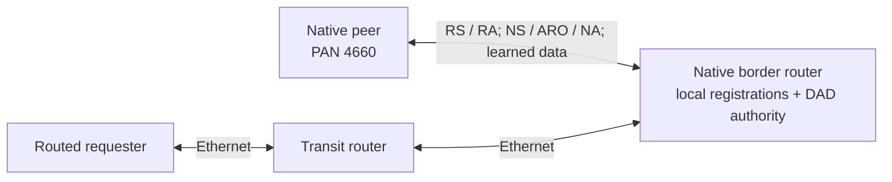

# Native border-router registration and routed ownership

> **Kind:** report · **Status:** current · **Seal:** none · **Owns:** — · **Stands on:** [6lowpan-completion.md](../../../plan/pending/6lowpan-publication-plan.md), [RFC 6775 §6.5](https://www.rfc-editor.org/rfc/rfc6775.html#section-6.5), [RFC 6775 §8.2.4](https://www.rfc-editor.org/rfc/rfc6775.html#section-8.2.4)

Publication association: [C26](../../../plan/pending/6lowpan-publication-plan.md#c26); donor `250cbcb68d`. The retained setup, assertions and parent explanation below describe this behavior. Original run counts, PASS statements and temporary artifact locations refer to the donor cohort. New-prefix results are recorded separately in the publication verification manifest; none is inferred from those historical statements. Exact-parent runtime execution is not claimed unless that manifest records it.


**Execution status: debug PASS, three runs.** This stage couples a border router's local native registrations with its duplicate-address authority. It does not implement a separate 6LR's asynchronous DAR relay, ABRO distribution or compression-context distribution.



The native domain has explicit peer identities and no configured learned-neighbor mappings. The first two runs use literal native wire messages, production MAC/adaptation/IPv6/ND receive handling and actual radio responses. They differ in the exact-expiry request's event priority. A third run uses a production native 6LN client: RS/RA discovery, link-local and SLAAC registration, then UDP in both directions. Routed requests cross the transit router in both directions; DAR and DAC start with Hop Limit 64 and arrive after one decrement. Replies use computed checksums and preserve the registered address, owner and requested lifetime.

Admission first checks local ownership, configured native mappings, local capacity and authority ownership/capacity. A native binding refused by the domain must leave neither a local registration nor an authority reservation. A successful binding is followed by both table updates and the ND-owned `/128` route before registration counters or an NA expose success. Different live owners receive Duplicate Address; a new key at capacity receives Neighbor Cache Full. Local capacity counts interface/address registrations; authority capacity counts address entries. There is no extra combined quota.

The DAD table and native Neighbor Cache have independent leases. A routed same-owner zero lifetime removes only the DAD entry; a positive routed lifetime updates only that entry. Neither operation removes, refreshes or prunes a native binding or route. A native zero lifetime removes the matching interface/address registration and matching DAD entry, while another interface's registration for the same owner remains unchanged. Native expiry does not erase an independently longer authority lease.

The combined border-router model also checks all live confirmed local registrations, across interfaces, before admitting an owner to the authority table. A different known local owner receives Duplicate Address even when the DAD entry is absent; expired local rows are ignored without being pruned by DAR handling. This is a conservative model interpretation supporting the substitutable DAD technique in RFC 6775 §8.2.4. It extends that section's literal empty-table Success and §6.5.1's arriving-interface check; it is not claimed as the uniquely mandated algorithm. It preserves §8.2.3's prohibition on changing the Neighbor Cache because of a DAR, without extending advertised lifetimes, tracking separate remote lease sources or adding a reference-count policy.

Direct observations include native router discovery, local registration and learned-route data; routed conflicts against locally registered owners; local conflicts against routed owners; both capacities, refresh and matching removal; exact-expiry ordering; crash and shutdown cleanup; and refusal by a foreign-owned domain binding followed by successful routed admission for that address. Same-owner registrations on two native interfaces are followed by removal on one interface and a conflicting routed request. A routed zero and shorter positive lifetime leave the other native binding, its 131-second route deadline and data delivery unchanged. A second local registration expires at 87 seconds while its longer DAD lease remains; a conflicting routed request still receives Duplicate Address. Another address's native and DAD leases both expire at the same instant; a new owner succeeds with its request scheduled before or after the expiry timer. The new owner's DAD entry survives cleanup of the expired native state.

The scripted runs use two native interfaces on the border router, two bare native peers and a passive native host. Native owner values end in `6601` and `6602`, the border interfaces in `6603` and `6605`. The real client uses `6604`; its run has one border native interface and a `/64` autonomous prefix, `2001:db8:3::`. Every run uses seed zero, uncompressed IPv6, and disabled scalar/vector recording. The scripted runs end at 92.7 seconds, after crash/start and shutdown/start; the real-client run ends at six seconds.

| Run | RS / RA | ARO NS / NA | DAR / DAC | DAR / DAC observed at transit | Delivered UDP | Successful host registrations |
| --- | --- | --- | --- | --- | ---: | ---: |
| Scripted, expiry priority −10 | 1 / 1 | 16 / 16 | 19 / 19 | 18 / 19 | 4 | 0 |
| Scripted, expiry priority +10 | 1 / 1 | 16 / 16 | 19 / 19 | 18 / 19 | 4 | 0 |
| Production 6LN | 1 / 1 | 2 / 2 | 0 / 0 | 0 / 0 | 2 | 2 |

Each scripted run also receives one ordinary native NS/NA exchange without an ARO. One exact-expiry DAR enters actual IPv6 ingress directly, preserving event priority; the other 18 DAR requests and all 19 DAC replies cross the Ethernet transit link. Native NAs are checked for computed checksum, Router/Solicited flags, owner bytes, cleared reserved bytes, copied lifetime, correct success/error IPv6 destination and actual native destination. Matching zero replies require absence of the corresponding binding and route. Delivered native data is checked against independent literal UDP bytes including its checksum.

The final related protocol selection passed six fixtures and fifteen runs:

```sh
opp_run_protocol_tests --load . -p inet -m debug --no-build \
  -w '^tests/protocol/6lowpan$' \
  -f 'Lowpan(AuthorityValidity|BorderRouterRegistration|RegistrationAuthority|NeighborRegistration|RegistrarValidity|HostRegistration)\.test$'
```

The authority controls exercise the ordinary-only routed profile and its separately reviewed lifetime-bound prerequisite; the other controls cover the local `router` role, finite registrar targets and the native host state machine. Debug/release builds, three module controls and scoped architecture/naming/source-seal checks passed. Exact source hashes and raw observations are recorded under `/home/miguel/workspace/.codex-artifacts/lowpan-p10-border-20261116/`. Debug assertions supply semantic proof; release compilation supplies build evidence. A first attempt passed both scripted runs but its passive-peer checker misread the real host's multicast RS as an NA; that fixture-only failure is preserved separately and corrected in the final run. A discarded femtosecond variant overflowed the ordinary configurator's default advertised lifetime during initialization; that setup attempt supplies no border-registration evidence. Fine-clock arithmetic is tested separately at a normal epoch by `LowpanAuthorityValidity.test`.

The bounded authority stores value identities and absolute deadlines, without retaining received packets or route pointers. Native registrations continue to use the existing registration expiry timer and owner-scoped route/domain cleanup. Native `router` role remains local-only; `borderRouter` enables the coupled policy and the existing native RS/RA/ordinary-NS responder. Default `static` mode retains its previous behavior.
