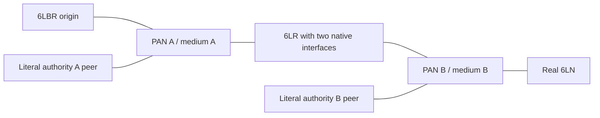

# Native authoritative context advertisements

> **Kind:** report · **Status:** current · **Seal:** none · **Owns:** — · **Stands on:** [publication plan](../../../plan/done/6lowpan-publication-plan.md)

Publication association: [C29](../../../plan/done/6lowpan-publication-plan.md#c29); donor `15656097de`. The retained setup, assertions and parent explanation below describe this behavior. Original run counts, PASS statements and temporary artifact locations refer to the donor cohort. New-prefix results are recorded separately in the publication verification manifest; none is inferred from those historical statements. Exact-parent runtime execution is not claimed unless that manifest records it.


This fixture checks the optional RFC 6775 context-distribution path through native
IEEE 802.15.4 radio interfaces. It is a protocol test, rather than a test of a
private authority-table API. The selected profile and remaining work belong to
[the completion plan](../../../plan/done/6lowpan-publication-plan.md).



PAN A is 4660; PAN B is 4661. The origin, upstream 6LR, downstream 6LR and host
use EUI-64 endings 6602, 6603, 6606 and 6601. The scripted peers end in 6604 and
6605. Each PAN has its own dedicated scalar radio medium. There are no configured
neighbor bindings. Case 6 adds a second host interface on PAN A; cases 9 and 10
add a second origin interface on PAN B.

## Production path and selected behavior

Context distribution is opt-in; its configuration is declared in
[LowpanIpv6NeighbourDiscovery.ned](../../../src/inet/linklayer/lowpan/LowpanIpv6NeighbourDiscovery.ned).
A `borderRouter` origin exports contexts from adaptation
`compressionContexts`/`setCompressionContext` and prefixes from
`Ipv6InterfaceData::AdvPrefix`, without another context configuration catalog.
Authority-group inventory is independent of candidate-default-router capacity.

The real 6LR sends startup RS after its native link-local address is ready, using
the existing maintenance timer and a uniform initial delay in [0,1] seconds.
Received RAs pass native source/SLLAO, checksum, Hop Limit, code and M=0 validation.
Complete authority groups are preflighted before accepted state changes. Router
groups are ND-wide and install effective contexts on both native interfaces before
downstream advertisement; host groups are scoped to the ingress interface.
Distribution routers ignore ABRO-less advertisements. Hosts accept individual
ABRO-less CID updates without withdrawing omitted CIDs.

An origin requires identical semantic configured context and PIO sets on all
native advertising interfaces. PIO ordering has no semantic significance. Raw
semantic changes increment the unsigned 32-bit origin version; ordinary lifetime
aging and reordering do not. The version and raw snapshot survive restart.
Changing semantics at `UINT32_MAX` produces a configuration error instead of
wrapping. Context introduction/retirement staging, including RFC 6775 section
7.2's C=0 transition guidance, remains configuration-owned; there is no automatic
300-second transition scheduler.

Source groups remain separate from effective CID ownership. Static CIDs are
reserved even after expiry or an explicit deadline-zero configuration. A static
overlap, incompatible live authority interpretation, ambiguous option set or
group-capacity refusal rejects the complete update. Stale groups cannot change
associated PIO/SLAAC state, RetransTimer or information-refresh state. Accepted
information is independent of host registration backoff and router-candidate
admission: C=0/zero still takes effect when those gates reject a default router.

Accepted matching-CID updates act in arrival order. C=0 immediately disables
compression; explicit 6CO zero immediately removes lookup eligibility. Omission,
ABRO expiry and lifecycle cleanup remove an effective entry only while the
affected source group still owns it. Retained old C=1 snapshots never reactivate
it automatically. These ownership/static-conflict rules are selected model
policies around RFC 6775's context semantics, not a claim that the RFC prescribes
one unique multi-authority reconciliation algorithm.

A zero withdrawal carries no new prefix interpretation: a different owner's
valid `::/0` withdrawal removes the CID without conflicting with its old prefix
or rewriting saved FRAG1 bytes. Configured CID protection still applies. Empty
ABRO-less updates retain no sender record; expired ABRO-less information releases
its group capacity. A zero-only sender can therefore apply its effects at the
group bound without allocating another retained group.

For a positive received 6CO, compression ends at its lifetime deadline, and
decoding ends after an additional twice the sampled RA Router Lifetime. Both
cutoffs are capped by the owning ABRO expiry. Codec lookup applies exact
`deadline <= now` rejection independently of timer priority. Raw finite wire
durations and receipt times remain separate from clock-saturated scheduling
deadlines, so forwarding cannot turn a finite received lifetime into infinity.
Explicit infinity is retained only where the wire/configuration defines it.

Forwarding preserves the ABRO bytes unchanged and floors remaining PIO seconds
and 6CO minutes. Positive context remainders below one minute are omitted rather
than converted into explicit-zero withdrawal. Expired configured origin slots
export zero directly; unlimited configured slots export 65535 minutes. Forwarding
ABRO unchanged can give a downstream receiver a later local authority expiry than
the forwarding router; the implementation follows that wire rule deliberately.

Inherited advertising-interface state and its timer carry periodic and up to
three triggered rounds. Separate authority groups use separate RAs, with native
multicast advertisements spaced by at least ten seconds. Solicited responses
reuse the existing bounded delayed unicast coordinator. No second periodic RA
scheduler is created. The existing host timer owns host information-refresh RSs;
omitted CIDs retain their own refresh deadlines across partial updates. Accepted
SLAAC addresses retain their independent RFC 4862 lifetime/two-hour-rule behavior
when authority metadata expires, and manual addresses are untouched.

## Independent wire checks

The fixture builds literal 6CO and ABRO bytes, including ABRO after the 6CO/PIOs,
and computes ICMPv6 checksums independently. Generated RAs are decoded with a
verified checksum. Origin output is also searched for independent byte vectors:

```text
6CO: 22 02 40 15 00 00 00 LL 20 01 0d b8 00 01 00 00
ABRO:23 03 56 78 12 34 00 02 20 01 0d b8 00 00 00 00
     00 00 00 00 00 00 00 0a
```

`LL` is the independently floored remaining number of minutes. The ABRO version
is `0x12345678`, with the low 16-bit half preceding the high half. ABRO has no
reserved field, as corrected by [RFC 6775 erratum 8338](https://www.rfc-editor.org/errata/eid8338).
Wire layouts and propagation rules come from [RFC 6775 sections 4.2, 4.3 and 8.1](https://www.rfc-editor.org/rfc/rfc6775.html).

## Cases and observations

All normal cases use seed 0 and default picosecond resolution. Recording is
disabled because direct assertions, wire observations and raw logs supply the
evidence.

| Case | Trigger and required observation |
| --- | --- |
| 0 | Real startup RS/RA across both PANs, host SLAAC/registration, then real context-compressed UDP in both directions. Observed host UDP=1, router UDP=1, registration successes=3, stateful wire frames=4. Origin byte vectors, decreased forwarded minutes and multicast spacing are checked. |
| 1 | Lower/equal/newer versions, independent authority version spaces, C=0/zero, owner-guarded omission, no retained-C=1 fallback and incompatible-prefix rejection. A stale RA carries a different PIO and RetransTimer; neither may change. |
| 2 | Router installs on both interfaces; host ABRO-less learning; exact compression and receive cutoffs. Two priority-order outbound probes must encode statelessly, two receive-only grace probes decode, and two exact receive-cutoff probes drop. |
| 3 | A real failed registration enters host discovery backoff. A later C=0/zero still retires the context without discovering another router. |
| 4 | Expired/deadline-zero static CID reservation, whole-group static refusal, distinct authority-group capacity, duplicate CID and multiple-ABRO refusal. Rejected PIOs do not create addresses. |
| 5 | Origin C=0 semantic version increment, full-node crash/restart preserving identical configured semantics/version, and explicit configured zero withdrawal with the next version. Bidirectional UDP succeeds before restart. A test configuration application restores the same raw PIO values before ND restarts; it supplies no private helper state. |
| 6 | The same authority/CID can describe different prefixes on separate host interfaces. Withdrawal on PAN B preserves the PAN A entry; malformed updates remain atomic. |
| 7 | Lower version and malformed groups do not change accepted information. At exact ABRO expiry, both timer priorities reject context use while independently valid SLAAC/manual addresses remain. A later authority is admitted. |
| 8 | A real registered default router fills host candidate capacity. New-peer contexts and C=0 are still learned despite observable candidate-capacity drops. A later partial RA omits an older CID; its original refresh deadline causes an RS at that exact deadline. |
| 9 | Two advertising origin interfaces contain reversed-order equivalent PIO sets. Reordering the first set later preserves the version. |
| 10 | The same equal-set/reordering control at version `UINT32_MAX` remains valid. |
| 11 | Literal finite ABRO/6CO lifetimes of 200 minutes and a 10000-second PIO produce real forwarded RAs with finite, aged lifetimes. |
| 12 | Literal native fragment input proves a decoded FRAG1 survives same-prefix zero removal; prefix replacement invalidates FRAGN-first state, and a new FRAG1 uses the new prefix. A new context-dependent FRAG1 after deletion drops. |
| 13 | 6LR crash clears its learned contexts on both interfaces; restart retains no stale learned entry, and a new real-radio RA reinstalls both. |
| 14 | ABRO zero uses the 10000-minute default rather than zero/infinity; raw scheduling cutoffs on both router interfaces demonstrate the cap. |
| 15 | A one-group cache rejects another positive group while retained ABRO-less information is live. Distinct zero-only senders still retire effective CIDs without reserving empty records or reactivating the old C=1 snapshot. Expiry releases the old source's capacity and a new positive authority is admitted. |
| 16 | Real length-3 6CO input carries 65-bit and 128-bit prefixes plus a 64-bit prefix with ignored reserved/padding bytes. Both router interfaces install canonical values, actual forwarded RAs use valid length-3 options, and the downstream host learns them. A length-2 option claiming 65 bits is rejected atomically. |

Case 11 is additionally executed at normal epoch with femtosecond resolution.
The finite received durations exceed that clock's approximately 9223-second
horizon, but real forwarded lifetimes remain finite and aged. This is a separate
supplementary simulation, not an extra protocol-runner case or a large-epoch
analog-radio claim.

Two separate expected-error executions use the same generated debug binary:
unequal origin PIO sets reject during initialization, and a semantic update at
version `UINT32_MAX` rejects before publishing a wrapped version. Expected exit 1
is recorded separately from normal protocol passes.

## Verification and limits

The generated verification record and raw artifacts are under
`/home/miguel/workspace/.codex-artifacts/lowpan-context-distribution-20261116/`.
It records exact commands, modes, selectors, source/artifact/library hashes,
counts, expected-error controls and setup/fixture attempts. Matching debug and
release builds pass. The final debug protocol selection passes eight fixtures
and 40 simulations, including all 17 context cases. Four directly mapped units
and five modules pass. Scoped architecture, naming, source-seal and whitespace
checks pass. The supplementary fine-clock run passes separately; both
expected-error controls reach their specific diagnostics with exit 1.

```sh
make MODE=debug -j2
make MODE=release -j2
opp_run_protocol_tests --load . -p inet -m debug --no-build -w '^tests/protocol/6lowpan$' -f 'Lowpan(ContextAdvertisements|DiscoveryCompression|StatefulContexts|ExtensionNhc|RouterDiscovery|HostRegistration|HostRetryTiming|MultihopRegistration)\.test$'
opp_run_unit_tests --load . -p inet -m debug --no-build -f 'Lowpan(StatefulContexts|Fragmentation|Iphc|IphcAcceptMatrix)\.test$'
opp_run_module_tests --load . -p inet -m debug --no-build -f 'Lowpan(ReassemblyExpiry|FragmentedLifecycle|MixedNeighbourDiscovery|OwnedBindings|DynamicBindings)\.test$'
```

Release evidence is compilation; the semantic assertions execute in debug.

The core topology and literal RA stimuli use actual native radio transmissions.
Exact cutoff receive probes and fragment-order probes enter the real native MAC
with independently built frames; they deliberately avoid radio latency changing
the requested event boundary. Exact compression probes enter adaptation directly
and are checked on real emitted MAC bytes. These establish codec/fragment timing,
not application source eligibility, which the ordinary host fixture covers.

The scope is one deterministic seed and bounded configured groups, not arbitrary
overload or every multi-authority deployment. Triggered/periodic delivery depends
on radio delivery and configured intervals. No authentication, RFC 8505 ownership,
context-synchronization mechanism between distinct origins, inner-tunnel discovery
classification or automatic context-transition scheduler is claimed. Ordinary,
compatibility and distribution-disabled siblings retain their existing paths.

The source change is one coherent behavior: wire parsing and preflight, bounded
authority ownership, raw lifetime provenance, scope-wide installation, codec
cutoffs, advertisement construction and lifecycle/timer integration must work
together to establish actual native distribution. A standalone unused helper
would not establish that production contract.
