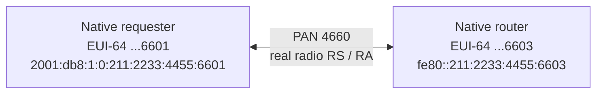

# Discovery compression without prior context knowledge

> **Kind:** report · **Status:** current · **Seal:** none · **Owns:** — · **Stands on:** [6lowpan-completion.md](../../../plan/done/6lowpan-publication-plan.md), [RFC 6282 §3](https://www.rfc-editor.org/rfc/rfc6282.html#section-3), [RFC 6775 §6.3](https://www.rfc-editor.org/rfc/rfc6775.html#section-6.3)

Publication association: [C28](../../../plan/done/6lowpan-publication-plan.md#c28); donor `d995bfefb8`. The retained setup, assertions and parent explanation below describe this behavior. Original run counts, PASS statements and temporary artifact locations refer to the donor cohort. New-prefix results are recorded separately in the publication verification manifest; none is inferred from those historical statements. Exact-parent runtime execution is not claimed unless that manifest records it.


**Execution status: debug PASS, two simulations.** The adaptation layer keeps outgoing outer ICMPv6 Router Solicitations and Router Advertisements independent of its compression-context table. Stateless IPHC remains enabled. This prevents a unicast RA to a valid global RS source from requiring a context the requester has not learned yet.



`LowpanDiscoveryCompression.test` has two static context configurations, no configured neighbor binding, uncompressed literal IPv6 input at the requester's adaptation boundary, and production IPHC/NHC, MAC, radio and IPv6/ND processing. Every RS has a computed checksum and native SLLAO. The real native router emits a unicast RA with Router Lifetime 120, Cur Hop Limit 42 and its native SLLAO. The requester receives and checks the reconstructed IPv6/RA addresses, Hop Limit 255, option fields and checksum. Seed is zero; one RS begins at 0.1 seconds and each run ends at three seconds. Scalar/vector recording is disabled.

| Run | Sender/receiver knowledge | Causal wire requirement |
| --- | --- | --- |
| 0 | Requester has an empty table; router has CID 5 for `2001:db8:1::/64`, matching the RA destination. | The real RA must retain IPHC while using no destination context. |
| 1 | Requester has that matching CID 5; router has an empty table. RS contains a valid eight-byte Hop-by-Hop header before ICMPv6. | The actual RS must retain compressed NHC Hop-by-Hop encoding while using no source context. A real RA then returns successfully. |

MAC transmission observers independently read the IPHC dispatch and SAC/DAC/CID bits from frame bytes, with the configured native MAC address widths. They read SCI/DCI when CID is present. The extension case also checks the NH bit and literal NHC Hop-by-Hop marker. For these global-source RS and link-local-source RA frames, SAC, DAC and CID are all zero after the fix. This does not change the codec's special encoding of an unspecified IPv6 source.

The unchanged parent was executed **before** editing `LowpanLayer.cc`, at commit `c571a6e13a40c6345dae6e6d8d1e72ec021c42a8`. Source, fixture and debug-library hashes were preserved. Parent run 0 actually emitted an RA with DAC=1, CID=1 and DCI=5. The context-empty requester received the radio frame, then its adaptation layer reported a malformed drop and delivered no RA. The protocol runner reached the intended final assertion failure; run 1 was skipped after that error. A separate execution of the same generated parent debug binary for run 1 actually emitted the HBH RS with SAC=1, CID=1, SCI=5 and NH=1; its context-empty router reported the corresponding adaptation drop and emitted no RA. That run also reached the expected final assertion failure. These are observed context-dependent wire fields plus receiver drops, rather than an inference from absence alone.

With the fix, the identical fixture passes both runs:

| Run | RS / RA frames | Context-dependent frames | NHC RS | Adaptation drops | Decoded RAs |
| --- | --- | ---: | ---: | ---: | ---: |
| Global-source RS / RA | 1 / 1 | 0 | 0 | 0 | 1 |
| HBH RS / RA | 1 / 1 | 0 | 1 | 0 | 1 |

The responsible owner remains `LowpanLayer::processUpperPacket`. It chooses one context-table pointer for both initial IPHC and the NHC chain's address re-encoding. A private read-only classifier walks the fixed 40-byte IPv6 header and supported concrete extension headers, advancing by positive byte-aligned lengths bounded by the packet length. Non-first IPv6 fragments are not inspected as transport headers. Unknown or uninspectable chains retain the existing context selection and malformed-packet handling. Classification is skipped when IPHC is disabled. No table mutation, request tag, codec/table API, timer, ND policy or generic IPv6 change is involved.

The focused executed selection is:

```sh
opp_run_protocol_tests --load . -p inet -m debug --no-build \
  -w '^tests/protocol/6lowpan$' \
  -f 'Lowpan(DiscoveryCompression|StatefulContexts|ExtensionNhc|RouterDiscovery)\.test$'
```

Four fixtures and five simulations passed: the new asymmetric-context runs plus stateful-data, NHC/fallback and existing native router-discovery controls. Matching debug/release builds, three related module fixtures and scoped architecture/naming/source-seal checks also passed. The parent failures, same-fixture comparison, exact commands, source/library hashes and raw observations are retained under `/home/miguel/workspace/.codex-artifacts/lowpan-discovery-compression-20261116/`. Debug assertions supply semantic proof; release compilation is separate. The two observed parent failures are comparison evidence and are not counted as passing current-tree simulations.

This correction does not claim inner-tunnel discovery classification, new IPv6 fragment/ND validation, or context/ABRO advertisement distribution. Those policies remain with their existing owners or later plan stages.
