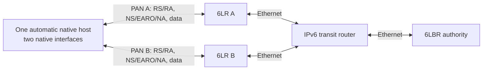

# Automatic updated host registration

> **Kind:** report · **Status:** current · **Seal:** none · **Owns:** — · **Stands on:** [6lowpan-completion.md](../../../plan/done/6lowpan-publication-plan.md), [RFC 8505](https://www.rfc-editor.org/rfc/rfc8505.html), [RFC 6775](https://www.rfc-editor.org/rfc/rfc6775.html)

Publication association: [C33](../../../plan/done/6lowpan-publication-plan.md#c33); donor `389090ca3e`. The retained setup, assertions and parent explanation below describe this behavior. Original run counts, PASS statements and temporary artifact locations refer to the donor cohort. New-prefix results are recorded separately in the publication verification manifest; none is inferred from those historical statements. Exact-parent runtime execution is not claimed unless that manifest records it.

Native hosts can opt in to updated registration using the configuration declared in [LowpanIpv6NeighbourDiscovery.ned](../../../src/inet/linklayer/lowpan/LowpanIpv6NeighbourDiscovery.ned). Default mode retains the legacy automatic host. Updated hosts advertise only E in RS capability options; the registrar roles continue to advertise their own services. The automatic consumer uses the completed [updated registrars](extended-registration.md), rather than a test-only registration path.

The existing host helper owns identity history, current logical transactions, frozen per-registrar copies and one host timer. ND continues to own gates, lifecycle, interface subscriptions and routes. The extension adds no module, timer engine, generic tag, packet-core dependency or context catalog.

History identifies each global IPv6 address across interfaces and each LL address within its interface scope. Different addresses may share the configured ROVR bytes while retaining independent TID/history state. Empty configuration captures the native EUI64 at first enrollment; moving an address does not silently replace that full identity. The bounded history includes removed and rejected addresses and survives ordinary stop/start. It is released on module destruction. No timed eviction or filesystem persistence pretends to recover lost transaction history. The history-full signal carries borrowed `Ipv6AddressInfo` only for the synchronous notification; it counts actual capacity-refusal attempts, not distinct refused addresses. The read-only count and WATCH expose retained histories.

The first logical transaction uses TID 240. Later refresh, movement and removal operations advance it once, using the standard linear/circular increment. Registrar copies and retries share the logical transaction's TID. Each copy freezes address, source, full and wire ROVR, convention, lifetime, peer/interface/domain identities, authority association and reply expectations. Compatible RA and LL renewal can extend current usable knowledge without changing those wire fields or retry budgets. A changed or expired required context cancels the copy. A newly discovered registrar becomes deliberate queued work; it does not independently increment the counter.

A positive operation requires a valid copy for its initiating registrar before allocation. An ineligible tentative alias cannot manufacture repeated refreshes toward another already accepted registrar. Removal can begin from any still-valid saved copy.

An updated global operation uses a successfully registered, assigned, non-tentative LL source at that registrar. The NS target is the registered address. Source and target therefore have independent ROVRs. LL refresh/expiry remains scheduled while a global operation is pending; necessary LL work can defer that copy without requiring the source lease to cover the entire maximum retry horizon. Every send and acceptance repeats the exact current source/context checks. Old replies cannot publish success after cancellation.

Legacy attachment still transmits EARO T1 but uses the current native EUI64 and legacy source/target convention. It never truncates the full configured host identity. A real legacy registrar may answer T0 without a TID echo. The host matches only the representable frozen peer/address/wire-EUI/lifetime fields, preserving its client TID separately from whether the registrar established recency. Such identical legacy tuples cannot prove freshness. Mixed legacy/full-owner attachments can legitimately conflict at a shared authority; this is not seamless identity translation.

Known TIDs also have finite wire space. An identical full wire tuple after lollipop reuse carries no generation discriminator. Retained client history and saved local correlation are not a permanent stale-packet oracle.

Accepted copies retain independent deadlines and saved correlation. A solicited Status 3 retires only the same registrar's prior accepted row saved when the rejected copy began, if that row still matches. An asynchronous Moved has S=0 and matches its own saved full owner/TID/peer correlation; it cannot delete a newer pending copy or another registrar's accepted state. Native ordinary data requires a current usable accepted registration. Status 1 withdraws native use of that address and attempts bounded removal of other accepted copies where a valid source remains.

An asynchronous Moved may cancel its matching pending transaction while leaving that pending copy's different prior acceptance intact. Only a notice matching the prior acceptance's own tuple, or its expiry, retires that row. The notice is not interpreted as a solicited refresh rejection.

Duplicate rejection persists in history so a later matching PIO cannot automatically recreate the failed SLAAC address and consume another TID. A genuine external assignment of that exact address reopens enrollment with retained identity and the next transaction; assigning a different address does not. Removal cancels positive work and queues a next-TID zero operation where a copy can actually start. Re-addition during zero waits for a later positive transaction. Helper-owned address changes are guarded against reentrant assignment/removal notifications.

Status 3/9 use bounded per-address cooldown progression. Known authority Status 9 blocks new work for that authority; absent identity uses address-wide cooldown. Live authority cooldowns are not evicted, and bounded-group overflow falls back to address-wide cooldown. Success at one attachment does not erase a different authority's protection. Queued, not-yet-transmitted copies obey cooldown without changing their TID; already transmitted copies keep their bounded attempt/reply budget. Stop/crash cancels transient operations and dynamic state while retaining identity/TID history and live cooldowns. Startup rediscovers and creates new transactions rather than restoring old accepted leases.

`LowpanExtendedHostRegistration.test` drives actual automatic hosts and committed registrars with seed zero. Both native domains contain explicit peers but no learned-neighbor mappings. Registrations, replies and data use actual IEEE 802.15.4 MAC/radio paths with IPHC; ordinary Ethernet ND and routing carry DAR/DAC through the transit router. Return data uses the registrar's owned route and learned native binding. Literal adverse/capability inputs enter IPv6 transport processing and actual native transmission; those controls test the real host receiver while explicitly scripting the remote policy. They do not replace the production baseline.

| Run | Direct trigger and checks |
| --- | --- |
| 0–3 | Configured ROVR widths 8/16/24/32, two registered addresses sharing bytes, two registrar copies sharing a TID, LL-before-global and bidirectional UDP. |
| 4 | Real legacy registrar/authority, actual EUI64 wire fallback from a configured long identity, T0 response correlation and bidirectional UDP. |
| 5 | Actual updated registrar with silent authority, unchanged retry-floor default and successful three-second fallback; copied retries retain identity/TID. |
| 6–7 | Actual authority cache full, unknown versus ABRO-known authority grouping; no rapid fresh-TID/candidate cycling. |
| 8 | Scripted capability change while a global request is outstanding, followed by its old success reply; cancellation prevents acceptance or in-place convention rewrite. |
| 9 | Compatible RA renewal during actual authority outage; no extra transaction from the renewal alone, normal copied retry/fallback behavior and data. |
| 10 | Empty ROVR configuration retains the first interface's EUI for a global address across the other native interface, while LL histories remain scoped. |
| 11 | Real-router repeated PIO after actual duplicate rejection, unrelated external address assignment, then explicit re-addition of the rejected address. Only deliberate re-addition produces its next transaction. |
| 12 | Scripted solicited refresh Status 3 retires the saved same-registrar acceptance, preserves another address, ignores the later old success, and enforces ordinary-data eligibility. |
| 13 | Scripted LL refresh occupies one registrar while the shared global transaction gets authority Status 9 elsewhere. Its queued copy waits for cooldown and retains the same TID before its first transmission. |
| 14 | Automatic positive/removal transactions traverse 240…255, 0…127 and the literal incomparable 127→0 boundary. Refusal/backoff and history expiry precede fresh acceptance; no private counter mutation or permanent ordering oracle. |
| 15 | A finite RA capability lease expires during a copied operation; its late matching success cannot restore usability. |
| 16 | Scripted success at authority group B preserves group A's live cooldown across address removal/re-add; its next A transaction waits without burning intermediate TIDs. |
| 17 | With a one-entry cooldown bound, a second live authority cooldown uses address-wide protection without evicting the first. New work remains deferred beyond the first group's shorter deadline. |
| 18 | A tentative assignment on one interface cannot initiate repeated transactions toward the valid parallel registrar. Only that registrar's legitimate refresh advances the shared transaction, and its data remains usable. |
| 19 | Accepted 240 plus pending 241 receives asynchronous Moved 241: pending is cancelled, prior 240 remains, and late success cannot reinstall 241. A later own-tuple Moved 240 retires it; ordinary-data and unrelated-address checks distinguish the states. |

Runs 16–17 use distinct valid ABRO identities in scripted RA inputs to test the host's bounded grouping policy. They do not establish reachability or DAD behavior for a second physical authority. The earlier production cases establish actual registrar/authority exchange.

The independently authored [host lifecycle fixture](extended-host-lifecycle.md) covers retained-history capacity, re-addition around removal, STOP/START, invalid LL source cancellation and stale/current unsolicited Moved. Its precise injection and lifecycle limits are documented there. The registrar main/race and P10 host/discovery/relay/context fixtures remain mode-off controls. No automatic-host claim relies on primitive helper tests alone.

Matching debug execution passed all 20 main simulations and five lifecycle simulations. The complete scoped selection passed 14 fixtures and 92 simulations, including the committed registrar and P10 controls. Two wire/registration units and three mixed-interface/domain modules also passed. All simulations use General configuration and seed zero. Fresh debug and release builds, architecture, naming, explicit source-protection and whitespace checks completed successfully.

The release main/lifecycle runs completed all 25 simulations. An independent comparison matched every printed case-counter row to debug. Release C++ assertions are inactive, so those runs establish completion and the observed counters; the debug runs supply the detailed semantic assertions. The [frozen verification record](https://github.com/mgonzalezlopezudc/inet/blob/9908c007bdb1eda9d74f6ca1f99fe1cae33fbc61/doc/project/evidence/model/6lowpan/p11-host-verification.json) records exact commands, selectors, generated inputs/binaries, raw outputs and library/source hashes. Its separate no-radio initialization controls reject short/nonhex ownership strings and accept uppercase hex; they are configuration checks, not extra registration simulations.

The host history, copied wire operations, source validation, lifecycle notifications and data eligibility must land together: each is a caller or terminal path of the same automatic transaction owner. The larger helper change is therefore one behavior change, with no unused parser or history-only prerequisite. The independently useful unsolicited-Moved flag and common source-egress corrections have separate preceding evidence.

Development setup attempts and pre-repair successes remain separate from final evidence. No parent-revision comparison of the complete updated host was executed. This document does not claim cryptographic ownership validation, arbitrary-overload liveness, module-recreation history, or freshness for an identical legacy wire tuple.
