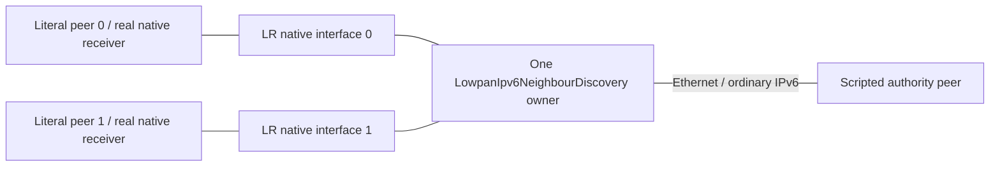

# Extended registration race controls

This fixture checks P11 ownership, transaction-history and pending-completion
regressions through the production native ND and routed relay paths.
It supplements `LowpanExtendedRegistration.test`; it does
not replace that fixture's width, authority, parallel-location or movement matrix.

## Topology and stimulus



All radios share one configured native PAN at fixed positions. Both native LR
interfaces belong to the same ND owner. The checker injects independently
constructed extended-address native frames at the MAC receive boundary. Each NS
contains a literal 128-bit ROVR, SLLAO, T=1/R=1 and a computed ICMPv6 checksum;
its size requires FRAG1 plus FRAGN with original IPv6 coordinates. Replies pass
through the real LR MAC/radio and peer adaptation before the checker verifies
their checksum, native destination, registered target, owner, TID and lifetime.
The checker never calls the registration helper or private state mutations.
Runs 5/6 use the supplementary IPv6 receive-gate boundary for their global
NS messages, with valid native indication/interface tags and literal checksums,
to control pending-operation birth times. Their LL bootstraps and
all replies/data still cross the native MAC/radio. Runs 0–4 retain the native MAC
receive boundary for all NS input.

The ordinary Ethernet authority has an assigned IPv6 address. Its scripted EDACs
have independently generated bytes/checksums and enter through the authority's
Ethernet stack. The actual LR DAR is checked at its IPv6 output and at authority
IPv6 input. Each scripted confirmation requires its matching DAR to have already
arrived there; Moved also requires the changed-lifetime refresh (and, in run 2,
the newer pending operation) to have arrived. Thus an injected reply cannot hide
an unresolved ordinary Ethernet neighbor. The authority does not run a second
implementation of the selection algorithm: it supplies precisely scheduled
valid confirmations and notifications.
The checker also observes each EDAC at LR IPv6 input and verifies its checksum,
so an absent late response cannot accidentally satisfy the no-reinstallation
assertion.

The fixed `seed-set=0` and runs 0–6 define the entire campaign. Header compression
is disabled to keep the independent wire stimuli simple. No fingerprint changes,
statistical claims or additional seed sweep are required for these deterministic
ordering defects.

## Cases and observations

| Run | Setup and trigger | Required observations |
| --- | --- | --- |
| 0 | Local router without authority; register the same LL literal on each interface with distinct owners/peers. Register global A/owner X on interface 0, filling `maxRegistrations=3`. Interface 1 then requests A/owner Y. | Both scoped LL bindings remain valid. Conflicting global request gets status 1 rather than capacity status 2. Only interface 0 has the global binding and ND-owned `/128`; a routed echo reaches peer 0. No DAR occurs. |
| 1 | Global A/owner X is accepted at TID 240, lifetime 2 minutes. An equal-TID refresh proposes 3 minutes. Authority sends Moved for the saved TID 240/2-minute lease; removal protection is only 0.5 seconds. After protection expires, a matching old Success for the 3-minute pending proposal arrives. Observe through the former three-second fallback window too. | Moved removes the old global binding/route and cancels its pending refresh independently of the changed lifetime. Late Success and fallback cannot reinstall it. Only one DAR for the refresh is emitted; no old positive NA appears. |
| 2 | Same initial sequence, but a newer TID 241/4-minute operation replaces the pending 240 refresh before Moved 240 arrives. Late Success 240 is followed by valid Success 241, then another old Moved 240. | Old Moved does not cancel the genuinely newer pending operation. Only 241 completes; the new binding/route survive subsequent old Moved and carry a routed echo. There is one DAR per initial, equal refresh and newer operation. |
| 3 | Local router without authority and both LL sources bootstrapped. Global 240 on interface 0 moves to 250 on interface 1, leaving protected old-240 history. TID 5 then registers on interface 1 before that history expires. | Each positive request succeeds. TID 5 is compared with the current 250, which it is newer than, rather than the old 240, which would classify it older. Only interface 1 retains global reachability and carries data. |
| 4 | Equal-TID 240 global locations exist on both interfaces. Newer zero-lifetime 250 on interface 0 removes only that location, preserving the old 240 lease on interface 1. Positive 5 then arrives on interface 1. | Zero preserves interface 1's independent lease. Its subsequent TID 5 registration compares with current transaction 250, succeeds and carries data despite the retained older location/history. |
| 5 | Routed authority stays silent. After real MAC LL bootstraps, one event delivers global 240 on the higher interface key followed by 250 on the lower key through IPv6 receive gates at exactly 1 second. | Both DAR send-time vectors are exactly 1, 2, 3 seconds and all six arrive at the authority. Neither binding exists at 3.9 seconds. At the shared four-second fallback, the timer's lower-key 250 completion commits and removes the next, older higher-key pending record safely. Only positive NA 250 appears, and its route carries data. |
| 6 | Silent authority; pending 240 on interface 0 starts at 1 second, pending 250 on interface 1 at 1.1 seconds, then incoming 5 on interface 0 at 1.2 seconds. Both preceding DARs must already have reached the authority before 5 is injected. | Admission compares 5 with current 250, without reclassifying it against historical exact-key pending 240. No status-3 rejection occurs. TID 5 emits DAR at 1.2, 2.2, 3.2 seconds and alone completes after the 4.2-second fallback, with usable interface-0 data reachability. Older pending work may be cancelled early or abandoned on stale completion; neither can install a lease. |

The short removal delay is deliberate. The default five seconds would mask the
old-pending fallback defect because its three-second completion occurs while the
tombstone is still live. Cancellation must hold independently of that delay.
Movement notifications may repeat harmlessly; the fixture checks their old tuple
and requires at least one, without prescribing an unnecessary exact count.
Run 5 targets traversal invalidation, not radio access timing. It verifies key
ordering and both complete retry vectors so an early stale-pending cancellation
cannot silently turn the test into an unrelated no-crash control. No DAC is
injected in this run. The IPv6-gate exception is explicit; it does not establish
that two independent radio exchanges complete at exactly the same instant.
Run 6 retains the same explicit gate boundary but staggers its three requests.
Its old-operation retry counts are bounded rather than fixed, allowing legitimate
early cleanup while still requiring both old admissions to be observed before
the historical-key replacement. No DAC is injected.

## Execution and evidence limits

To rerun this fixture alone from the INET root after a fresh matching library:

```sh
opp_run_protocol_tests --load . -p inet -m debug --no-build \
  -w '^tests/protocol/6lowpan$' -f 'LowpanExtendedRegistrationRaces\.test$'
```

All seven runs pass in the final debug campaign with their semantic `ASSERT`
checks active. The matching release campaign also completes all seven runs;
their printed counter rows match debug exactly. Release `ASSERT` checks are
inactive, so release completion and counter equality supplement the debug proof
rather than establishing those semantic assertions independently.

The observed rows are identical in both modes:

| Run | Native input frames | Direct global NS | LL replies | Moved replies | DAR at authority | Return echo |
| --- | ---: | ---: | ---: | ---: | ---: | ---: |
| 0 | 8 | 0 | 2 | 0 | 0 | 1 |
| 1 | 6 | 0 | 1 | 1 | 2 | 0 |
| 2 | 8 | 0 | 1 | 1 | 3 | 1 |
| 3 | 10 | 0 | 2 | 1 | 0 | 1 |
| 4 | 12 | 0 | 2 | 0 | 0 | 1 |
| 5 | 4 | 2 | 2 | 0 | 6 | 1 |
| 6 | 4 | 3 | 2 | 0 | 7 | 1 |

The [main registrar verification](extended-registration.md) owns the complete
campaign commands, build status and broader scope. Raw artifacts are retained
under `/home/miguel/workspace/.codex-artifacts/lowpan-p11-registrars-20261116/`:
`protocol-debug-final.log`, `protocol-release-final.log`, each mode's
`final-{debug,release}/protocol/LowpanExtendedRegistrationRaces/test.out`, and
`release-counter-comparison.json`. The owning `verification.json` records exact
commands, source/generated-input/binary/library hashes, runs and exit statuses.
This publication update changes only the reviewer document; the executed test
inputs and source remain unchanged.

The source-level pre-fix expectation is that run 0 returns capacity status 2
before checking the owner already registered on the other interface, and run 1 can emit another refresh DAR/reinstall
after protection expiry. These are not claims of an executed parent comparison.
Run 2 also protects against an overbroad repair that erases all pending work at
the address. Runs 3/4 protect the current-transaction owner from reapplying the
nontransitive comparator against retained old locations or removal history.
This fixture does not establish automatic-host P11 behavior or the
full extended-registrar profile.
