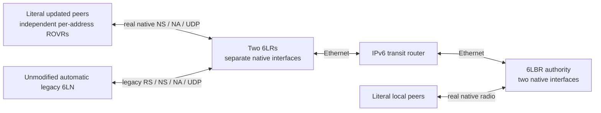

# Updated native and routed registrars

> **Kind:** report · **Status:** current · **Seal:** none · **Owns:** — · **Stands on:** [6lowpan-completion.md](../../../plan/pending/6lowpan-completion.md), [RFC 8505](https://www.rfc-editor.org/rfc/rfc8505.html), [RFC 6775](https://www.rfc-editor.org/rfc/rfc6775.html)

This stage adds opt-in updated registrar, relay and authority behavior. Automatic native hosts continue to send legacy registrations. Enabling the updated mode on a host is rejected until its transaction implementation exists. The configuration declarations belong to [LowpanIpv6NeighbourDiscovery.ned](../../../src/inet/linklayer/lowpan/LowpanIpv6NeighbourDiscovery.ned); their capacities cover confirmed, pending and removal protection rather than silently evicting protected state.



The full ROVR remains a byte vector belonging to the registered IPv6 address. It is separate from the native communicating peer, SLLAO, registered link-local source, NS target and reply destination. Updated requests use a link-local source and put the registered address in the NS target. A self-source/target link-local request bootstraps that source binding. A global-source updated request receives Status 7; a registered source whose communicating peer conflicts receives Status 6; a missing registered source is silently discarded. Registering a global address never compares its ROVR with the source link-local address's independent ROVR.

After structural validation and source checks, target ownership precedes recency and capacity. Global ownership/recency is checked across this registrar's native interfaces, while link-local ownership remains interface scoped. Local cache exhaustion returns Status 2 before authority exhaustion returns Status 9. A known transaction may upgrade same-owner unknown legacy state without a numeric comparison. A legacy request cannot renew live known state: it receives Status 3 as an explicit unknown-recency/current-attachment policy. Different owners still receive Duplicate Address first.

The four-outcome transaction comparator follows the literal linear/circular rule from RFC 8505, rather than modular-distance ordering. Its INCOMPARABLE result is retained. A genuine known TID zero is distinct from unknown legacy provenance. T0 compatibility accepts the base eight-byte ROVR only, ignores its legacy reserved metadata, infers reachability R1 and replies with synthetic TID zero. Updated T1 replies copy the accepted R/I/opaque/ROVR and lifetime, with reserved bits zero. Nonzero I and long T0 are unsupported.

Local recency compares with one current admitted transaction for the scoped address, separately from each location's saved notification/removal correlation. This distinction matters because the comparator is not transitive: after 240→250, incoming 5 is compared with 250 rather than an old 240 tombstone. Successful local admission of a newer pending operation advances that current transaction before authority confirmation. Negative or invalidated pending work does not roll it back while a scoped lease or removal record remains. This records observed valid-wire recency, not confirmed uniqueness. The record disappears when the confirmed/removal/pending union is empty; it adds no permanent history or numeric ordering oracle.

The combined border-router synchronizes this retained local current transaction on accepted routed updates without changing native leases, bindings or routes from DAR. If its physical authority entry expires before local removal protection, that retained transaction still supplies owner and recency checks. Positive commits supersede historical transaction locations while preserving exact-current parallel locations. Pending completion must still match the current transaction; it cannot re-admit itself by numerically comparing a historical TID again. The relay's timer snapshots keys before completing operations because one successful movement can erase a sibling pending operation.

Equal owner/TID at different locations creates parallel leases. At the same location, an equal transaction cannot change R/opaque/communicating identity; its positive lifetime can change without resetting relay retry, birth or attempt bounds. The domain represents one peer per interface/address, so an equal-TID different peer at that exact location receives local capacity Status 2 and preserves the incumbent. R0 retains ownership and neighbor state without an ND-owned return route; changing R1 to R0 removes only that route.

Zero lifetime removes only the requesting location and leaves bounded removal protection. Identical zero repeats do not extend its deadline. Equal positive requests from that location remain refused during protection; genuinely newer requests can replace it. Other equal-TID locations retain their own leases. At the authority, both live and removal locations count toward the address's location bound. Expiry checks use `<= now` before decisions, independently of timer ordering.

Newer movement commits first and then uses saved address, full owner, TID provenance and communicating location to clean superseded state. A saved Moved notification also cancels an equal-TID pending refresh when its proposed lifetime differs; strict lifetime matching remains required for solicited confirmation. It cannot cancel a genuinely newer pending request. Unknown remote locations receive no unsolicited Moved notification, because an on-wire TID zero cannot distinguish unknown provenance from a genuine known zero. Their old leases age or are rejected without renewal on their next legacy request. This is an explicit notification limit, not a new wire discriminator.

The relay freezes the full local and actual transmitted owner independently. A legacy authority receives the mandated leftmost 64-bit projection. Its Code 0 DAC has no transaction discriminator, so matching authority/address/projected owner/lifetime does not prove freshness after a later operation reuses that exact tuple. Updated authorities retain full-width correlation. The existing three positive/three removal attempt and twenty-second birth bounds remain unchanged. Exact source/interface/domain/lifetime checks still apply at delayed completion.

6CIO insertion reuses the existing RS/RA envelopes. E is advertised only by the implemented updated registrar roles, and D comes from a real local authority, explicit administrator knowledge or accepted authoritative information. Router-capable RS responses require an actual ABRO. A context-distribution router without a learned group withholds advertisements; configuration that can never provide ABRO information is incomplete for responding to router-capable requests. No ABRO is fabricated. Ordinary restart and stop/crash retain their existing ownership boundaries and cancel pending operations before cleanup.

`LowpanExtendedRegistration.test` uses seed zero and four independent native PANs with explicit peers but no configured learned-neighbor mappings. Native replies and return data traverse actual IEEE 802.15.4 radios with IPHC. DAR/DAC traverse an Ethernet transit router with ten-millisecond links. The checker observes actual routed ingress, Hop Limit 64 to 63, checksums, full wire owner widths and real native reply source/target/destination/metadata. Two exact-boundary NS controls use real IPv6 ingress with native metadata to select event priority; the other requests enter native MAC transmission. The authority-only location inputs use literal Ethernet packets with assigned source aliases. The independent [race fixture](extended-registration-races.md) supplies the cross-interface and pending-Moved regressions.

| Run | Direct checks |
| --- | --- |
| 0 | Independent link-local/global identities; eight-, sixteen-, twenty-four- and thirty-two-byte owners; return UDP; R1→R0→R1 route transitions. |
| 1 | Source Status 7/6, missing-source silence, owner-first duplicate, same-location peer capacity, nonzero-I/no-SLLAO rejection and INCOMPARABLE refusal. |
| 2 | Unknown legacy→genuine known TID zero upgrade; no unsafe unknown notification; downgrade/no-renewal; literal older/incomparable vectors; protected zero and fresh admission after history expiry. |
| 3 | Four authority locations, fifth-location Status 9, independent equal-TID refresh, zero-repeat deadline preservation, same-location refusal, reclamation and newer movement. Counts check the actual DAC dispositions. |
| 4 | Two native 6LBR locations, zero at one preserving the other, remote zero preserving native lease, then newer native movement and saved cleanup. |
| 5 | Long full local owner with leftmost-eight-byte EDAR projection and legacy Code 0 DAC; full local ownership still rejects a different-length owner. |
| 6 | Coalesced positive TTL update without attempt reset, zero after all positive attempts, three removal attempts, mismatched lifetime/TID DACs, genuinely newer pending replacement and checksum-valid nonzero Code Prefix. |
| 7–8 | Exact registration expiry before/after timer priority, live source refresh, pending operation canceled by crash/start, fresh post-start registration. |
| 9 | Actual unchanged automatic host attaches to updated registrars using legacy wire, receives usable SLAAC registration and return UDP; link-local registration produces no DAR. |
| 10 | 6CIO envelope validation, no advertisement before actual authority learning, real ABRO+D response afterward and learned full-width authority selection. |
| 11 | Combined border-router native 240, routed newer-zero 250 preserving its native lease, then successful native 5 against the synchronized current transaction. |
| 12 | A remote positive 250 moves native 240 to an eighty-second local removal record. The sixty-second authority lease expires first. Stale, unknown-recency and foreign-owner requests remain rejected before and after that expiry; native 5 succeeds, and a separate address admits a fresh owner after all protection expires. |

The unit [LowpanRegistrationInfo.test](../../unit/LowpanRegistrationInfo.test) independently fixes the literal comparator outcomes and EARO width/reserved/metadata conventions. It supplies primitive evidence; the native/routed fixture establishes their production callers. These tests do not establish automatic updated-host transaction allocation, arbitrary-overload liveness, cryptographic ownership verification, permanent history after expiry or unambiguous freshness over a legacy DAC tuple. They do not claim P11 completion.

The final debug selection passes eleven fixtures and sixty-four simulations:

```sh
opp_run_protocol_tests --load . -p inet -m debug --no-build \
  -w '^tests/protocol/6lowpan$' \
  -f 'Lowpan(ExtendedRegistration(Races)?|NeighborRegistration|RouterDiscovery|HostRegistration|MultihopRegistration|BorderRouterRegistration|RegistrationAuthority|ContextAdvertisements|HostRetryTiming|DiscoveryCompression)\.test$'
```

The new main fixture passes thirteen simulations; the independent race fixture passes seven. The other nine fixtures preserve the selected legacy host/server/authority/relay, discovery, context and retry behavior. Two direct units (`LowpanRegistrationInfo`, `Ipv6NdRegistrationWire`) and three modules (`LowpanMixedNeighbourDiscovery`, `LowpanOwnedBindings`, `LowpanDynamicBindings`) also pass in debug. Matching debug and release libraries compile successfully. Release execution of the two new fixtures completes all twenty simulations, with printed counter sequences independently matching debug. Its inactive `ASSERT` checks cannot supply the debug semantic proof.

Observed main-fixture counts are:

| Run | Literal NS | Native NA | 6LR DAR | DAR at authority | DAC at 6LR | Moved NA | Return UDP |
| --- | ---: | ---: | ---: | ---: | ---: | ---: | ---: |
| 0 | 8 | 8 | 7 | 7 | 7 | 0 | 1 |
| 1 | 11 | 8 | 1 | 1 | 1 | 0 | 0 |
| 2 | 13 | 13 | 6 | 6 | 6 | 0 | 0 |
| 3 | 0 | 0 | 0 | 13 | 16 | 0 | 0 |
| 4 | 7 | 8 | 0 | 1 | 1 | 1 | 0 |
| 5 | 4 | 4 | 2 | 2 | 2 | 0 | 0 |
| 6 | 9 | 4 | 8 | 8 | 4 | 0 | 0 |
| 7–8, each | 7 | 6 | 4 | 4 | 3 | 0 | 0 |
| 9 | 0 | 2 | 1 | 1 | 1 | 0 | 0 |
| 10 | 2 | 2 | 1 | 1 | 1 | 0 | 0 |
| 11 | 3 | 3 | 0 | 1 | 1 | 0 | 0 |
| 12 | 5 | 7 | 0 | 9 | 9 | 2 | 0 |

Run 9 additionally receives one UDP datagram at the real automatic host; its NS inputs are produced by that host rather than the literal checker. Authority-only literal DARs explain why runs 3/4/11/12 receive requests without a 6LR-produced DAR. Run 3's extra DACs are saved-location Moved notifications. The verifier also checks exact expected DAC dispositions, rather than treating message totals as correctness.

A separate initialization control uses the fixture's no-radio `ExtendedRejectedHostNetwork`, enables `extendedRegistration` on its host role and expects exit one with the explicit unsupported-host diagnostic. No simulation event or transaction starts. An earlier attempt reached the same diagnostic in the full radio topology but aborted during unrelated partial-initialization radio teardown; its exit 134 and stack trace are preserved as that limitation, separately from the clean rejection. No generic radio code was changed.

Raw commands, source/generated-input/binary/library hashes, seeds, successful outputs, builds and scoped architecture/naming/source-seal checks are preserved in `/home/miguel/workspace/.codex-artifacts/lowpan-p11-registrars-20261116/verification.json`. Early attempts remain classified separately: a unit namespace collision was fixture compilation, a full-width DAR/DAC missing chunk length was a production wire error corrected before final runs, and early response-window/lifecycle/empty-authority expectations were fixture timing assumptions. The final evidence does not substitute those attempts for passing current-source verification.

This implementation is one registrar integration boundary: the full ownership/transaction representation enters with native admission, delayed relay completion, authority policy and capability envelopes that consume it. Advertising updated capability with only some of those receivers installed would expose incompatible behavior. Automatic updated-host history remains a separate production stage.

## Solicited and asynchronous advertisement flags

Direct registration replies use S=1. Saved asynchronous Moved notifications use S=0, as required for unsolicited unicast NA by [RFC 4861 section 4.4](https://www.rfc-editor.org/rfc/rfc4861.html#section-4.4). The fixture checks the received wire flag in both cases.

The unchanged sender at registrar commit 777bd8cb2d fails the added asynchronous check in run 4 at 5.008832 seconds, event 399, after runs 0–3 pass. Applying only the private sender flag selection passes all thirteen main runs and seven race controls in the isolated registrar checkout. The [separate verification record](../../../doc/project/evidence/model/6lowpan/p11-moved-flags-verification.json) retains that causal comparison, matching build modes, source/library hashes and raw artifacts. It does not claim automatic updated-host behavior.
