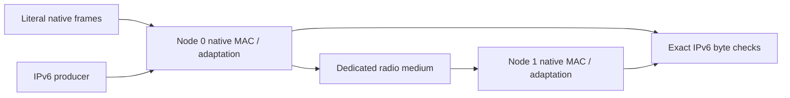

# Native extension-header compression

> **Kind:** report · **Status:** current · **Seal:** none · **Owns:** — · **Stands on:** [RFC 6282 section 4.2](../../../doc/project/evidence/standard/rfc6282/rfc6282.txt), [6lowpan-completion.md](../../../plan/pending/6lowpan-completion.md)

`LowpanExtensionNhc.test` uses two native IEEE 802.15.4 interfaces on one dedicated scalar radio medium. Node 0 is `0011223344556602`; node 1 is `0011223344556601`. Their IPv6 IIDs invert the native U/L bit. The only configured neighbor binding supports the node 0 transmitter; literal receive frames do not use it. The run lasts 80 ms with seed 0.



Eleven literal frames enter the real receive MAC. Five contain the Hop-by-Hop, Routing, Fragment, Destination and Mobility encodings with an inline next-header value. Hop-by-Hop/Destination bodies omit one final two-byte PadN; reconstruction must restore it. A sixth carries the IPv6 EID marker and a nested IPHC header. Two frames carry one 104-byte IPv6 datagram: the first expands into 48 header bytes plus 16 payload bytes, and the final fragment starts at original-byte offset 64. Three reserved or malformed chains must be dropped.

Three packets enter the real sender. The short Hop-by-Hop packet must emit the literal compressed bytes checked at the MAC and reconstruct exactly on node 1. One large Routing header has a 262-byte body, exceeding the NHC length field. Another has a legal 254-byte body whose compressed chain exceeds the first-fragment budget. Both must retain the inline Routing next-header value in base IPHC; the extension bytes span ordinary fragments and reconstruct exactly. The test requires ten exact IPv6 deliveries, eleven injections, three drops, one short compressed transmission, two fallback first fragments and at least one fallback subsequent fragment. All three deliveries on node 1 prove the radio and normal receive path ran.

`LowpanExtensionNhcWire.test` independently checks EID and NH wire fields, reserved values, every truncated header, the 255/256-byte serializer boundary and nested IID derivation from different enclosing global addresses. `LowpanNhcChains.test` checks each extension followed by UDP, a mixed Hop-by-Hop/Routing/Destination/UDP chain, nested IPv6/UDP, unknown inline next headers, malformed lengths and both inferred and explicitly supplied original datagram sizes. The 254/262-byte Routing-body boundary checks codec fallback independently of frame budgeting.

Run against a matching debug library:

```sh
opp_run_unit_tests --load . -p inet -m debug --no-build -f 'Lowpan(NhcChains|ExtensionNhcWire)\.test$'
opp_run_protocol_tests --load . -p inet -m debug --no-build -w '^tests/protocol/6lowpan$' -f 'LowpanExtensionNhc\.test$'
```

These fixtures prove the listed transformations and paths. They do not establish ND registration, mesh routing, selective recovery, arbitrary extension semantics, transport checksum validity or interoperability with an external peer. Existing ordinary UDP and stateful-context tests remain regression controls.
