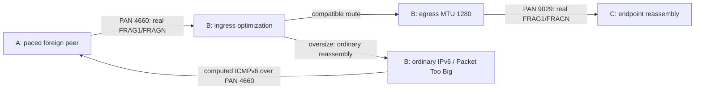

# Native fragment forwarding and the IPv6 egress MTU

The [three-case fixture](LowpanFragmentForwardingMtu.test) checks that fragment
forwarding honors the selected IPv6 interface MTU, including a change after
forwarding starts. The owning path is
[LowpanFragmentForwarding](../../../src/inet/linklayer/lowpan/LowpanFragmentForwarding.cc).
It reads the original length from the existing IPv6 header; compressed wire
length cannot substitute for that value.

All three nodes use native IEEE 802.15.4 interfaces with independent media/PANs
on either side of B. Explicit global addresses, IPv6 routes and native neighbor
bindings provide a static data-plane composition. Only B enables optimized
fragment forwarding; its ingress lists A's actual native identity. All source
interfaces use the production paced fragmenter, including its first-frame ACK
barrier and 500 ms gaps. ICMPv6 checksums are computed on the actual error sender.
The hosts have neither UDP nor TCP transport enabled.

The checker injects an original IPv6 packet into A's public interface upper
input. This intentionally bypasses A's ordinary IPv6 MTU check to emulate a
foreign peer sending a legal RFC 4944 datagram larger than B's selected link MTU.
It does not claim that a normal INET application emits that oversized packet.
The production fragmenter/pacer, native MAC, radios, receive path and B's actual
IPv6 forwarding/error path remain in use. The raw payload uses Next Header 59;
the successful output claim is byte-exact adaptation delivery, without an
application or transport service claim.

| Case | Stimulus | Required observation |
| --- | --- | --- |
|0 | Original length 1281, encoded IPHC length 1276, selected egress MTU 1280. | B completes ordinary reassembly once; no optimized B-to-C data or C datagram. A receives a real Packet Too Big with MTU 1280, a valid independently recomputed checksum and the matching original packet prefix. |
|1 | Original length 1200, compatible MTU 1280. | B forwards before A emits its last fragment, without ordinary B reassembly. C receives the exact original bytes with Hop Limit reduced once to 63. |
|2 | Original length 1200; change B's egress MTU to 1000 in the first successful native transmission notification. | Only the first optimized data frame leaves B. No C datagram completes; its partial reassembly expires once. The saved operation is aborted rather than rerouted or switched to reassembly after output. |

Case 0 distinguishes original IPv6 size from compressed size at the boundary.
Initial ineligibility preserves the existing sticky ordinary disposition; the
complete packet reaches ordinary IPv6, which constructs Packet Too Big. The
optimized helper does not invent a partial quote or a second error path.
For admitted forwarding, the same private path query runs before output,
after packet observations and after native completion. It checks the current
MTU against the retained header's original payload length without new size
state. Existing FRAG1 validation checks that the header payload length agrees
with the original datagram size. Case 2 uses a public runtime invalidation
stimulus; it is not a claim that an initial native interface with MTU 1000 is
a supported configuration.

The checker records actual radio data transmissions and matched source native
ACKs, and verifies the source's ACK-relative spacing. A source's successful
native transmission is not a final-destination acknowledgment. Case 2 deliberately
lets A finish its paced local transmissions while C remains incomplete.

All three cases pass in debug and complete normally in release, with identical
printed rows:

| Case | Source frames / local ACKs | Optimized B frames | Ordinary B reassemblies | C datagrams | Packet Too Big | Partial expiry |
| --- | --- | --- | --- | --- | --- | --- |
|0 |14 /14 |0 |1 |0 |1, MTU 1280, valid checksum |0 |
|1 |13 /13 |13 |0 |1 |0 |0 |
|2 |13 /13 |1 |0 |0 |0 |1 |

The unchanged pre-fix library forwards all 14 frames in case 0 and delivers the
1281-byte datagram to C without reassembling at B or sending Packet Too Big.
It also continues all 13 frames in case 2 after the MTU changes to 1000, and C
completes the datagram. Both intended assertions fail; the compatible case 1
passes. Final per-case replays use the same executable, generated inputs and
arguments with independently verified old/new library paths. Generated
CPP/NED/INI/default inputs are also byte-identical in the initial parent/fixed
comparison. A first fixture compilation
attempt missing an IPv6-header include is retained as a setup failure.

The mapped default-mode campaign passes five protocol fixtures / 90 simulations
in each mode, including the original forwarding, lifecycle, paced-source and
native-reassembly cases. Three debug fragmentation/reassembly/tag units and
the 20 native-completion module runs also pass. Exact commands, seed 0, final
source/library/cohort identities and release observations are recorded in
[p14-mtu-verification.json](../../../doc/project/evidence/model/6lowpan/p14-mtu-verification.json).
Actual feature-disabled UDP execution is explicitly deferred to the parent-owned
final campaign; no feature state is changed here.

The original P14 and P15 evidence records remain historical and unchanged.
This follow-up adds its own evidence. Debug assertions establish byte, timing
and checksum checks; release normal completion and independently compared
printed counters supplement those checks without enabling ASSERT.
