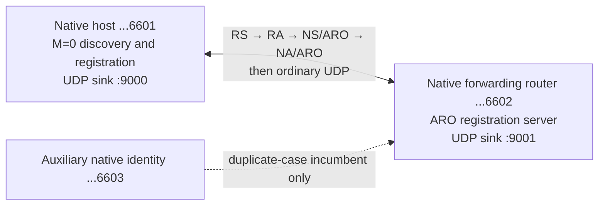

# Native host discovery and address registration

> **Kind:** report · **Status:** current · **Seal:** none · **Owns:** — · **Stands on:** [6lowpan-completion.md](../../../plan/done/6lowpan-publication-plan.md), [RFC 6775](../../../doc/project/evidence/standard/rfc6775/rfc6775.txt), [RFC 4862 §5.5.3](https://www.rfc-editor.org/rfc/rfc4862.html#section-5.5.3)

Publication association: [C22](../../../plan/done/6lowpan-publication-plan.md#c22); donor `bced36c7d3`. The retained setup, assertions and parent explanation below describe this behavior. Original run counts, PASS statements and temporary artifact locations refer to the donor cohort. New-prefix results are recorded separately in the publication verification manifest; none is inferred from those historical statements. Exact-parent runtime execution is not claimed unless that manifest records it.


`LowpanHostRegistration.test` exercises the native `host` role against the production native `router` role. Discovery, registration and subsequent UDP data cross the actual IEEE 802.15.4 radio, adaptation and IPv6 paths. Neither learned endpoint has an XML `<neighbor>` mapping.



The native link-local address supplies the IID for `/64` autonomous addresses. The router advertises `2001:db8:1::/64`, with L forced clear and A set. The normal host address is `2001:db8:1:0:211:2233:4455:6601`. An explicitly configured finite address, `2001:db8:1::99`, expires at five seconds. PAN ID is 4660; all six runs use seed 0 and end at 80 simulated seconds. Run 5 adds a second host interface, EUI-64 `0011223344556604`, on the same native domain.

The selected host profile accepts M=0 advertisements. M=1 advertisements produce an unsupported drop without adding routers, addresses or registrations; this profile does not supply DHCPv6. Candidate routers and the combined configured/autonomous/rejected address inventory have independent module-wide bounds. The host owns its default routes, router bindings and one timer; it deletes these by ownership on expiration and lifecycle transitions. It retains no route pointers. Runtime address-assigned notifications immediately start registration for newly configured addresses.

Each router has at most one outstanding base-ARO registration. Success enables ordinary data only while the local address lifetime, router lifetime and accepted registration remain valid. Refresh starts at the configured fraction of accepted lifetime (0.8 by default). A request is sent at most three times, at intervals of at least one second. Duplicate status removes the rejected address; cache-full and exhausted retries evict the router. Rediscovery waits at least ten seconds. An error, or expiry of an outstanding address, also imposes a quiet interval before another address is tried, because base-ARO error replies do not identify the failed IPv6 address.

Unregistered ordinary data is dropped with `ADDRESS_RESOLUTION_FAILED`; it is not queued for later replay. This applies before discovery, after losing the default route, on transmit and at local delivery. ND controls remain usable before registration. Applications should start after registration succeeds. A valid, non-tentative ordinary-interface alias still permits weak-host local delivery; a tentative alias does not. Deprecated native addresses remain usable until their valid lifetime expires, provided their registration remains accepted.

| Run | Stimulus and required observations |
| --- | --- |
| 0 | Complete RS/RA/NS/NA exchange, SLAAC, radio UDP delivery, refresh before registration expiry, runtime address assignment, finite address expiration and crash/restart. |
| 1 | Router cache capacity one: link-local registration succeeds, global registration receives cache-full, and rediscovery remains bounded. |
| 2 | A distinct owner already holds the autonomous address: duplicate status removes the host address and later advertisements cannot recreate it. |
| 3 | Router radio turns off after the accepted RA and its MAC acknowledgement: exactly three NS attempts occur, followed by router eviction and delayed rediscovery. |
| 4 | M=1 advertisements: no SLAAC address, registration request or successful discovery state is created. |
| 5 | Both native interfaces learn the router independently. Lifetime-zero advertisements withdraw it on the first interface; discovery continues there while the second interface retains a usable router and registration. |

In run 0, ordinary packets before registration are denied in both directions. A no-default-route packet never reaches the adaptation layer, including after registration later succeeds. Outbound and inbound packets at exactly five seconds run at event priority -10, before the host's priority-0 expiration timer: both must be denied at the finite address's deadline. One tick later the address row is absent. A tentative ordinary alias at 5.5 seconds still denies delivery; a valid ordinary alias at six seconds permits a real UDP delivery. Making the native autonomous address tentative at ten seconds denies its use as well.

Literal, checksum-valid advertisements pass through the radio receive path to test prefix processing independently of the router emitter. L=1 prefixes are ignored. A zero valid lifetime preserves a short remaining lifetime under RFC 4862's two-hour rule while updating the preferred deadline. A finite wire lifetime of `0xfffffffe` seconds at 12 seconds must not overflow `SimTime`: an expiry beyond the representable simulation horizon is treated as non-expiring within that horizon. A shorter advertisement at 13 seconds sets a 7200-second remaining lifetime; another zero advertisement at 16 seconds preserves that deadline. Manually configured addresses sharing the prefix retain their own deadlines. Information-refresh solicitations remain at least ten seconds apart.

An address assigned at 25 seconds produces an observed NS before 25.1 seconds, then successfully carries data after acceptance. Another address expires at 26.001 seconds while its duplicate error is in flight. The following address, assigned at 26.002 seconds, survives that late error and registers after the quiet interval. Success and duplicate NAs for two further pending finite addresses enter real IPv6 receive dispatch at their exact deadlines, 42.001 and 56.001 seconds, with priority -10. Expiry is applied before reply matching: neither an expired success signal nor eviction of the router carrying the still-valid autonomous address may result. Crash at 65 seconds clears host state; restart at 66 seconds produces fresh discovery and accepted data at 70 seconds. Previously removed manual addresses are not sent in stale registration requests.

Ordinary unicast NS without ARO or SLLAO reaches the registered host over the radio and elicits a solicited NA with R=0, O=0 and no TLLAO, returned over the radio to the actual native requester. Host-to-router unicast and multicast NS cases also return radio NAs, with R=1 and native TLLAO on the multicast case. Bad Hop Limit, bad checksum, unassigned target, tentative target and expired target produce no additional NA. These replies do not alter registration state. The independent [router fixture](neighbor-registration.md) covers the same router responder without the host client.

In run 5, the first interface loses its router at 20 seconds. Router advertising is disabled at 29 seconds without disabling the ARO server. After the first interface's RS at 30 seconds, a lifetime-zero RA for that now-unknown router arrives at 30.001 seconds. This must restart that interface's discovery even though the second interface still holds a valid router. At 51 seconds the first interface must have sent at least three further solicitations, while the second retains its router binding and usable registration. Advertising is then re-enabled. This distinguishes per-interface discovery progress from the mere presence of some router elsewhere in the module.

The duplicate runs preset only the conflicting address through the public domain binding API, using the auxiliary owner's identity. This provides a server incumbent without supplying host-to-router learning. All RS, RA, NS, NA and successful data observations use real production transmission and reception. All emitted controls have verified computed checksums, Hop Limit 255 and native identities; the RS uses a non-unspecified link-local source and all-routers destination.

The final debug run observed these counts. NS counts ARO requests from the first host interface; NA counts router-produced advertisements, including the two ordinary router responses in run 0. `accepted` counts successful registration replies across host interfaces; `guard` counts IPv6 data eligibility drops, and `unrouted` counts ND handoff drops without a route. In run 0, the 42.001-second pending-address expiry quiet interval postpones the first default refresh from about 48 seconds until about 52 seconds, still before the original accepted lifetime ends.

| Run | RS | NS | RA | NA | Accepted | Guard | Unrouted | Radio UDP deliveries | Ordinary-alias deliveries |
| --- | ---: | ---: | ---: | ---: | ---: | ---: | ---: | ---: | ---: |
| 0 | 3 | 12 | 3 | 14 | 9 | 8 | 1 | 4 | 1 |
| 1 | 8 | 16 | 8 | 16 | 8 | 2 | 2 | 0 | 0 |
| 2 | 2 | 4 | 2 | 4 | 3 | 2 | 2 | 0 | 0 |
| 3 | 5 | 3 | 1 | 0 | 0 | 2 | 2 | 0 | 0 |
| 4 | 5 | 0 | 4 | 0 | 0 | 2 | 2 | 0 | 0 |
| 5 | 5 | 4 | 3 | 8 | 8 | 2 | 1 | 0 | 0 |

```sh
opp_run_protocol_tests --load . -p inet -m debug --no-build \
  -w '^tests/protocol/6lowpan$' -f 'Lowpan(HostRegistration|RouterDiscovery|NeighborRegistration)\.test$'
opp_run_module_tests --load . -p inet -m debug --no-build \
  -f 'Lowpan(MixedNeighbourDiscovery|NativeLifecycle|NativeRouteOver|DynamicBindings|OwnedBindings)\.test$'
```

The protocol selection contains three fixtures and eight simulation runs; the module selection contains five fixtures and six runs. The existing static/mixed fixture remains a compatibility control. This stage does not implement DHCPv6, 6CO/ABRO distribution or DAR/DAC processing. The multi-router state bound is implemented, but these cases use one physical discovered router and do not establish multi-router interoperability or multihop registration.
