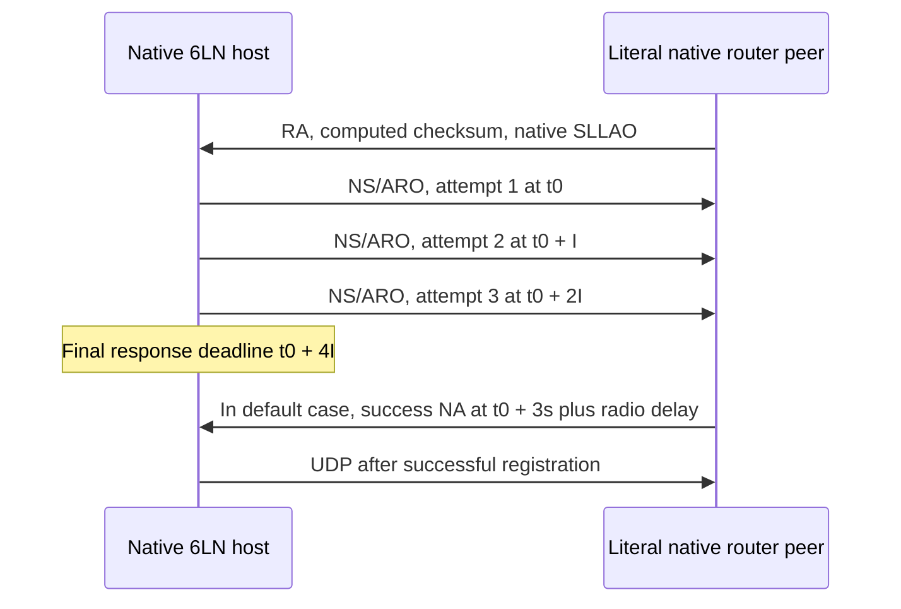

# Native host registration response timing

> **Kind:** report · **Status:** current · **Seal:** none · **Owns:** — · **Stands on:** [6lowpan-completion.md](../../../plan/done/6lowpan-publication-plan.md), [RFC 4861 §6.3.4](https://www.rfc-editor.org/rfc/rfc4861.html#section-6.3.4), [RFC 6775 §8.2.6](https://www.rfc-editor.org/rfc/rfc6775.html#section-8.2.6)

Publication association: [C23](../../../plan/done/6lowpan-publication-plan.md#c23); donor `53b126d2a9`. The retained setup, assertions and parent explanation below describe this behavior. Original run counts, PASS statements and temporary artifact locations refer to the donor cohort. New-prefix results are recorded separately in the publication verification manifest; none is inferred from those historical statements. Exact-parent runtime execution is not claimed unless that manifest records it.


**Execution status: debug PASS, eight protocol simulations plus three supplementary fine-clock simulations.** The host uses its existing per-interface RetransTimer in milliseconds. A structurally valid, checksum-valid, Hop-Limit-255 native M=0 RA copies a nonzero Retrans Timer before router-capacity, discovery-backoff or zero-router-lifetime handling. Zero retains the previous value. Unsupported M=1 and malformed messages leave it unchanged.



The effective interval is the maximum of one second, the configured retry floor and the interface's advertised millisecond value. Three NS transmissions remain the limit; only the final response wait doubles. An already armed deadline is fixed when a later RA changes the interface timer. Subsequent scheduling uses the new value, avoiding a received-RA mechanism that could indefinitely postpone an outstanding request.

`LowpanHostRetryTiming.test` has one real native host and one bare native router peer in PAN 4660, with explicit EUI-64 peers and no configured learned-neighbor mapping. The peer sends literal complete IPv6 control datagrams through its real adaptation/MAC/radio. The real host receives RA/NA and sends RS/NS through production IPv6/ND and its actual radio. The checker observes outgoing NS at adaptation admission for exact scheduling times, and also decodes the NS after reception at the peer. Native checksums, NS source/target and ARO fields are checked on that received path. The successful default case delivers literal UDP bytes after registration.

Observed cases:

| Run | Clock | Trigger and expected timing |
| --- | --- | --- |
| 0 | ps | Default one-second floor, unspecified RA timer: requests at 0/1/2 seconds; actual-radio NA sent at +3 seconds succeeds before +4, then data works. |
| 1 | ps | RA advertises 2000 ms: requests at 0/2/4; router remains through +7.9 and is evicted by +8.1. |
| 2 | ps | Configured three-second floor with RA 2000 ms: requests at 0/3/6 and eviction at +12. |
| 3 | ps | RA advertises 500 ms: one-second minimum remains; eviction at +4, followed by ten seconds of discovery backoff without a hot loop. |
| 4 | ps | Initial 2000 ms, then 4000 ms and zero: first armed retry stays +2; next request is +6; final expiry is +14. Zero retains 4000 ms. |
| 5 | ps | A lifetime-zero RA updates the interface to 2000 ms. Zero, invalid hop, bad checksum and M=1 controls preserve it; a later valid M=0 RA updates to 2500 ms even during discovery backoff. |
| 6 | ps, plus supplementary fs run | A normal-epoch RA lifetime of 65535 seconds is accepted; under fs it saturates router/default-route expiry and information refresh without duration-construction overflow. |
| 7 | ps, plus supplementary fs run | RA Retrans Timer `UINT32_MAX` milliseconds is retained; under fs the next retry deadline saturates safely before constructing that duration. |

All offsets refer to the first NS's production adaptation-admission time. Seed is zero. The timing fixture sets the retry floor to its default value of one second except in the explicit three-second-floor case. Scalar/vector recording is disabled. The protocol runner executes eight cases with its fixed global ps resolution; cases 6/7 are also executed separately from the generated debug binary with fs resolution. One additional fs execution of case 6 supplies a configured floor of 10000 seconds, which itself exceeds the fs clock horizon. This verifies initialization and the first NS without converting the configured floor to an unrepresentable `SimTime`. These are three supplementary simulations, distinct from the eight protocol-runner simulations.

All femtosecond executions finish less than one second after initialization; they do not use a large absolute radio timestamp. Deadline arithmetic retains the configured floor as finite raw seconds and compares raw intervals, including the final multiplier, with the remaining clock range before constructing `SimTime`. RA information refresh takes the minimum applicable wire lifetime, applies the fraction in raw seconds, then bounds the result. Discovery/backoff uses the same bounded operation; the initial never-sent sentinel cannot impose a fictitious ten-second startup wait.

```sh
opp_run_protocol_tests --load . -p inet -m debug --no-build \
  -w '^tests/protocol/6lowpan$' -f 'LowpanHostRetryTiming\.test$'
```

The final protocol execution selected this fixture together with `LowpanHostRegistration`, `LowpanRegistrarValidity`, `LowpanBorderRouterRegistration` and `LowpanNeighborRegistration`: five fixtures and twenty simulations passed. The observed NS offsets are `0,1,2`; `0,2,4`; `0,3,6`; `0,1,2`; `0,2,6`; then one initial NS in each remaining case. The peer receives every NS over the actual radio. Run 0 accepts one delayed NA and delivers one UDP packet. Run 3 sends its second RS only after the final four-second response window and ten-second backoff. Run 5 observes two malformed drops and one unsupported M=1 drop, while preserving the prior timer through those controls.

From the generated `tests/protocol/6lowpan/work/LowpanHostRetryTiming` directory, the additional clock executions use the same debug binary and current `libINET_dbg`:

```sh
./LowpanHostRetryTiming_dbg -u Cmdenv -r 6,7 --check-signals=false \
  --simtime-resolution=fs -n ../../../../../src:.:../../../lib omnetpp.ini _defaults.ini
./LowpanHostRetryTiming_dbg -u Cmdenv -r 6 --check-signals=false \
  --simtime-resolution=fs \
  '--*.host.ipv6.neighbourDiscovery.nativeRegistrationRetryInterval=10000s' \
  -n ../../../../../src:.:../../../lib omnetpp.ini _defaults.ini
```

Both fine-clock wire cases pass with one NS and no accepted registration; the configured-floor execution also prints and verifies the effective input parameter of 10000 seconds without initialization overflow. Result metadata preserves the command-line fs override and floor value. These three executions are not counted as additional protocol-runner cases. Debug/release builds, three related module fixtures and scoped architecture/naming/source-seal gates passed. Exact commands, source hashes, runtime output and library provenance are retained under `/home/miguel/workspace/.codex-artifacts/lowpan-host-retry-20261116/`.

An initial fixture attempted to vary the global clock resolution through a per-run iteration expression; configuration rejected that expression before simulation. A subsequent ps-only attempt retained an fs-only MAX assertion in case 6; the first six cases passed, then that fixture expectation failed. Both attempts are preserved separately. The final clock-dependent assertion and supplementary commands distinguish representable ps deadlines from saturated fs deadlines. Release compilation is recorded separately from debug semantic assertions. Large-epoch radio behavior and late-clock backoff execution are not claimed.

The delayed literal NA proves that the default host can accept a response arriving after three seconds. It does not prove a routed 6LR's three-attempt DAR fallback; the later relay fixture must exercise that behavior with the default client and actual routed authority exchange. No helper-private API, new module, extra timer state, or generic IPv6 change is used.
