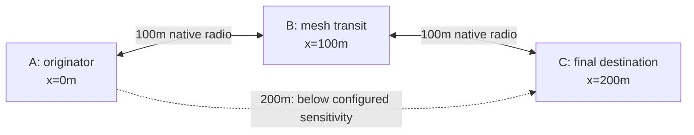

# Native mesh-under forwarding

> **Kind:** report · **Status:** current · **Seal:** none · **Owns:** — · **Stands on:** [6lowpan-completion.md](../../../plan/done/6lowpan-completion.md), [RFC 4944](https://www.rfc-editor.org/rfc/rfc4944.html)

The native adaptation layer can forward outer Mesh/BC0 frames before interpreting
their IPv6 or fragmentation payload. Its opt-in configuration and supported
ranges are declared in [LowpanLayer.ned](../../../src/inet/linklayer/lowpan/LowpanLayer.ned).
An exact final-L2-to-next-L2 route selects each unicast hop. Missing routes drop;
there is no routing discovery, default forwarder or peer reachability inspection.
The domain still supplies native identities and its existing radio/deadline
contract. Default mesh-disabled behavior remains covered by the existing
registration, compression and per-hop fixtures.

The fixture uses real `Ieee802154NativeLowpanInterface` adaptation, bounded queue,
MAC, boundary and narrowband scalar radios with stationary geometry and explicit
FreeSpacePathLoss. Adjacent receivers are above the sensitivity threshold;
A–C is below it. A separate B-down broadcast control and absence of C MAC-upper
acceptance from A make this distinction causal. The checker supplies IPv6 bytes
at the public adaptation input and observes actual radio transmissions and final
upper output. This static L2 data composition does not claim multihop optimized
Neighbor Discovery: those native receivers still validate the immediate peer.

## Wire and identity ownership

RFC 4944 sections 5.2 and 11 place Mesh before BC0 and fragmentation. Its
originator/final identities remain unchanged while the MAC source/destination
change. Transit decrements Mesh Hops Left before forwarding; zero never wraps.
Local final delivery does not spend a forwarding hop. The IPv6 Hop Limit is
untouched. Short/extended address widths and deep-hop form are represented by
the local wire types; the selected native data profile uses extended unicast and
short broadcast. Deep form is retained while forwarding, including its width.

The selected profile requires BC0 for Mesh broadcast and rejects standalone BC0
or BC0 with Mesh unicast. These restrictions and flooding choices are model
policies, not universal RFC requirements. Broadcast is delivered locally once
and forwarded once if budget permits. At zero forwarding budget it can still be
delivered locally. The adaptation owner commits duplicate admission before
either action, so queue refusal cannot cause a replay to repeat local delivery.

Both compression passes receive logical originator/final identities. At an
endpoint, private Layer arguments supply these same identities to decompression
and the existing reassembly key. MAC-owned indication tags remain immediate
receive facts. A partial datagram arriving from different immediate senders can
therefore reassemble under one logical identity without rewriting those tags.
Transit does not call reassembly or decrement IPv6 Hop Limit. Unknown inner
dispatch is opaque there; endpoints retain their existing unsupported handling.
The dissector visits ordered Mesh/BC0 headers, leaves FRAGN/unknown bodies opaque
and bounds malformed input; the printer exposes identities, hops and sequence.

## Bounded broadcast and residence policy

One source BC0 sequence is shared by all fragments of a broadcast datagram.
Source reservations prevent reuse until the original hop-budget residence bound
plus receiver retention has elapsed. Every fragmented Mesh datagram, including
unicast, also reserves its fragmentation tag through the complete hop horizon
plus maximum reassembly retention. A different BC0 sequence alone cannot protect
the reassembly key, which does not contain that sequence.

Receive records are keyed by originator/sequence. They retain immutable
unfragmented/fragmented form and size/tag, with a fixed 256-bit offset bitmap.
Later fragments and duplicates do not refresh the first-arrival expiry. Shape
conflict, duplicate and unknown-record capacity refusal occur before delivery or
forwarding. Live records are never evicted. Capacity counts datagrams rather
than fragment slots. It is a resource bound, not a promise that every fragment
of an admitted datagram will arrive or that every source can progress.

All participating interfaces must use the same residence and retention profile.
Each transmission gets a fresh prepared immediate envelope and the smaller of
its lower deadline and the per-hop residence deadline. The existing native MAC
includes queue residence, backoff/retries, turnaround, conservative maximum
airtime and propagation in its decision before transmission. It does not promise
delivery through arbitrary interference or congestion.

Raw durations are validated before conversion, quantized once to the simulation
clock, and shared by per-hop/cache deadlines and source reservations. Reservations
sum those exact effective durations using guarded integer-clock multiplication
and addition. Large finite values saturate at clock range; sub-tick durations
are rejected rather than silently rounded upward. This is not sub-tick physical
precision. Exact `expiry <= now` precedes decisions. Ordinary stop/start retains
duplicate records and source reservations while clearing reassembly/transmit
state; module recreation loses the history.

The fixed receive retention promises once-per-live-record behavior. A delayed
alternate-path copy after record expiry can be accepted again; bounded hop count
does not imply that every delayed copy arrives within that retention interval.

## Direct cases

`LowpanMeshForwarding.test` uses General configuration and seed zero. It observes
real radio frame bytes, immediate address pairs, logical identities, frame size,
forwarding/reassembly/drop signals and final byte-exact IPv6 output.

| Run | Trigger and causal observations |
| --- | --- |
| 0 | Fragmented IPHC A–B–C unicast. B transmits before A's last fragment transmission, never enters its fragment/reassembly/upper path, and C delivers original bytes with Hop Limit 37 and immediate peer B. Inner fragment bytes match across hops. |
| 1 | Fragmented Mesh broadcast with a two-transmission budget, source backoff and actual first-frame replay. B/C each deliver once; distinct fragments share sequence zero and survive duplicate suppression. C has exhausted forwarding budget. |
| 2–5 | Source budgets 1, 2, 0 and deep 255. Transit exhaustion emits nothing, budget 2 reaches C with 1, source zero refuses emission, and deep 255 becomes 254 without changing identities. |
| 6 | Literal FRAG1 from A and FRAGN from C cross actual radios to final B under the same logical A/B identity. One reassembly delivers exact bytes and preserves final immediate indication C. Its local Mesh budget is zero. |
| 7 | Nine actual-radio malformed/order controls: truncated deep/address fields, standalone BC0, unicast BC0, missing broadcast BC0, repeated Mesh, misplaced BC0 in FRAG1, zero FRAGN offset and truncated BC0. No local delivery. |
| 8 | Two-record bound, exact replay, changed fragmented shape and unknown third record. Same-size radio input at exactly the first record's 60-second deadline is accepted, establishing exact expiry rather than sliding retention. |
| 9 | The same admission sequence with B's queue refusing forwarding. Local delivery remains once per offset; replay does not retry the local side effect. |
| 10 | Refused source queue fills all 256 BC0 slots at one simulation time. Exhaustion refuses before emission and survives actual STOP/START. Exact original hold expiry permits sequence zero again. This is allocator/admission evidence, not radio delivery. |
| 11 | Fragmented uncompressed A–B–C control with the same early opaque-forwarding and byte/identity checks. |
| 12 | Actual CRASH/START preserves receiver duplicate records but clears partial reassembly. Old first-fragment replay is suppressed; its later tail cannot reconstruct cleared state. Exact first expiry and a new shape after original fragment-record expiry, before a hypothetical sliding expiry, are accepted. |
| 13–14 | Missing source route and missing transit route produce observable refusal at the correct owner. |
| 15 | With B down, a real A broadcast cannot reach C directly. |
| 16–17 | Uniform residence values differing by one ps at the source's conservative 127-byte boundary. The lower value prevents A transmission; the next permits A and B local delivery. B's additional post-receive quiet interval then exhausts its fresh budget: this tight boundary is not a successful complete A–B–C path. |
| 18 | An actual-radio received zero-hop transit frame drops without unsigned wrap or B transmission. |
| 19 | Fill source slots and inspect refusal envelopes through fractional-duration reservation expiry. A supplementary us-clock execution distinguishes sum-of-quantized-duration protection from rounding a whole-path floating sum. No radio delivery or private allocator mutation is claimed. |

The independent `LowpanMeshWire.test` supplies literal vectors for all four V/F
width combinations, direct/deep hops, canonical address octets, every positive
truncation, BC0, dissector visitation and printed fields. It supplements the
production path rather than replacing it.

## Execution and limits

Fresh debug and release builds passed. The final debug scope comprises 18
fixtures and 116 simulations, including the latest 20-case Mesh fixture, plus
six unit and seven module fixtures. The release scope completed four fixtures
and 42 simulations. All 40 printed Mesh/updated-host counter rows matched debug;
the other two release controls establish normal completion. Release C++ ASSERTs
are inactive, so detailed semantic checks come from debug. After correcting the
last malformed literal from repeated BC0 to truly truncated BC0, that fixture's
20 debug/release cases were refreshed; the unchanged controls were retained.

Separate debug executions passed the fractional-duration case at us resolution
and the actual A–B–C case with large finite durations at normal-epoch fs
resolution. In the us case the effective residence is 20,001 ticks and retention
1,000,000 ticks. From allocation at 100,000, all slots remain protected at
6,200,200 and sequence zero becomes available exactly at 6,200,255. The fs case
proves large-duration initialization and real forwarding without overflow; it
does not directly inspect private reservation values. Two separate sub-tick
configuration controls exit one during initialization with the intended error;
they are not extra successful simulations.

Final matching results and provenance are recorded in
[p12-mesh-verification.json](../../../doc/project/evidence/model/6lowpan/p12-mesh-verification.json).
Development setup attempts remain separate: an omitted fixture include; the
initial default breakpoint attenuation; hidden-terminal loss during a longer
broadcast flood; wildcard queue precedence; attempted mutation of a nonmutable
queue parameter; and arrival-time expectations that omitted differing frame
airtime or B's post-receive quiet interval. They caused no MAC/PHY workaround or
production policy change. Numeric review separately corrected per-hop versus
whole-path quantization before final matching execution.

The complete feature's headers, routing, duplicate ownership, final logical
identity consumers and introspection land together. An unused wire-only or
cache-only prerequisite would not establish the production caller. There is no
parent-revision runtime comparison of this new feature, multi-seed robustness,
automatic mesh routing, security claim or multihop optimized-ND claim.
