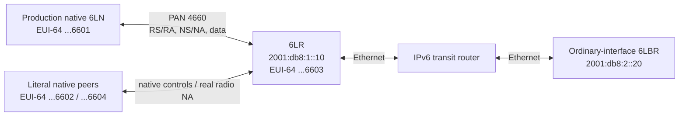

# Routed native registration confirmation and fallback

> **Kind:** report · **Status:** current · **Seal:** none · **Owns:** — · **Stands on:** [6lowpan-completion.md](../../../plan/pending/6lowpan-completion.md), [RFC 6775 §6.5.2](https://www.rfc-editor.org/rfc/rfc6775.html#section-6.5.2), [RFC 6775 §8.2](https://www.rfc-editor.org/rfc/rfc6775.html#section-8.2), [RFC 4291 §2.5.3](https://www.rfc-editor.org/rfc/rfc4291.html#section-2.5.3)

**Execution status: debug PASS, four relay simulations.** The optional 6LR relay uses one configured authority, an explicitly assigned non-link-local DAR source, copied pending operations and one ND-owned timer. The native `router` profile retains local registration when both address parameters are empty. `borderRouter` continues to use its already implemented coupled local authority. The relay does not distribute ABROs or compression contexts.



Set `registrationAuthorityAddress` and `registrationSourceAddress` together on the `router` role. Both must be non-link-local unicast addresses; the DAR source must also be non-loopback. The explicit loopback rejection prevents generic IPv6 from preserving `::1` onto a routed request and prevents an invalid configuration from reaching fallback. Startup checks the source after interface address configuration, requiring a valid non-tentative assignment on an up interface. Before each DAR and before delayed completion, the owner repeats that check. It also resolves the saved interface by both IPv6 interface ID and module ID, requires the same live native boundary/domain and known native identities, and checks that the saved NA source/target is still a valid non-tentative local address. Invalidated context abandons pending work without an NA or fallback acceptance; an independently confirmed lease ages normally.

DAR uses a fresh ICMPv6 packet, computed checksum, explicit configured source, routed authority destination and Hop Limit 64. It has neither an interface pin nor received indication tags. Ordinary IPv6 routing and the ICMPv6 postrouting hook choose the path and finalize the checksum. No native binding or `/128` route exists for an initial tentative operation. Matching DAC or the selected fallback installs it through the existing local admission function, which repeats owner, static-map, capacity and domain ownership checks. Positive expiry is calculated from completion time, with raw minute-to-second arithmetic bounded before `SimTime` construction.

`maxRegistrations` bounds the union of distinct confirmed and pending interface/address keys. Refresh of a confirmed key does not consume another slot. Same-owner repeats coalesce without resetting the original tentative deadline, retry time or positive attempt count. Changed positive lifetime replaces the copied operation fields, and an old-lifetime DAC cannot complete it. A competing tentative owner is ignored; a conflicting confirmed owner receives Duplicate Address.

A zero lifetime removes matching local state immediately and supersedes the positive phase once. It gets at most three zero-lifetime DAR attempts, while retaining the original 20-second birth deadline. Repeated zero requests cannot restart it; positive requests during that removal phase are ignored. One pending birth therefore emits at most three positive and three removal DARs. Only a zero-lifetime DAC can complete the removal phase. All response publication waits for the matching DAC or fallback.

DAC must come from the configured authority to the configured source and match address, eight-byte owner and current operation lifetime. The selected legacy interoperability profile accepts base Code 0 and compatible suffix 1, with Code Prefix normalized by the generic wire decoder and reserved/TID ignored. Checksum and option lengths are validated on the actual packet bytes. Unknown valid operations are ignored. A matched negative status removes only the rejected same-owner local state; an unrelated incumbent remains. Exact `<= now` expiry checks apply independently of timer order. Stop/crash cancels the relay timer and clears copied pending records before ordinary ND cleanup. No received packet, interface pointer or route pointer is retained.

The relay sends DAR at operation times 0, 1 and 2 seconds. If no confirmation arrives, the three-second timeout follows RFC 6775 §8.2.6's recommended Success response. This is acceptance without confirmed uniqueness. Existing confirmed data remains usable during a positive refresh until confirmation, rejection or its own expiry. The fixture distinguishes fallback from confirmed acceptance by actual DAR/DAC traffic and timing.

`LowpanMultihopRegistration.test` uses seed zero, uncompressed native IPv6 and explicit domain peers without configured learned-neighbor mappings. Native NAs and data cross the actual IEEE 802.15.4 radio. Literal NS/ARO inputs enter the real native MAC receive gate. DAR and most DAC controls cross the Ethernet transit router; exact-context-boundary DACs enter real 6LR IPv6 ingress directly to preserve event priority. Ordinary Ethernet neighbor discovery remains active.

| Run | Production path and direct assertions |
| --- | --- |
| 0 | Real host and authority, 250 ms per Ethernet hop. No initial route/binding before that address's first DAC; no NA before its latest DAR has a received DAC. Serial link-local/global registration, bidirectional data, then periodic refresh after 40 seconds while old-route data continues. New deadlines equal completion plus requested minutes. |
| 1 | Real host with its retry-floor parameter **unassigned**, using the NED default. The authority runs static ND and returns no DAC. Two serial addresses produce exactly six routed DARs, six host NSs, two fallback NAs and two accepted registrations; UDP works both ways. No timer override hides the three-second fallback/four-second client response-window race. |
| 2 | Literal owners test tentative conflict, confirmed conflict, pending/confirmed union capacity, changed positive lifetime, old-lifetime DAC, negative refresh cleanup and data while pending. Zero after all three positive DARs adds exactly three removal DARs; late positive DAC and later positive NS cannot resurrect it. A separate zero receives a matching zero-lifetime DAC, then ignores a late positive DAC while preserving another confirmed address. Wrong owner/address/source/checksum controls cannot complete the request. Valid checksum over Code `0xa1` and `0xb0` with nonzero reserved/TID completes the matching operation. |
| 3 | Expired reply alias remains in the address table; tentative reply address, exact source expiry and down native interface independently invalidate delayed completion. Invalidated refresh preserves its old route deadline and data until exact lease expiry. Pending initial and refresh operations cross crash/start and shutdown/start; stale DACs cannot complete a new owner's operation. |

The 20-second tentative ceiling is enforced by source checks, but normal three-attempt completion and the one-way removal phase finish within six seconds; the fixture does not claim a naturally outstanding operation survives to twenty seconds. Runtime domain replacement is not supported by the static domain configuration and is not simulated; weak domain references and membership checks cover that delayed-use boundary in source. This fixture does not establish P11 recency for identical legacy tuples across completed operations, authoritative context distribution, large-epoch radio behavior or an arbitrary-overload liveness guarantee.

```sh
opp_run_protocol_tests --load . -p inet -m debug --no-build \
  -w '^tests/protocol/6lowpan$' -f 'LowpanMultihopRegistration\.test$'
```

Observed final debug totals:

| Run | DAR produced / transit / authority | DAC at 6LR IPv6 | Native NA | Host NS / accepted | Delivered data: host / 6LR / peer |
| --- | --- | ---: | ---: | --- | --- |
| Delayed production confirmation | 10 / 10 / 10 | 10 | 5 | 9 / 4 | 2 / 1 / 0 |
| Default-client outage fallback | 6 / 6 / 6 | 0 | 2 | 6 / 2 | 1 / 1 / 0 |
| Literal operation correlation | 14 / 14 / 14 | 14 | 11 | 0 / 0 | 0 / 0 / 1 |
| Context, expiry and lifecycle | 10 / 10 / 10 | 11 | 3 | 0 / 0 | 0 / 0 / 1 |

Every DAR is checksum-verified at routed ingress, and Hop Limit decreases from 64 to 63. The delayed production run includes a late host retry crossing a completed operation, so its five published NAs yield four client acceptances; each new operation still waits for its own confirmation. Literal NA expectations use distinct operation/time windows and check owner, lifetime, status, IPv6 source/target/destination, Router/Solicited flags and computed checksum. One intentionally bad DAC checksum produces an observable malformed drop. Five exact-context-boundary DACs use direct IPv6 ingress; one additional injected DAC arrives while the 6LR is crashed and never reaches its IPv6 receive signal.

The final related command passed seven fixtures and twenty-six simulations:

```sh
opp_run_protocol_tests --load . -p inet -m debug --no-build \
  -w '^tests/protocol/6lowpan$' \
  -f 'Lowpan(MultihopRegistration|HostRetryTiming|HostRegistration|BorderRouterRegistration|RegistrationAuthority|RegistrarValidity|NeighborRegistration)\.test$'
```

Matching debug/release builds, three related module controls and scoped architecture/naming/source-seal checks are recorded with source hashes and raw logs under `/home/miguel/workspace/.codex-artifacts/lowpan-p10-relay-20261116/`. Debug runtime assertions supply semantic evidence; release compilation is separate. Early fixture attempts are not protocol evidence: one started data before serial neighbor/registration exchange had completed, and another read interface data while the node was deliberately crashed. A missing include was a production compilation failure corrected before matching verification; an accidentally started runner was stopped and supplies no runtime result. The verification record preserves those classifications and does not claim a failing-parent comparison or full P10 completion.

Final review identified that merely excluding link-local and unspecified values had still admitted `::1` through the up loopback interface. The relay now explicitly rejects that source value, consistent with the global DAR-source requirement in RFC 6775 §8.2.3 and the loopback-source restriction in RFC 4291 §2.5.3. A separate direct initialization control reuses the generated debug binary and topology, changing only `registrationSourceAddress` to `::1`. It expects exit status one with the specific non-loopback-source error during ND initialization, before any simulation event, DAR, pending timer or fallback NA. This expected rejection is distinct from the twenty-six normal protocol simulations; no old-source runtime reproduction is claimed.

From the generated fixture directory, its essential override is:

```sh
./LowpanMultihopRegistration_dbg -u Cmdenv -r 0 --check-signals=false \
  '--*.lr.ipv6.neighbourDiscovery.registrationSourceAddress="::1"' \
  -n ../../../../../src:.:../../../lib omnetpp.ini _defaults.ini
```

An earlier unquoted `::1` override was rejected by the parameter expression parser before reaching the relay guard. Its separate setup log is retained and is not counted as the guard's verification.
