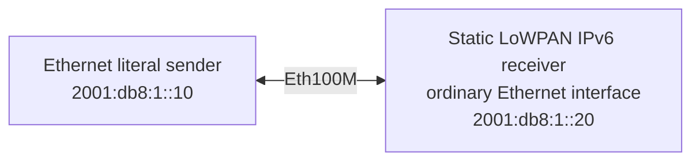

# ND wire validation before dispatch

> **Kind:** report · **Status:** current · **Seal:** none · **Owns:** — · **Stands on:** [6lowpan-completion.md](../../../plan/pending/6lowpan-completion.md), [RFC 6775 §4.4](https://www.rfc-editor.org/rfc/rfc6775.html#section-4.4)

`LowpanNdWireValidation.test` is the direct protocol fixture for the LoWPAN IPv6 malformed ND receive guard. It uses the existing static role and needs no registration-authority helper, border-router role or authority parameters.



The sender injects complete literal IPv6 datagrams into its production Ethernet encapsulation, with actual interface MAC addresses. The receiving Ethernet and IPv6 modules process them normally. Both nodes have ordinary Ethernet interfaces; the receiver selects `LowpanIpv6NetworkLayer` with `nativeNdRole="static"`. Addresses and routes come from the IPv6 network configurator. Seed is zero and the limit is 0.2 simulated seconds.

Eight controls are sent at 10-millisecond intervals:

| Input | Expected observation |
| --- | --- |
| 32-byte DAR with unsupported Code suffix 5 | One observable `LOWPAN_MALFORMED` drop in LoWPAN IPv6. |
| 31-byte truncated DAR | One observable `LOWPAN_MALFORMED` drop in LoWPAN IPv6. |
| One-byte DAC containing only type 158 | One observable `LOWPAN_MALFORMED` drop without attempting a full header peek. |
| NS with a 24-byte fixed header followed by zero-length option `{1,0}` | One observable `LOWPAN_MALFORMED` drop before ND's checked option peek. |
| RA with a 16-byte fixed header followed by truncated PIO `{3,4}` | One observable `LOWPAN_MALFORMED` drop before ND's checked option peek. |
| Valid base Code-zero DAR | Ordinary ND receives the decoded message and safely drops it as unsupported. |
| Compatible Code-one DAR with an eight-byte owner | Ordinary ND safely drops it as unsupported. |
| Valid ordinary NS with a typed 48-bit Ethernet SLLAO | A real computed-checksum solicited NA returns over Ethernet. |

The malformed inputs must be consumed before `Ipv6::handleReceivedIcmp()` performs its default checked peek and before the ordinary ND receive path peeks again. Generic decoding marks unsupported DAR suffixes and invalid ND options incorrect; truncated input is incomplete. The guard covers RS, RA, NS, NA, Redirect, DAR and DAC fixed minimum lengths and checks the decoded flags with explicit permission to inspect incorrect/incomplete chunks. Other ICMPv6 types keep their inherited receive path. Packet core and generic IPv6 remain unchanged.

The debug run passed with eight received literal controls, five IPv6 malformed drops, two safe unsupported ND drops and one received ordinary NA. Run it after a matching debug build:

```sh
opp_run_protocol_tests --load . -p inet -m debug --no-build \
  -w '^tests/protocol/6lowpan$' -f 'LowpanNdWireValidation\.test$'
```

The selector runs one fixture and one simulation. The same fixture was executed against host-client commit `9584a787a1`, whose compiled source is unchanged by the subsequent plan-only parent. It fails at the first malformed DAR, event 7 at 0.01000789 seconds, with "Returning an incorrect chunk is not allowed according to the flags: 0" in `LowpanIpv6`. Applying only this receive guard makes the fixture pass. The isolated fixed tree also passes the host, native registration and router-discovery controls; its [verification record](../../../doc/project/evidence/model/6lowpan/p10-nd-wire-validation-verification.json) retains both executions. The fixture establishes receive validation and preserved ordinary NS behavior. It does not establish authority-table policy, DAR/DAC routing, native ARO handling or extended registration.
