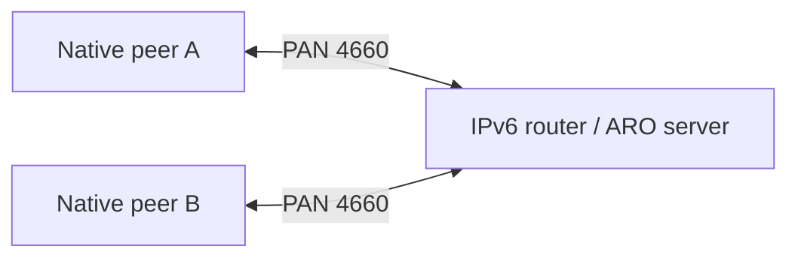

# Native address registration server

> **Kind:** report · **Status:** current · **Seal:** none · **Owns:** — · **Stands on:** [6lowpan-completion.md](../../../plan/pending/6lowpan-completion.md), [RFC 6775](../../../doc/project/evidence/standard/rfc6775/rfc6775.txt)

`LowpanNeighborRegistration.test` exercises the local 6LR registration server through native MAC reception, IPv6 delivery and the ND owner. The server returns real radio Neighbor Advertisements and installs routes used by later data. The learned addresses have no static neighbor bindings. One distinct static address checks conflict handling without masking learning. This is P10's local-server stage; host discovery, context distribution and multihop DAD are separate stages.



The router is a `StandardHost` with forwarding enabled, `LowpanIpv6NetworkLayer`, one native interface, `nativeNdRole="router"` and a module-wide capacity of one registration. Its EUI-64 is `0011223344556603`; peers A/B use the corresponding final octets `01`/`02`. The registered global addresses are `2001:db8::a` and `2001:db8::b`. Literal native frames enter the router's production MAC receive gate. Both peer interfaces receive the router's real transmissions over the scalar IEEE 802.15.4 medium and deliver reconstructed IPv6 packets to the checker.

The run uses seed 0 and a 60.22-second simulated limit. Native checksums are computed even though the inherited ND checksum parameter retains its default. Compression is disabled to make the literal NS/ARO inputs and resulting packets directly inspectable. The minute-based registration lifetime is not scaled down.

| Stimulus | Required observation |
| --- | --- |
| A registers its global address at 1 ms | Success NA, native binding and ND-owned `/128` route. |
| B requests A's address at 10 ms | Duplicate status 1; A remains the incumbent. |
| B requests its own address at 20 ms | Cache-full status 2; the single existing registration remains. |
| Duplicate ARO options, delivered in two RFC 4944 fragments at 31/32 ms | One malformed-registration drop after actual reassembly. |
| Hop Limit 254, bad checksum, or SLLAO different from the received native source | Three more malformed-registration drops without registration changes. |
| A refreshes at 60 ms | Same registration remains; its deadline advances. Reserved ARO bytes are ignored on receive and zeroed in transmitted replies. |
| Router sends ICMP data at 70 ms | The packet selects the learned route and native binding, reaches A over the radio and has a valid checksum. No explicit native request is supplied by the test's data sender. |
| A's native source/SLLAO carries B's ARO owner at 85 ms | Duplicate response goes to B's EUI-derived link-local address and B's native EUI-64, preserving the distinction between owner and actual sender. |
| A de-registers at 100 ms; B registers at 110 ms | A's route/binding disappear, then B succeeds. |
| B requests zero lifetime for distinct static address `2001:db8::c` at 200 ms | Duplicate status 1; the configured mapping to A remains and no learned route is created for it. |
| Ordinary NS without ARO at 300/320 ms, first unicast with no options and then IPv6 multicast with native SLLAO | Two real radio NAs return to A without changing B's registration, adding a route for A, or changing registration counts. The unicast reply omits TLLAO and clears Override; the multicast reply contains the native router TLLAO and sets Override. |
| DAD NS at 340 ms, unspecified source, solicited-node multicast destination and no options | An all-nodes NA with Solicited clear and native TLLAO is broadcast over the radio and received by both peers; B's registration and route remain unchanged. |
| Invalid DAD NS at 360/380 ms, respectively with unicast IPv6 destination and with SLLAO | Two malformed drops and no further NA or registration mutation. |
| Exact deadline at 60.110 s | Domain lookup rejects B even when the checker runs before the ND expiry event; the owned route is absent immediately afterward. |
| Crash/start at 60.130/60.140 s and shutdown/start at 60.160/60.170 s | Owned bindings/routes disappear; new registrations after each start succeed. |

The final assertions require 21 injected native frames, eleven checked ARO radio NAs, two ordinary unicast radio NAs, the DAD broadcast NA received by both peers, one radio data packet, six ND malformed drops and the registration-count sequence `1,0,1,0,1,0,1,0,1`. Every ARO NA has the expected status, lifetime, IPv6 destination, native destination, router/solicited flags and valid ICMPv6 checksum. Ordinary unicast NAs have the router/solicited flags, source/target router address, requesting IPv6 destination and valid checksum. Received packets must not retain `Ieee802154AddressReq`. The refreshed route deadline is checked before and after a duplicate-owner request.

The ordinary-NS responder follows [RFC 6775 §6.5](https://www.rfc-editor.org/rfc/rfc6775.html#section-6.5) and [RFC 4861 §7.2.4](https://www.rfc-editor.org/rfc/rfc4861.html#section-7.2.4). It checks code, Hop Limit, checksum, complete options, current target lifetime and non-tentative assignment. A unicast NS need not contain SLLAO; an included native SLLAO must match the received native identity. Replies use the actual native source metadata directly, without learning a new registration or interpreting it as a 48-bit Ethernet address. The multicast case has an IPv6 solicited-node destination and is injected into the router's native MAC as a literal frame; its returning NA crosses the actual radio.

`LowpanDynamicBindings.test` separately exercises the explicit-request production path: a valid request reaches a real peer; an incorrect source identity is rejected. `LowpanOwnedBindings.test` is the domain-only prerequisite: it checks owner isolation, same-owner refresh, replacement after exact expiry, invalid arguments and preservation of static entries. Its direct calls do not establish live registration behavior. The protocol fixture supplies that evidence for learned entries and the server's zero-lifetime static-conflict response.

Run the direct protocol case after a matching debug build:

```sh
opp_run_protocol_tests --load . -p inet -m debug --no-build \
  -w '^tests/protocol/6lowpan$' -f 'LowpanNeighborRegistration\.test$'
```

The fixture checks one native PAN and one router interface. It does not establish multi-interface registration independence, host retry/refresh generation, RS/RA processing, 6CO/ABRO propagation, or DAR/DAC. The unchanged static profile is controlled by the existing mixed-interface, native lifecycle and route-over module cases. No fingerprint baseline changes are part of this stage.
