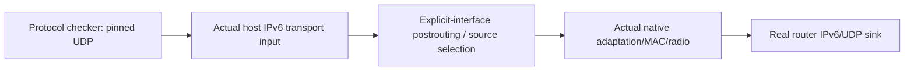

# Native source validity with an explicit IPv6 interface

> **Kind:** report · **Status:** current · **Seal:** none · **Owns:** — · **Stands on:** [publication plan](../../../plan/pending/6lowpan-publication-plan.md)

Publication association: [C32](../../../plan/pending/6lowpan-publication-plan.md#c32); donor `4663b7ca3d`. The retained setup, assertions and parent explanation below describe this behavior. Original run counts, PASS statements and temporary artifact locations refer to the donor cohort. New-prefix results are recorded separately in the publication verification manifest; none is inferred from those historical statements. Exact-parent runtime execution is not claimed unless that manifest records it.


This prerequisite fixture uses the committed legacy native-host profile:
`extendedRegistration=false`, ordinary RS/RA/ARO registration and the existing
public `isNativeSourceUsable` query. It has no updated-host history APIs,
ownership parameters or simulated accepted-state injection.

## Trigger and production path



An IPv6 `InterfaceReq` selects the egress path before ordinary route/MAC lookup.
The old source guard in `resolveMACAddressAndSendPacket` is consequently skipped.
An assigned but unregistered native host source can reach the radio and receiver
through that path. The guard belongs at the common `fragmentAndSend` entry,
after `fragmentPostRouting` fills an unspecified source, so both explicit and
automatic source forms are checked before ordinary transmission.

The checker sends valid independently checksummed one-byte UDP data through the
host's real IPv6 transport entry. It supplies the actual native source/destination
EUI64s, matching PAN IDs and an explicit native request. This intentionally
isolates source validity from neighbor resolution; those L2 requests are not
learned bindings or fabricated registration. The domain contains peer identities
only. Public interface assignment supplies one valid, non-tentative manual global
address A, which is also verified as the preferred source.

## Three deterministic runs

| Run | Setup and trigger | Required observations |
| --- | --- | --- |
| 0 | Native host source A is assigned but unregistered. Registrar advertising is disabled publicly. After its real receiver observes the host's valid initial RS, send explicit-source UDP pinned to the native interface. | One `ADDRESS_RESOLUTION_FAILED` source-guard drop, with filled IPv6 source A and the selected interface; no ordinary UDP reaches adaptation, receiver adaptation or UDP sink. The actual RS crossing the radio proves the ND-control exemption remains usable. |
| 1 | Same unregistered setup, but the UDP L3 request leaves its source unspecified. | IPv6 chooses preferred A before the common guard. The observed drop contains A, rather than an unspecified address. Ordinary radio/receiver delivery is absent while RS still traverses the native link. |
| 2 | Enable the real registrar, discover it and complete actual legacy ARO registration for LL and A. | Only after the host's real accepted-registration event and usable-source query, send the same explicit-source and auto-source pinned UDP forms. Both cross real native adaptation/MAC/radio and reach the UDP sink with exact payload bytes 1/2. Real RS/RA/NS/NA observations accompany that accepted state. |

The cases use General runs 0–2, `seed-set=0`, fixed positions and no induced loss.
Negative checks wait 1.2 seconds after their actual control reception, longer
than the native default lower-delivery lifetime. The physical absence assertions
are separate from the public source predicate and the exact guard-drop count.
Before failing, each run prints transmitted/received/sink counts so a parent
comparison can show an actual bypass rather than only a helper mismatch.

## Verification

Focused reproduction after a fresh matching library:

```sh
opp_run_protocol_tests --load . -p inet -m debug --no-build \
  -w '^tests/protocol/6lowpan$' -f 'LowpanPinnedSourceValidity\.test$'
```

The isolated before/after comparison uses identical fixture bytes and the legacy
profile. The checkout's tracked source was verified equal to prerequisite parent
`a7e4c084eb`. Run 0 fails at 1.204096 seconds/event 44: the source is unusable, yet
one ordinary UDP packet crosses native adaptation/radio and reaches the sink.
Its row is `submitted=1 usable=0 guardDrops=0 txUDP=1 rxUDP=1 sink=1
RSreceived=1`. The runner then skips runs 1/2; their parent outcomes were not
executed and are not inferred from that failure.

After only the `LowpanIpv6.cc` guard move and a fresh matching debug build, all
three runs pass with their assertions active:

| Run | Submitted | Source usable | Guard drops | Auto-filled drop | UDP admitted to adaptation | UDP after radio | Sink delivery | Received RS |
| --- | ---: | ---: | ---: | ---: | ---: | ---: | ---: | ---: |
| 0 | 1 | 0 | 1 | 0 | 0 | 0 | 0 | 1 |
| 1 | 1 | 0 | 1 | 1 | 0 | 0 | 0 | 1 |
| 2 | 2 | 1 | 0 | 0 | 2 | 2 | 2 | 1 |

The same debug campaign also passes the six existing host-registration runs and
two native-tag-guard runs: three fixtures/eleven simulations in total. A matching
release library builds, and this fixture's three release runs complete normally
with exactly the same printed rows. Release C++ `ASSERT` checks are inactive;
completion and counter agreement supplement the debug proof rather than
establishing its assertions independently.

The common POST_ROUTING continuation also serves queued/reinjected datagrams.
Rechecking registration/source expiry after an actual queued interval is
**SOURCE_TRACED**, not a separately executed queued-expiry case. The runtime proof
here covers pinned explicit and auto-selected sources, actual registered data
and the RS exemption.

The [verification record](https://github.com/mgonzalezlopezudc/inet/blob/9908c007bdb1eda9d74f6ca1f99fe1cae33fbc61/doc/project/evidence/model/6lowpan/p11-source-validity-verification.json)
owns exact commands, source/test/library/binary hashes, modes, runs, seeds and
exit statuses. Raw logs and comparison inputs are retained under
`/home/miguel/workspace/.codex-artifacts/lowpan-pinned-source-evidence-20261116/`,
including `parent-inputs.json`, `parent-generated/test.out` and `.err`,
`fixed-debug/LowpanPinnedSourceValidity/test.out`, and the fixed debug/release
build and protocol logs.

The fixture establishes this native legacy-host source-gating path and its ND
exemption, not updated-host lifecycle/history behavior, arbitrary interface
composition or broad protocol conformance. It needs the UDP transport feature.
No baseline update or additional random-seed campaign is implied.
