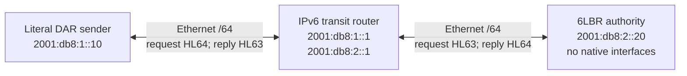

# Routed registration authority

> **Kind:** report · **Status:** current · **Seal:** none · **Owns:** — · **Stands on:** [6lowpan-completion.md](../../../plan/done/6lowpan-publication-plan.md), [RFC 6775 §4.4](https://www.rfc-editor.org/rfc/rfc6775.html#section-4.4), [RFC 6775 §8.2](https://www.rfc-editor.org/rfc/rfc6775.html#section-8.2)

Publication association: [C24](../../../plan/done/6lowpan-publication-plan.md#c24); donor `112b8db04d`. The retained setup, assertions and parent explanation below describe this behavior. Original run counts, PASS statements and temporary artifact locations refer to the donor cohort. New-prefix results are recorded separately in the publication verification manifest; none is inferred from those historical statements. Exact-parent runtime execution is not claimed unless that manifest records it.


`LowpanRegistrationAuthority.test` passes both fixed-seed priority runs through the production registration authority and routed Ethernet path. It validates the authority independently of a 6LR registration relay.

The behavior under test is an independently usable 6LBR DAD authority. It receives routed Duplicate Address Requests, maintains a bounded IPv6-address/owner/lifetime table, and returns routed Duplicate Address Confirmations. It must not create native neighbor bindings or routes to the registered host addresses. The fixture calls no authority-helper API.



`Ipv6NetworkConfigurator` supplies real addresses and forward/reverse routes. Literal IPv6 datagrams enter the sender's Ethernet encapsulation with the transit router's actual MAC destination. This bypasses the sender's ICMP postrouting checksum insertion, preserving both independently calculated valid checksums and deliberately invalid checksums. It does not bypass either Ethernet link or the transit IPv6 forwarding decision. Valid requests use a 32-byte DAR: type 157, Code zero, status zero, reserved zero, lifetime in minutes, eight canonical owner bytes and the registered IPv6 address. The initial Hop Limit is 64. DACs must originate at the addressed authority with Hop Limit 64 and reach the requester with Hop Limit 63.

The configuration is `nativeNdRole="borderRouter"`, `maxDuplicateAddressEntries=1`, forwarding enabled, and no wireless interfaces. There is no native link domain or configured native neighbor. The registered addresses `2001:db8:99::{a,b,c,d}` are distinct from the Ethernet interface addresses. All three nodes use ordinary production Ethernet/IPv6 paths; only the authority selects the LoWPAN network-layer composition. The run uses seed 0 and 134 simulated seconds. The two runs vary only the exact-expiry packet's event priority, -10 and +10.

The current `borderRouter` role enables the routed authority on ordinary interfaces. Native optimized ARO/RA handling remains in the separate `router` role; combining those policies into a native 6LBR is a later P10 integration task. The authority owns a bounded map, one expiry timer and its entry-count signal. It cancels the timer and clears only this table on stop, crash and destruction. It retains no packet, native binding, interface pointer or route pointer in table entries.

| Time | Request and expected result |
| --- | --- |
| 1 s | A/owner 1, one minute: success. |
| 2 s | A/same owner, two minutes: success and lifetime refresh. |
| 3 s | A/owner 2: duplicate, preserving owner 1. |
| 4 s | B/owner 2: cache-full because A occupies the single slot. |
| 5 s | Zero lifetime for A/owner 2: duplicate; another owner cannot remove A. |
| 6–7 s | Matching zero lifetime removes A, then B/owner 2 succeeds. |
| 8 s | B/same owner, compatible Code 1, nonzero reserved byte and a well-formed unknown option: success. Request Hop Limit 2 reaches the authority as 1; transmitted DAC still uses base Code zero, reserved zero and Hop Limit 64. |
| 9–10 s | B/owner 1 conflicts, then B's matching owner removes it. |
| 11 s | C/owner 1 succeeds with a one-minute lifetime; record the local processing/send time. |
| 12–18.5 s | Bad checksum, unsupported Code suffix 5, 31-byte truncation, multicast registered address, unsupported 16-byte owner, unsolicited DAC and zero-length trailing option: no DAC and no table mutation. At 16 seconds a different owner with nonzero DAR status still receives duplicate status; the input status is ignored. |
| 19–20 s | C/owner 2 still conflicts, and a new D still receives cache-full, proving invalid controls did not replace/remove the incumbent. |
| C's exact deadline | C/owner 2 succeeds independently of whether the expiry timer runs first. |
| Deadline +0.1/+0.2/+0.3 s | Former owner 1 conflicts; matching owner 2 removes C; D/owner 3 then succeeds. |
| 72/72.1/72.2 s | Crash/start, then D/owner 4 succeeds, proving the earlier owner was cleared. |
| 72.4/72.5/72.6 s | Graceful stop/start, then D/owner 5 succeeds, proving cleanup is repeatable. |
| 73/132.8 s | Same owner 5 refreshes D; owner 6 still receives duplicate after the old lifetime would have expired but before the refreshed deadline. This proves stored lifetime extension rather than only an echoed DAC lifetime. |

Every returned DAC is compared byte-for-byte with an independent expected 32-byte vector, including status, zero transmitted Code/reserved fields, lifetime and unchanged canonical owner/address bytes. Its IPv6 source is the addressed authority; its destination is the DAR source. A second checksum verification uses the actual returned IPv6 pseudo-header. Observations at both transit ingress directions check the Hop Limit decrement. The fixture scans the public routing table throughout and rejects ND-owned `/128` routes for any registered address.

The selected compatibility interpretation follows the plan's explicit resolution of RFC 6775's conflicting Code rules: §4.4 says ignore Code on reception, whereas §8.2.1 lists Code zero as a validation condition. This base authority accepts the compatible eight-byte extended form, ignores its transaction/reserved byte, and replies in base format. It does not infer support for a longer owner or unknown suffix; extended recency policy belongs to P11.

The exact-deadline case supplements the routed cases with direct production IPv6 receive ingress. The fixture observes the authority's local `packetReceivedFromUpper` event for C's first successful DAC. This occurs at the same simulation time as the authority's preceding table update, before Ethernet transmission or return-path delay. Processing delay is zero on that gate path. The deadline is that observed time plus 60 seconds, not DAC reception time at the requester. At the deadline, a literal DAR enters the authority IPv6 queue at priority -10 in one run and +10 in the other. The resulting DAC still returns through the real Ethernet transit path. This assertion requires authority lookup to reject expired ownership independently of timer ordering.

Both runs passed with 29 injected controls: 28 traversed the sender Ethernet and transit path, while one was the direct exact-deadline probe. Seven inputs produced no DAC; the remaining twenty-two each produced one locally originated DAC, one transit forwarding observation and one requester reception. The ND owner reported five drops per run; malformed wire drops handled by the IPv6 prerequisite are observed separately. Drop-layer classification is not fixed by this authority fixture.

Focused command, after a fresh matching debug build:

```sh
opp_run_protocol_tests --load . -p inet -m debug --no-build \
  -w '^tests/protocol/6lowpan$' -f 'LowpanRegistrationAuthority\.test$'
```

The selector executes one fixture and two runs. Its parent does not support the new role/parameter surface, so no failing-parent protocol comparison is claimed. This fixture does not establish the 6LR pending-state caller, native ARO response timing, DAR retry/fallback, authority selection, context distribution, authentication, or extended-owner transaction recency. Those require their separately planned production cases.
