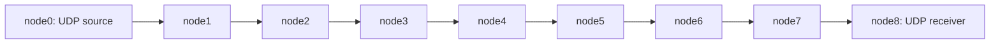

# Native selective recovery

> **Kind:** report · **Status:** current · **Seal:** none · **Owns:** — · **Stands on:** [6LoWPAN plan](../../../plan/done/6lowpan-completion.md)

`LowpanSelectiveRecovery.test` exercises the opt-in RFC8931 source, receiver and
route-over relay through actual native radios. The configuration contract lives
in [LowpanLayer.ned](../../../src/inet/linklayer/lowpan/LowpanLayer.ned); source
partition settings apply to the fragmenting endpoint, including its final
fragment. Relay rewrites obey the wire fields and actual egress envelope rather
than imposing the source's tuning sizes on another endpoint.

Each edge is a separate PAN, native link domain and radio medium. The seven
routers have two interfaces. Configured native peers and link-local next-hop
bindings establish this topology; the fixture installs IPv6 host routes and
global interface addresses. This is a declared eight-link deployment, not a hop
count inferred from IPv6 Hop Limit. Transit nodes have no UDP policy hook; the
standard associated ICMPv6 hook remains present. The actual UDP and ICMPv6
checksums are computed. A declared checksum mode is simulation metadata and is
not carried by the serialized recovery bytes.

The normal source emits one 1280-byte IPv6/UDP datagram. Its contextless outer
IPHC header retains the Next Header inline; extensions and transport bytes remain
raw. The declared94-byte path budget leaves at most71 source bytes in the first
fragment after the recovery header and17-byte worst-case header-growth reserve.
The chosen partition has17 sequences and no short-final exception. Routers
decrement only the outer Hop Limit, translate compressed size/offsets using their
frozen header-length difference, and preserve raw tails. At C the fixture
compares the entire reconstructed datagram with independently saved source bytes
and Hop Limit57, then observes the 1232-byte UDP application delivery.

Source retries share one bounded logical operation, an immutable partition and
cumulative per-sequence submission counts. Positive ACK credit is monotonic.
Initial transmissions precede missing repairs; the current X sequence may be
probed while waiting for its response. Lower refusal/failure counts as a
submission and arms the X response wait. A separate operation deadline also
terminates work when lower callbacks or ACKs cannot make progress. Receiver FULL
means recovery at that fragmentation endpoint; a native MAC success means only
the adjacent link's ACK. Neither establishes application delivery.

| Case | Stimulus and direct observation |
| --- | --- |
|0–2 | Window1/2/32: byte-exact data and real UDP delivery across all eight links;17 data frames per link. |
|3 | Lose non-X sequence2 beyond MAC retries; observe all initial0..16 before repair2. |
|4 | Lose the first X frame beyond MAC retries; observe the bounded response wait after lower failure. |
|5 | Lose FULL; an X probe obtains the cached FULL without another C delivery. |
|6 | Lose every X copy; exactly four source submissions, no recovered datagram. |
|7 | Literal premature FULL while sequences are still unsent cannot complete the source. |
|8 | Literal partial ACK claims an unsent bit while sequence2 is missing at C; the entire impossible ACK is ignored and2 is repaired. |
|9–10 | Matching NULL followed by late FULL cannot revive work; a wrong-tag FULL cannot finish it. |
|11 | Repeated ACK loss leaves progress possible but insufficient; source expires exactly at its fixed45-second horizon. |
|12–14 | A real registered policy hook, an exactly expired IPv6 route and Hop Limit1 prevent relay output. |
|15 | An infeasible source minimum refuses before tag allocation/output. |
|16–17 | Retained source protection counts against record capacity; original-plus-encoded-header bytes count against the data quota. |
|18 | A real registered host removes its source address inside `fragmentSent`; there is one observation and no actual source data transmission. |
|19 | Stop the receiver in `reassemblyCompleted`; no subsequent upper delivery occurs. |
|20 | An indicated ACK and fresh source input run at the exact operation/history deadline before the timer, under a one-record/1400-byte bound. Expired ownership is released before the fresh admission. |
|21 | Literal original size1400 is larger than actual egress MTU1280: NULL, no relay data, real computed-checksum Packet Too Big carrying1280. |
|22 | Host-managed transit egress cannot use another node's unregistered source. |
|23 | Reduce egress MTU after the first output. Returning ACK continuation revalidates it, aborts before another source frame and returns Packet Too Big1000. |

The adverse ACKs use actual native radio input from the communicating peer.
Case20 alone injects its explicitly indicated ACK and fresh full IPv6 input at
the public Layer ingress gates to control event priority; its data still traverses
the real native path. Case21 bypasses the normal source MTU/allocator admission
only to supply an oversized foreign first fragment. These seams do not claim
that a compliant local1280-byte source generates those stimuli.

For cases0–2, every data/ACK hop is correlated using actual native addresses,
PAN, tag, sequence/shape or ACK bitmap and the full adaptation bytes. The next
Layer receipt must precede the saved transmission deadline, which is clipped to
the original ingress plus50ms. Duplicate observations cannot move the anchor.
Source X submission is separately matched to the actual returning RFRAG-ACK,
not the native MAC ACK:

| Window | Data hops | ACK hops | Matched end-to-end RTTs | Maximum hop residence | Maximum RTT |
| --- | ---: | ---: | ---: | ---: | ---: |
|1 |136 |136 |17 |4ms |44.704ms |
|2 |136 |72 |9 |4ms |44.704ms |
|32 |136 |8 |1 |4ms |43.680ms |

These are actual deterministic seed0 observations and assert the selected50ms
per-link and800ms round-trip bounds for these loss-free runs. Loss cases test
the bounded recovery behavior; they do not extend this timing/liveness claim to
arbitrary overload, link delays or ACK loss. Printed per-case metrics also permit
an independent debug/release comparison.

`LowpanRecoverySource` owns source originals, partition/batch/credit and attempt
state. `LowpanSelectiveRecovery` owns receiver coverage, relay queues, fixed
FULL/abort protection, bounded controls and copied reverse correlations. The
actual egress Layer's one 8-bit pool serves both local sources and all ingress
relays; its tag guard outlives the selected operation/path/history bound. Byte
accounting includes retained originals, distinct encoded prefixes, reserved
receiver bytes and queued/in-flight relay/control data. The bounded header,
shape and region metadata is additional; this is not a measurement of allocator
or serializer-cache heap overhead.

These source/receiver/relay, wire, reverse-ACK and terminal/lifecycle paths must
land together: enabling one without the others would emit unsupported traffic
or lose ownership/correlation. This is the reason the production change is one
coherent behavior stage rather than an unused parser or scheduler prerequisite.
The separate [lifecycle fixture](selective-recovery-lifecycle.md) verifies
reentrant cancellation and history, and the [core fixture](selective-recovery-no-udp.md)
covers resets, ECN, general raw tails and the no-UDP build.

Execution: the24-case debug fixture and its release completion/counter comparison
pass. The mapped campaign covers25 protocol fixtures/269 debug simulations,
22 debug units and14 module fixtures; the release selection covers11 protocol
fixtures/195 simulations and the same14 modules. The module selection includes
one declared initialization diagnostic, reported separately from38 normal runs.
Actual feature-disabled UDP verification covers the separate raw fixture and
mapped core checks. Exact commands, inputs, library hashes and the final raw
checker-only rerun composition are recorded in
[p15-selective-recovery-verification.json](../../../doc/project/evidence/model/6lowpan/p15-selective-recovery-verification.json).
Release ASSERTs are disabled: completion and printed-field comparison are
distinct from the debug semantic assertions. The raw report documents the
bounded pre-fix tag-reuse comparison; no whole-protocol parent comparison,
arbitrary topology/loss guarantee, Mesh/multicast recovery, PMTU
repartitioning, source ECN adaptation or transport/application delivery for raw
fixtures is claimed.
