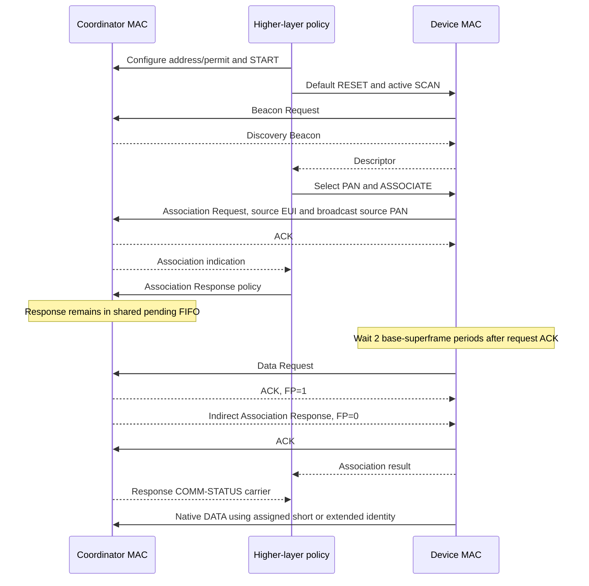

# Managed non-beacon association

The [implementation contract](../../../doc/project/evidence/model/ieee802154/association.md)
maps IEEE Std 802.15.4-2024, 10.21.2/5/6 and Tables 10-101–107 to the owners.
This test uses two production native interfaces and a scalar medium. The single
test higher-layer module implements PAN selection, admission, short-address
allocation and duplicate-request policy explicitly. It is not a second MAC.



Thirteen scenarios run typed/raw (26 proposed runs): allocated short address,
extended-only success, admission denial, AssociationPermit=false, missing
higher-layer response, cancel during decision wait, RESET during decision wait,
bad channel, response expiry before extraction, short-addressed coordinator with
extended-identity learning, first request ACK lost, response ACK lost, and RESET
during the poll PPDU. The request-ACK loss test retries the same DSN; the fixture's
policy supplies only one response despite repeated indications.

Every request uses full device identity and a source PAN of 0xffff. No association
success may precede the actual request ACK plus 30.72 ms (two 960-symbol periods).
The test checks PIB PAN/association flag/address/coordinator identity and an actual
post-join DATA/ACK exchange, with original payload bytes and correct source mode.
Rejection is a processed response with association status 2, rather than a joined
device. Empty store, expiry and prohibited association produce distinct results.

When a response ACK is lost the device can receive and accept its response while
the coordinator retains the transaction awaiting another poll. This fixture
explicitly cancels that retained command at 65 ms; it does not invent a direct
retry or claim coordinator SUCCESS. Cancel/reset during decision wait likewise
retires the coordinator's independent queued response explicitly. RESET during
an emitted poll retains the documented packet-level waveform-abort limitation.

Execute after a fresh debug build:

```sh
opp_run_protocol_tests --load . -p inet -m debug --no-build \
  -w '^tests/protocol/ieee802154$' -f 'Ieee802154Association\.test$'
```

The initial 26-run fixture passed on 2026-11-15, exit 0, 26 explicit PASS and
zero FAIL (`/home/miguel/workspace/ai-logs/executions/tmp-preservation-20261115/ieee802154/ieee802154-association-protocol.log`, copied outputs/INI in
`/home/miguel/workspace/ai-logs/executions/tmp-preservation-20261115/ieee802154/ieee802154-association-evidence/`). Fixture corrections supplied the
installed DSL, explicit noise configuration and module context for scheduled
listener actions. The current extension adds one typed/raw case (28-run scope):
after a short-address join, DATA queued by EUI must be extracted by a short poll
while retaining the EUI destination on wire. That extension passed all **28 runs**,
exit 0, zero FAIL (`/home/miguel/workspace/ai-logs/executions/tmp-preservation-20261115/ieee802154/ieee802154-associated-poll-protocol.log`, copied outputs
in `/home/miguel/workspace/ai-logs/executions/tmp-preservation-20261115/ieee802154/ieee802154-associated-poll-evidence/`).
No fingerprint or serializer baseline changes are requested. Mermaid rendering
is unverified. This test does not establish orphan recovery,
security, or beacon-enabled association.

## Disassociation extension

The [disassociation contract](../../../doc/project/evidence/model/ieee802154/disassociation.md)
defines additional cases 14–20 (42-run total scope, passed before expansion):
device leave with TxIndirect ignored; awake coordinator direct removal; sleeping
device extraction of indirect removal; extended-only device leave; expired
indirect removal; all device-leave ACKs lost; coordinator channel access failure.
The device's five association references must be cleared when it leaves or
receives a valid removal. A sleeping device cannot receive an expired notification,
and an inaccessible channel cannot notify it; those cases retain the device's
local association while the coordinator considers it removed. No fictitious
remote state transition is asserted. An actual command response to POLL returns
NO_DATA without an MSDU. Verification now runs at 110 ms to include the 75.36-ms
indirect expiry; the protocol matcher deadline is 114 ms.

Cases 21–32 add foreign PAN/unknown member/reserved reason/unsupported security
request failures; queued cancel and retain RESET; correctly checksummed wrong
source and wrong PAN input; ignored received FP=1; removal of queued DATA for
the same peer; preservation/cancellation of another peer's DATA; and two queued
DATA retirements with stop reentry during the first callback. Both affected
packets must be destroyed before that first callback. RESET admission is BUSY
during cleanup; direct module stop wins, producing STOPPED for remaining DATA
and the removal confirmation. The wrong-source stimulus changes only the high
EUI octet, preserving the low 48 bits and physical frame length.

The complete **66-run** fixture passed on 2026-11-15, exit 0, 66 explicit PASS,
zero FAIL (`/home/miguel/workspace/ai-logs/executions/tmp-preservation-20261115/ieee802154/ieee802154-disassociation-expanded-protocol.log`, outputs/INI in
`/home/miguel/workspace/ai-logs/executions/tmp-preservation-20261115/ieee802154/ieee802154-disassociation-evidence/`). This supersedes the earlier 26/28/42
results for this fixture. It establishes the specified cleanup and callback
boundaries, without adding a waveform-retraction claim.
