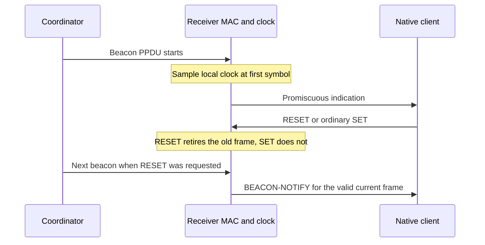

# IEEE 802.15.4 beacon clock anchor

Plan: [B-01](../../../plan/pending/802154-superframe-gts-plan.md#b-01--ieee802154-add-superframe-clock-and-schedule-contracts), `ieee802154: add: superframe clock and schedule contracts`. Test: [Ieee802154BeaconClock.test](Ieee802154BeaconClock.test).

A native coordinator sends a real legacy beacon over the selected scalar O-QPSK radio to a native managed receiver. The receiver enables the superframe preparation component and a real clock with a nonzero initial offset and +40 ppm fixed drift. A separate observer samples that clock at the receiver radio's first PPDU symbol; the native BEACON-NOTIFY timestamp must equal that independent sample in 16-microsecond symbols. `macSyncSymbolOffset` reports ten: the selected first-symbol boundary is ten O-QPSK symbols before the first symbol after SFD. Typed and raw packet representations use the same observer and public service calls.

The baseline has only the post-SFD simulation-time timestamp and cannot select this local-clock boundary. The planned implementation carries a copied physical reception identity from start to delivery and consumes its clock sample before callback dispatch. It must not convert the historical receive start using the clock API after the PPDU has completed.

The first case checks normal notification. In the second, the receiver's promiscuous callback synchronously submits RESET after the first beacon and then a second beacon arrives. The old frame must not produce a post-reset notification; the second frame must produce exactly one notification with its own observed timestamp. The third case submits an ordinary SET from that callback: the first frame must still produce its notification. This distinguishes actual receive retirement from a change to an unrelated service-request ID. The fourth repeats the RESET case with the controller disabled and checks the legacy post-SFD simulation-time timestamp and zero synchronization offset.



The scenario observes native beacon generation, radio reception and the receiver-owned primitive. It does not claim periodic superframe transmission, tracking, CAP access or whole-standard conformance. Module tests separately exercise clock drift signs, coincident starts, abandonment and lifecycle cleanup.

On 2026-11-16 the debug build and the following focused checks passed. The protocol fixture passed all eight scenario and packet-representation combinations; its three existing controls also passed. The module fixture passed all 60 combinations.

```sh
opp_run_protocol_tests --load . -p inet -m debug --no-build -w '^tests/protocol/ieee802154$' -f 'Ieee802154(BeaconClock|DataAck|Lifecycle|PhyLifecycle)[.]test$'
opp_run_module_tests --load . -p inet -m debug --no-build -f 'Ieee802154PassiveScan_1[.]test$'
```

Before the receive-retirement fix, the enabled-controller RESET scenario failed because the old beacon reached BEACON-NOTIFY before the second beacon. The two normal representations passed in that pre-fix run. The retained pre-fix artifacts are under `.codex-artifacts/ieee802154-followup-execution-20261116/b01-beaconclock-prefixed-red` in the workspace parent. These focused results do not cover later planned scheduling or GTS behavior.

The Mermaid diagram has not been rendered in this environment.
