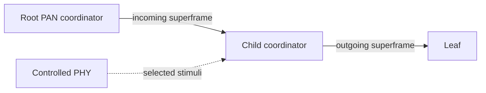
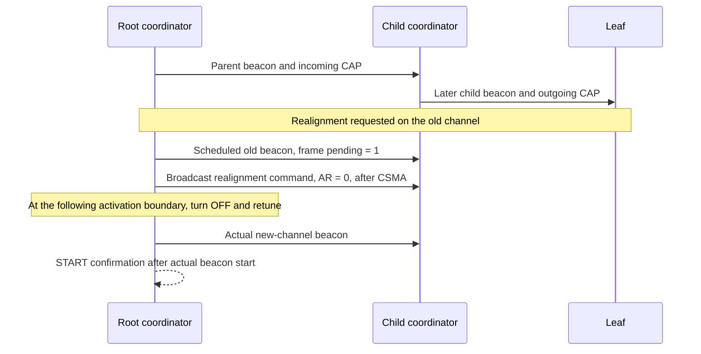

# IEEE 802.15.4 linked coordinator superframes

Plan: [B1-04](../../../plan/pending/802154-superframe-gts-plan.md#b1-04--ieee802154-add-linked-coordinator-superframe-timing),
`ieee802154: add: linked coordinator superframe timing`. The protocol fixture is
[Ieee802154BeaconReconfiguration.test](Ieee802154BeaconReconfiguration.test).

Three native O-QPSK interfaces share a radio medium. The root accepts the child
through the existing nonbeaconing association procedure; the child becomes a
BO15 coordinator and accepts the leaf through a second real association. The
root then starts periodic beacons and the child installs SYNC before starting
its outgoing superframe. A fourth, separately controlled PHY supplies selected
interference and late DATA. Both typed and serialized radio paths are selected.
The topology describes coordinator links, not network-layer forwarding.

For BO3/SO1, the child uses a rounded offset from an actual parent receive-start
anchor. Tests exercise absent tracking, zero versus nonzero StartTime, mismatched
orders, cross-channel rejection, an offset greater than one BI and a 24-bit
offset. They observe the first three missed-parent periods, four-miss loss,
received realignment followed by actual overlapping geometry, and reset from
the overlap indication. Separate SO15 cases compare actual beacon occupancy,
including a larger next outgoing beacon. Physical interval unit checks cover
equality and one tick on each side. The fixture also injects a waveform ending
one tick before, at, and one tick after preparation: beacon priority permits
preemption, and the last case observes local radio OFF before the propagated
waveform ends, followed by the actual on-time beacon.

Two direct DATA cases submit child-to-parent traffic during the child's CAP and
child-to-leaf traffic during the parent's CAP. An additional transaction starts
too late in its correct CAP and crosses an intervening wrong-side publication.
They require no wrong-window RF start, retained ownership, and acknowledged
delivery in the matching CAP. Same-channel BO15 shutdown is followed by DATA
in the still-valid incoming CAP.

Additional cases exercise a parent-directed transaction without an installed
tracker, a one-shot acquisition followed by a search, and realignment from a
previously nonbeaconing child. The latter checks that a multi-interval initial
offset remains tied to the parent beacon observed at request acceptance even
when the command waits for a later CAP. A zero-offset realignment that would
overlap the known parent superframe is refused. Other cases check callback-driven RESET during
loss, BO15 before PHY submission, old-CAP reception while realignment waits,
and retuning while an incoming waveform is active. The external-clock SO15
case checks that drift uncertainty prevents a forecast overlap; exact
physical interval tests use the simulation clock. Another case starts a
realignment near the parent CAP end and stops the parent: four missed beacons
must retire the pending command and START before any child beacon. A second
case retains an active child schedule and checks that the old command is no
longer cancelable when its START termination callback runs.

For coordinator realignment, the fixture observes the old beacon's pending
bit, old-channel RF frequency, broadcast command with AR clear, and the actual
new-channel beacon observed by a tuned receiver after confirmation. Other cases
exercise nonbeaconing and BO15 target operation, a controlled fourth-radio CCA
failure with old-channel retention, RESET-confirm reentry, PHY stop/restart,
active replacement commit/cancel, and an incoming AR=1 frame whose ACK must
yield to an earlier pending beacon. The initial zero-backoff diagnostic also
exposed an unrelated leaf PAN Conflict command caused by the existing
parent/principal metadata gap; that gap is assigned to B2-03. The successful
realignment case retains normal reception and uses bounded CSMA retries.

Local BO/BLE SET checks include invalid values, PHY-only down, actual on-air
frame immutability, next-beacon activation, and BO15 retirement. Coordinator
role probes cover a failed START, reset with and without PIB defaults, and
successful same-channel promotion to PAN coordinator through both START roles.
Sixteen external-clock cases combine both ±40 ppm parent/child assignments,
four rounding modes and the two oscillator event backends. Their local target
is derived from the actual receive anchor; the public future inverse is sampled
at beacon submission and must equal the physical RF start. The supported clock
profile is documented in the [beacon profile](../../../doc/project/evidence/model/ieee802154/beacon-profile.md).

The parent implementation had periodic root beacons and single-window slotted
access; it could not start a linked child schedule, distinguish incoming from
outgoing CAPs or perform the phased realignment. It therefore cannot satisfy
these linked-schedule assertions. The fixture does not claim managed
beacon-mode association, GTS, security or multi-hop forwarding.

Earlier matching checkpoints and their limits are recorded in
[followup-results.md](../../../doc/project/evidence/model/ieee802154/followup-results.md).
The B1-04 acceptance campaign passed all 132 typed/serialized fixture runs,
together with the selected unit, module, and protocol controls. Mermaid
rendering is **NOT_RUN**.
