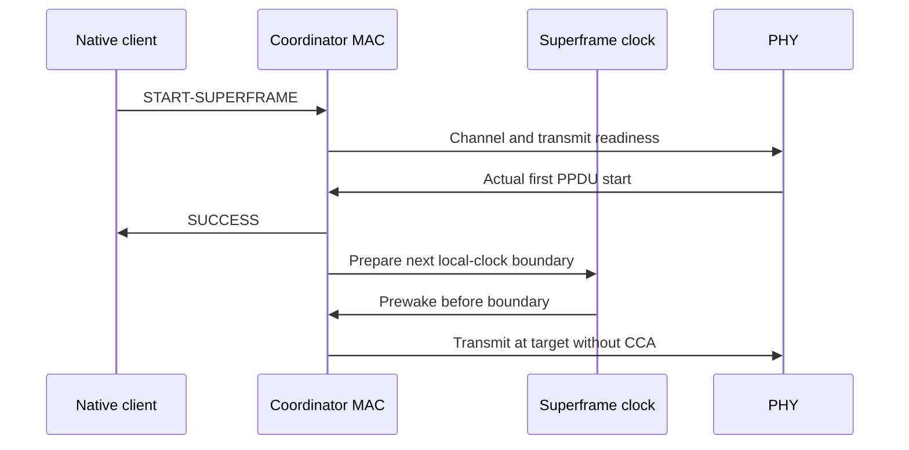

# IEEE 802.15.4 periodic coordinator beacons

Plan: [B1-02](../../../plan/pending/802154-superframe-gts-plan.md#b1-02--ieee802154-add-periodic-pan-coordinator-beacons), `ieee802154: add: periodic PAN coordinator beacons`. Test: [Ieee802154BeaconSchedule.test](Ieee802154BeaconSchedule.test).

A native PAN coordinator and receiver use the selected scalar O-QPSK radio at one metre, with a fixed +40 ppm local clock. The coordinator is started through the native management service. The receiver observes actual beacon PPDUs and their superframe fields, while a separate transmission-start observer records local-clock boundaries. The BO/SO combinations include 0/0, 3/1, 14/14, 3/15 and 15/15. The invalid-order, missing-short-address and protected-request cases must fail once without a beacon. The fixture also exercises changes to beacon payload and pending addresses, timestamp wrap, RESET reentry from the first start confirmation, BO=15 shutdown, a nonzero-time one-shot beacon and PHY-only shutdown during first-start preparation or an established schedule. Both typed and raw representations are selected.



The first boundary is the actual ready transmission; subsequent boundaries are measured in the local clock and PHY turnaround and PPDU airtime remain physical time. This fixture is a timing and service check, not evidence of slotted CAP or GTS support. Mermaid rendering is unverified in this environment.

The running coordinator is also challenged with a bad-channel replacement, PHY shutdown after a real retune, and generic SET requests that cannot safely mutate its active configuration. Its following beacon must retain the original phase and configuration. Separate cases cover MAC stop and crash, a receive window overlapping the first beacon, and a passive scan spanning two scheduled boundaries. The access module's backoff signal distinguishes periodic operation from the existing one-shot discovery path. Radio-mode observations cover the ordinary outgoing CAP, beacon-only operation and battery-life extension with default and 40-symbol backoff periods. With BO=3/SO=0, 41 BLE periods of 40 symbols keep RX enabled after the nominal CAP end; this duty does not extend the geometric CAP or authorize contention outside it.

The MAC's `periodicBeaconStart` signal reports the actual first-symbol timestamp in 24-bit local symbols; the signal's simulation time supplies the unwrapped physical event time. The `outgoingCapActive` Boolean signal records the opening and closing of the coordinator's CAP receive duty. The fixture compares beacon signal values with its independent clock observer, checks CAP transitions and resets reentrantly from each signal. Signal delivery is synchronous, so these cases also check that a retired START or CAP does not continue afterward.

The nominal CAP runs to its advertised boundary; when the next mandatory beacon shares that boundary, the real radio begins its transmit turnaround before it. Late acknowledged DATA tests cover both an ACK that cannot fit and a successful ACK whose completion and required IFS fit before the boundary and the local beacon-preparation reservation. Beacon payload SET rejects a resulting oversized frame without changing the PIB. If pending addresses later grow, the coordinator keeps the payload and selects the oldest unique addresses that fit, then groups short addresses first on the wire; unadvertised transactions stay queued.

On 2026-11-16 a fresh debug build and the focused campaign below passed: all 62 schedule runs, four unit fixtures, five module fixtures and twelve protocol fixtures. The matching source identity and raw results are retained under `b102-repaired62-pass` and `b102-repaired62-checkpoint.json` in the workspace parent's `.codex-artifacts/ieee802154-followup-execution-20261116` directory. The retained `b102-reentry-red`, `b102-priority-red`, `b102-payload-red`, `b102-ble-red` and `b102-rollback-red` artifacts show the corresponding pre-fix failures. These focused checks do not establish the later slotted or GTS services.

```sh
opp_run_unit_tests --load . -p inet -m debug --no-build -f 'Ieee802154(MacPib|Beacons|SuperframeTiming|PendingTransactions)_1[.]test$'
opp_run_module_tests --load . -p inet -m debug --no-build -f 'Ieee802154(SuperframeController|Discovery|PassiveScan|Start|Composition)_1[.]test$'
opp_run_protocol_tests --load . -p inet -m debug --no-build -w '^tests/protocol/ieee802154$' -f 'Ieee802154(BeaconSchedule|BeaconClock|Broadcast|Reassociation|PanConflict|ReceiverEnable|Association|Indirect|Orphan|Lifecycle|PhyLifecycle|DataAck)[.]test$'
```
