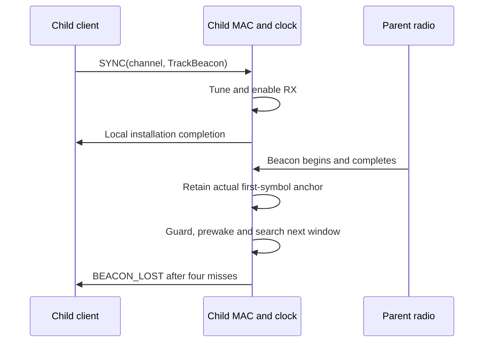

# IEEE 802.15.4 beacon synchronization

Plan: [B1-03](../../../plan/pending/802154-superframe-gts-plan.md#b1-03--ieee802154-add-beacon-acquisition-and-tracking), `ieee802154: add: beacon acquisition and tracking`. Test: [Ieee802154BeaconSynchronization.test](Ieee802154BeaconSynchronization.test).

A native coordinator sends periodic legacy beacons to a native child over a one-metre scalar O-QPSK link. Separate fixed-rate clocks use +40 ppm at the coordinator and −40 ppm at the child. The child configures its PAN, coordinator and beacon order through public PIB requests, then installs SYNC through the native management service. Its local completion is an installation result; it does not claim that a beacon was acquired. Typed and raw packet representations are selected.



Acquisition searches run for 960 × (2^BO + 1) local symbols beginning at actual readiness. Tracking predicts the next beacon from the most recent qualifying first-symbol sample. Its model guard grows from that anchor at a conservative 81 ppm relative drift, with propagation and simulation rounding allowances and room for a maximum-size beacon to complete. Exact-deadline completion is accepted. A PHY-only outage retains logical tracking and miss accounting; MAC reset, stop or crash retire it. Foreign or protected beacons cannot renew the parent anchor. This fixture does not implement slotted CAP traffic or GTS allocation. Mermaid rendering is unverified in this environment.

The foreign-beacon control explicitly enables promiscuous receive duty so it
can observe beacons outside the tracked CAP. Those observations do not renew
the parent anchor or suppress the four-miss loss.

The fixed-rate clock profile requires the nominal scheduling quantum to divide the 16 µs symbol, `OscillatorBasedClock.clockGranularity = 0`, an aligned initial offset and fixed rates within ±40 ppm, with no clock or oscillator changes while tracking. Without an external clock, simulation time represents the symbol exactly. The wake guard and completion allowance round outward to whole symbols, including two symbols for anchor quantization; a future physical deadline is retained to compare receive completion without quantizing a late frame back onto the boundary. The fixture uses 1 µs clocks, both drift-sign pairs and all four clock rounding modes; separate cases leave each clock module unset. Exact fourth-deadline and one-tick-late cases use a matching scripted beacon over a real PHY and a controlled 1 µs propagation delay. Another case sends a full 127-byte beacon at the latest permitted start.

On the fourth miss the old installation is detached and its native BEACON_LOST indication is delivered before the miss/loss observation signals. An observer that installs a new SYNC cannot suppress the old indication or have its new installation retired by the old callback. A completed one-shot acquisition still gates unslotted DATA and POLL while the configured beacon order is below 15. The associated-child PAN-conflict control uses a real M2 association before enabling beacon tracking and checks that no conflict command or unslotted backoff escapes while the CAP backend is unavailable.

On 2026-11-16 the matching debug build passed the focused campaign: all 82 synchronization runs, two unit fixtures, five module fixtures and all twelve other protocol fixtures, including all 30 PAN-conflict runs. The matching source/library identity and raw results are retained under `b103-repaired82-pass` and `b103-repaired82-checkpoint.json` in the workspace parent's `.codex-artifacts/ieee802154-followup-execution-20261116` directory. Retained `b103-loss-red`, `b103-missed-red`, `b103-gate-red` and `b103-panconflict-red` directories record the corresponding pre-fix failures. These focused checks do not establish later slotted or GTS services.

```sh
opp_run_unit_tests --load . -p inet -m debug --no-build -f 'Ieee802154(MacPib|SuperframeTiming)_1[.]test$'
opp_run_module_tests --load . -p inet -m debug --no-build -f 'Ieee802154(SuperframeController|Discovery|PassiveScan|Start|Composition)_1[.]test$'
opp_run_protocol_tests --load . -p inet -m debug --no-build -w '^tests/protocol/ieee802154$' -f 'Ieee802154(BeaconSynchronization|BeaconSchedule|BeaconClock|Broadcast|Reassociation|PanConflict|ReceiverEnable|Association|Indirect|Orphan|Lifecycle|PhyLifecycle|DataAck)[.]test$'
```
