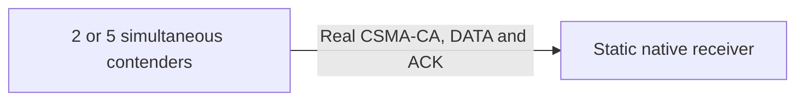

# Bounded contention safety campaign

Series `IEEE802154-5/6C`, companion `Ieee802154Contention.test`. This fulfills the plan's
declared 20-seed campaign with two and five contenders, additionally on typed/raw radios:
80 runs. The seeds are exactly 0–19; failures are investigated, never rerun until green.

All contenders submit one acknowledged four-byte MSDU to a static receiver at 1 ms. Production
CSMA-CA uses BE=3, cap=5, four busy backoffs and one retransmission. The sink and all contenders
use complete EUI-64 identities with identical low 48 bits. The native client independently
checks one terminal SUCCESS/NO_ACK/CHANNEL_ACCESS_FAILURE, valid confirmation metadata and
delivered source/payload/destination identity. Repeated indications are permitted because
duplicate suppression is disabled.



The protocol program requires exactly the contender count of terminal callback events within
100 ms. With these finite NB/BE/retry limits, that window exceeds the worst configured access
and retransmission waits. The medium permits intentional simultaneous starts; collisions are
part of the scenario. No throughput, fairness, delivery probability or hardware PER claim is
derived from these runs. This campaign supplements exact deterministic exchange tests.

Focused command after a fresh debug build:

```sh
opp_run_protocol_tests --load . -p inet -m debug --no-build \
  -w '^tests/protocol/ieee802154$' -f 'Ieee802154Contention\.test$'
```

Executed 2026-11-15 in debug mode: 80 PASS, 0 FAIL, exit 0. The combined verification and
artifact paths are recorded in the [model results](../../../doc/project/evidence/model/ieee802154/results.md).
Diagram rendering remains unverified; no baselines changed.
