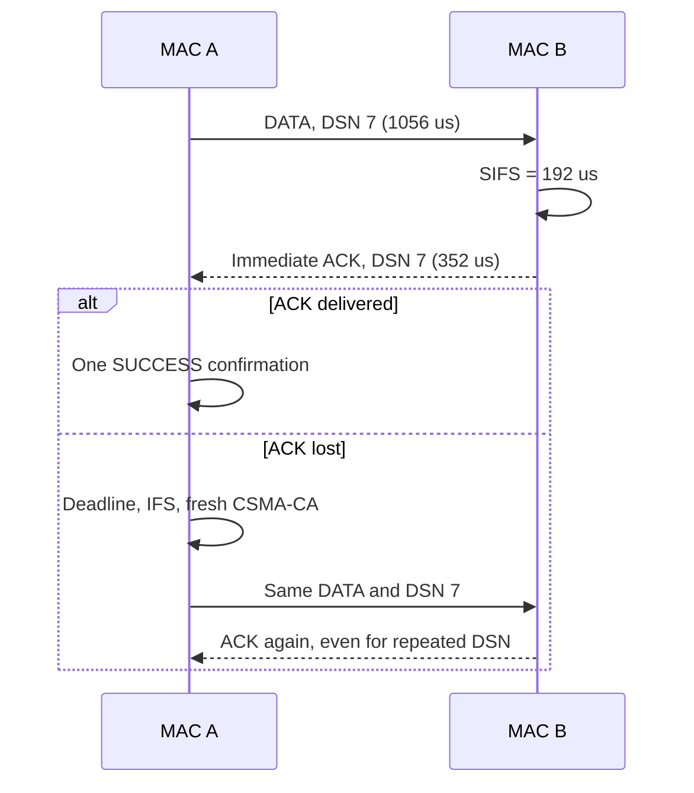

# Direct DATA and immediate ACKs

Series `IEEE802154-6B/6C`: immediate ACKs, direct retries and device-wide DSN lifecycle.
The companion `Ieee802154DataAck.test` follows IEEE Std 802.15.4-2024, 6.6.2–6.6.3,
7.3.3 and the bounded O-QPSK timing contract in the model evidence.

Two native interfaces use production MAC, access and PHY services and real scalar radios.
A higher-layer client configures zero initial backoff, two retransmissions and DSN 7 through
MLME-SET, then submits four bytes at 1 ms with AckTx=true. The complete DATA MPDU is 27 bytes.
The test runs six cases: typed/raw radio representation crossed with no loss, first-ACK loss
and all-ACK loss. Faults act on the radio medium, not on a scripted MAC completion.



The protocol matcher checks full identities and FCS on each DATA, exact SIFS at B, the
address-free five-byte version-0 ACK, and ACK receipt at A. Zero/first/all loss requires one,
two/three DATA attempts respectively. A never-clause prohibits extra retransmission after the
terminal outcome. The higher-layer client independently requires one correlated SUCCESS or
NO_ACK and tests valid/invalid confirmation metadata. B's indications preserve both complete
EUI-64 values, DSN, compressed PAN presence and original bytes; AckSent must already be true.
Repeated DSNs are indicated again because duplicate suppression is disabled.

Before the change AckTx DATA was unavailable in the replacement. The correction adds a
separate ACK exchange, bounds matching by DSN/channel/actual event times, keeps DSN across
direct retries and cancels the deadline on success. This is a source-based before-state;
no parent execution is claimed. Planned execution uses a fresh debug library:

```sh
opp_run_protocol_tests --load . -p inet -m debug --no-build \
  -w '^tests/protocol/ieee802154$' -f 'Ieee802154DataAck\.test$'
```

Executed 2026-11-15 in the active checkout, debug mode after a fresh library build: one test
file, **6/6 General runs successful**, six explicit PASS and zero FAIL verdicts, seed 0, exit 0.
Runner log `/home/miguel/workspace/ai-logs/executions/tmp-preservation-20261115/ieee802154/ieee802154-ack-protocol.log`; retained simulation output and INI in
`/home/miguel/workspace/ai-logs/executions/tmp-preservation-20261115/ieee802154/ieee802154-ack-evidence/`. A fixture import initially named the wrong test-library NED
package; correcting it to `inet.protocoltest` resolved setup. Explicit negative verdict
guards prevent one passing run from concealing another run's protocol failure.

Sequence wrap/interleaved destinations, receive rejection/security,
reset/stop at every state and contention campaigns remain separate required evidence.
Diagram rendering is unverified; no fingerprint baseline is changed.

The current fixture supersedes the six-run result above with **16 passing runs**
(eight cases, typed and raw). Additional cases inject wrong DSN with correct CRC,
bad FCS, unsupported version-2 ACK, exact-deadline ACK and an ACK two picoseconds
late. The exact-deadline case uses 1-us propagation per leg and a 1-us configured
bound; reception priority 0 precedes timeout priority 1. The late case sets the
bound one picosecond below actual propagation and must finish NO_ACK after three
attempts. Native clients assert exact completion instants; protocol matcher
deadlines include 1-ps slack to avoid the matcher's own timeout winning equality.
All 16 also pass in the refreshed 288-run batch recorded in the
[results ledger](../../../doc/project/evidence/model/ieee802154/results.md).
