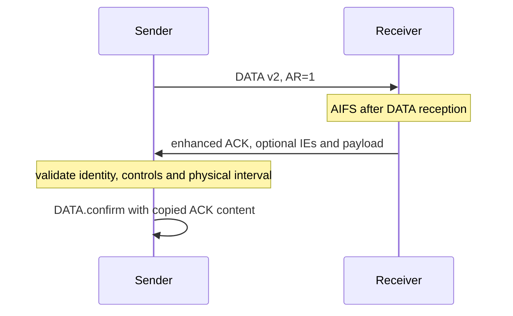

# IEEE 802.15.4 enhanced acknowledgements

Plan: [E1-05](../../../plan/pending/802154-enhanced-frames-plan.md#e1-05--ieee802154-add-enhanced-ack-exchanges), `ieee802154: add: enhanced ACK exchanges`. The owning protocol fixtures are [Ieee802154EnhancedAck.test](Ieee802154EnhancedAck.test) and [Ieee802154EnhancedAckTiming.test](Ieee802154EnhancedAckTiming.test).

The native ACK exchange uses the existing DATA transaction, PHY state and ACK
timer. An acknowledged version-2 DATA frame receives a version-2 enhanced ACK;
legacy exchanges keep the immediate ACK format. The ACK copies sequence
presence and compression controls, addresses the triggering source, and uses
the responder's own source identity and PAN. Its confirmation content is absent when no enhanced
ACK was accepted, and is present even when an accepted enhanced ACK has no
IEs or payload.

The receiver's default-empty `enhancedAckHeaderIes`, `enhancedAckPayloadIes`
and `enhancedAckPayload` values are local model policy, not invented PIB
attributes. IE lists contain typed NED maps with an `id` or `group` and an
array of octets named `content`. This selected producer accepts vendor Header
IEs and vendor/MLME-vendor Payload IEs with complete three-octet identifiers;
other feature formats are not activated by their structural representation.
Received, structurally valid unknown IEs remain observable in the confirmation.
The configured encoded body is limited to 104 octets at initialization. This
local conservative limit leaves room for the largest selected 21-octet MHR
and two-octet FCS in a 127-octet PSDU for every supported address layout.

The receiver schedules its response after the selected AIFS. The originator
does not know the peer's optional content and budgets a maximum legal ACK PPDU;
the allowed CAP response-start envelope and the existing propagation bound are
included in the shared exchange timing. This stage's unslotted cases do not
replace E1-07's required CAP/GTS boundary and optional-content fitting tests.

The direct fixture uses two actual interfaces and a scalar O-QPSK medium. Its
typed/raw cases cover default and configured ACK content; short and extended
address combinations; sequence presence and suppression; wrong peer, PAN,
address mode, controls and FCS; unknown and malformed IEs; retry after a lost
ACK; all-ACK loss; nonzero propagation; and lifecycle interruptions at receive
preparation, pre-transmit, ACK waiting and actual ACK transmission. A separate
scripted PHY fixture supplies ACKs at the permitted start and maximum-PSDU end
boundaries. Its below-earliest case checks the end-to-end outcome only, because
the originator radio may not yet be ready to expose that signal to the MAC.
The receiver-stop/reset cases act from the actual ACK transmission-start signal.
In this radio model the waveform already committed to the medium can complete,
so the sender can correctly report SUCCESS even though the receiver was stopped;
the test does not treat that committed waveform as retracted.

The PAN-omitted, sequence-suppressed case establishes an actual association in
`Ieee802154EnhancedData`; a GTS activity listener requesting RESET in
`Ieee802154GtsData` checks that the old DATA success and packet destruction
precede RESET confirmation. The module adapter control checks that confirmation
contents are copied into the gate tag, and configuration controls reject
forbidden/incomplete IEs and a body beyond the common bound.
Another pair observes an ACK to a broadcast-PAN request at the sender and checks
the responder's actual source PAN. A real association also tests an ACK whose
source uses the bound peer's alternate short address; the unbound wrong-mode
case remains a negative control.

After a fresh debug build, the owning protocol fixtures can be selected with:

```sh
opp_run_protocol_tests --load . -p inet -m debug --no-build -w '^tests/protocol/ieee802154$' -f 'Ieee802154(EnhancedAck|EnhancedAckTiming|EnhancedData|GtsData)[.]test$'
```



Mermaid rendering: NOT_RUN. A fresh matching debug diagnostic passed all 284
actual protocol runs across EnhancedAck, EnhancedAckTiming, EnhancedData and
GtsData, plus the timing unit and five module fixtures. Before the bounded
responder repair, a broadcast-PAN control observed the wrong ACK Source PAN and
the bound alternate-address control received a valid ACK that did not complete
DATA. The repaired run passed both controls and the group-address response case.
The earlier four-run diagnostic established only the default-empty direct
exchange. The subsequent combined acceptance passed all 636 protocol runs,
ten unit fixtures, nine module fixtures and both serializer fixtures against
the matching library. The scoped C++ warning gate remains FAIL with no new
diagnostics in the final comparison.
# Scheduled reservation controls

Scheduled CAP and GTS ACK boundary cases use the real reservation topology in
[enhanced-superframe.md](enhanced-superframe.md), in addition to the
unscheduled enhanced ACK controls below.
