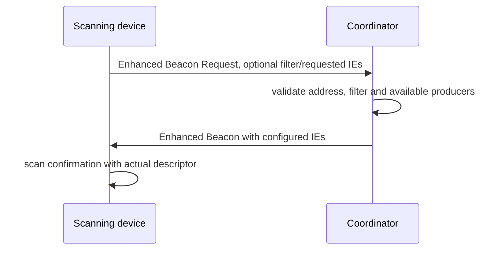

# IEEE 802.15.4 enhanced discovery beacons

Plan: [E1-06](../../../plan/pending/802154-enhanced-frames-plan.md#e1-06--ieee802154-add-enhanced-beacon-request-and-response), `ieee802154: add: enhanced beacon request and response`. The owning native fixture is [Ieee802154EnhancedBeacon.test](Ieee802154EnhancedBeacon.test).

An enhanced active scan uses the existing scan/channel-restoration owner and
transmits a version-2 Enhanced Beacon Request. Requested zero-length IE values
are request grammar; an actual Enhanced Beacon Filter is a separate nonempty
short Nested IE. With automatic responses enabled, the coordinator applies the
selected address and filter policy before the existing beacon owner queues the
response. When automatic response is disabled, the actual request is delivered
to the management client. Enhanced beacon descriptors retain optional wire
PAN/sequence fields and copied IE values; they do not invent a legacy
superframe body, and this stage does not renew legacy tracking or GTS state.



`macEbsn` is separate from the legacy beacon and DATA counters. The enhanced
profile alone draws an initial EBSN; an unsuppressed enhanced beacon consumes
it and a suppressed one does not. Unknown feature semantics, protected
content, periodic enhanced scheduling, TSCH and DSME are not enabled here.

The native enhanced scan sends its EBR with the local extended address.
An automatic response copies that address as its destination, carries the
coordinator PAN as Destination PAN and omits Source PAN. Address combinations
that cannot express those fields under the selected Table 7-2 rules receive no
automatic response; they do not silently change the configured source mode.
Explicit one-shot beacons retain their independently selected layout. Beacon
payload bytes come from the existing `macBeaconPayload` PIB and are separate
from the configured IE lists.

The two-node fixture exercises both typed and raw radio representations. It
checks the requested Header, Nested and top-level Payload IE paths, including
unavailable allocated values, and checks specific and broadcast requests as
well as an external anonymous requester. It tests filter RNG use, preserved
reserved receive bits, malformed and protected requests, and bad FCS. Actual
beacon bytes and scan descriptors establish the separate wire and effective
PAN values, payload, source identity and sequence presence. Rollover and reset
cases cover DSN, BSN and EBSN. MAC and PHY interruption cases retire an
automatic response before PHY submission; another case receives an EBR while an
acknowledged DATA transaction is outstanding and checks that a queued response
does not survive coordinator stop or PHY loss. After PHY recovery it issues a
fresh request and checks that the discarded response did not consume EBSN.

From the checkout root, after a fresh debug build, run:

```sh
opp_run_unit_tests --load . -p inet -m debug --no-build -f 'Ieee802154EnhancedPib_1[.]test$'
opp_run_protocol_tests --load . -p inet -m debug --no-build -f 'Ieee802154EnhancedBeacon[.]test$' -w '^tests/protocol/ieee802154$' --concurrent
```

The final focused checkpoint passed all 110 enhanced-beacon cases in typed and
raw representations, together with the Enhanced PIB unit and all 16 discovery
module cases; there were no protocol errors, skips or FAIL results. An earlier
fresh-debug checkpoint passed 102 enhanced-beacon and 28 broadcast cases,
including queued-response PHY interruption and recovery. The broad compatibility
snapshot passed 1,056 protocol cases, 12 unit fixtures and two serializers;
its discovery module control was subsequently updated for the documented
disabled-profile refusal and passed in the final focused checkpoint. The final
whole-plan acceptance and Mermaid rendering remain pending.
