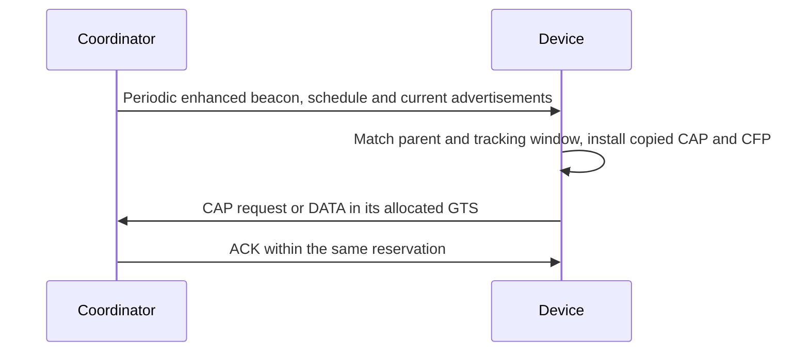

# IEEE 802.15.4 scheduled enhanced beacons

Plan: [E1-07](../../../plan/pending/802154-enhanced-frames-plan.md#e1-07--ieee802154-add-scheduled-enhanced-beacon-integration), `ieee802154: add: scheduled enhanced beacon integration`.

The periodic beacon owner constructs the selected legacy or enhanced format
from the same outgoing epoch and GTS ledger. An enhanced periodic beacon has
no destination address and carries the Simplified Superframe Header IE. Its
optional Simplified GTS list contains retained advertisements, whose count and
lifetime are independent of the number of active grants. The actual encoded
beacon determines the CAP start. A directed discovery response is not a
periodic timing sample and cannot renew the tracking epoch or install grants.

GTS admission budgets DATA through the final SIFS and minimum appropriate ACK,
including propagation and the applicable clock guard. The sender's next
transmission still observes its ordinary frame-size-dependent SIFS or LIFS.
Scheduled ACK receive duty is bounded by the copied reservation completion
allowance; its permitted start envelope is computed independently. The
one-slot legacy regression first reproduced a `FRAME_TOO_LONG` terminal for a
23-byte DATA frame that fits the 1,920 µs slot, then passed in both radio
representations after the timing correction. Opposite-drift 15-slot uplink and
downlink cases independently compare actual RF and final SIFS with the peer's
physical grant end; both reproduced a late transmission and passed after the
end-aged guard correction.

For CAP, the completion allowance uses the DATA-length SIFS or LIFS, while a
GTS uses its final SIFS. A copied reception-start reservation remains tied to
the PHY transmission ID through asynchronous ACK readiness. A valid late
external DATA frame is delivered without an ACK when its CAP has ended. An
orphan-scan realignment uses its existing unslotted response owner instead of
borrowing an old scheduled reservation.

The focused fixtures cover actual enhanced periodic synchronization, CAP and
both GTS directions, live format switching, a directed CAP response that does
not alter the epoch, and malformed schedule rejection before grant updates.
The loss/reacquisition case explicitly deallocates the coordinator's retained
old grant through its public service before requesting a fresh allocation;
child synchronization loss alone does not clear that remote ledger.

The GTS DATA fixture exercises an enhanced ACK with omitted optional content,
the applicable CAP and GTS completion bounds, and a lost ACK followed by a
same-DSN retry in the next grant. The expiry fixture covers v2 uplink activity
and a late externally generated DATA frame. The controller module checks
transmission-ID-bound CAP and CFP snapshots and their retirement. The full
scheduled integration, enhanced ACK boundary matrix, compatibility
controls and final Mermaid rendering are not yet accepted. The one-shot discovery
profile and its separate controls are described in [enhanced-beacon.md](enhanced-beacon.md).

The final-SIFS grant boundary controls use the computed fit budget, including
the conservative two-way propagation allowance, at one simulation tick before,
at and after equality. The exact CAP-end reception control keeps an independent
RX-ENABLE duty active across the boundary, verifies actual DATA delivery and
requires no ACK. An earlier probe observed only the planned waveform end after
the radio had switched off, so it did not establish delivery or an ACK result.

At SO0 with five live slots and an 88-byte ordinary payload, the wire controls
measure a 101-byte legacy PSDU and a 107-byte enhanced PSDU. Their ordinary CAP
budgets are 446 and 434 symbols respectively: switching formats retains the
grants for the constructed old beacon, serves its downlink in that epoch, and
removes the 2-slot downlink when the next enhanced beacon is constructed. A
separate failed START control inspects the proposed enhanced removal before RF,
stops the PHY, and verifies the old SO1 and grant remain usable after restart.

The later-CAP ACK control uses an external scripted peer. A valid-FCS mutation
clears the ACK-request bit only on the coordinator's received DATA copy, so its
native ACK cannot overlap the scripted response. The sender still requests an
ACK. The scripted ACK starts 160 µs after AIFS, and the test independently
checks that the maximum unknown-ACK wait exceeds the clipped CAP allowance
while this actual ACK fits. Separate GTS and CAP loss controls require a
same-DSN retry after the reservation and verify that the receiver does not stay
on solely for the expired ACK wait.

An overlapping CAP/CFP control injects an otherwise valid external DATA frame
from short source 3 during source 2's receive-grant prewake. The frame is
delivered under the CAP rules and cannot borrow source 2's later ACK deadline.
An opposite-drift uplink control independently observes a valid source-2
reception before the coordinator's nominal grant start, then verifies one
activity observation and expiration only after two subsequent silent
opportunities. Reception anchors retain both the CAP and bounded CFP candidates;
the MAC rechecks the live identity before using either GTS activity or its ACK
completion bound.

The final owning protocol selections are `Ieee802154EnhancedSuperframe.test`
(runs 0–25), `Ieee802154GtsData.test` (0–125),
`Ieee802154GtsExpiry.test` (0–53), and
`Ieee802154SlottedManagementBoundary.test` (0–89). The first contains the
format contrast and START rollback; GtsData owns scheduled ACK and duty
boundaries; GtsExpiry owns activity, overlap and scripted peer cases; and the
slotted management fixture covers the version-2 quick-pending path. The
`EnhancedGts` managed example demonstrates legacy association followed by
enhanced periodic beacons and a bidirectional GTS exchange. Its app policy is
limited to one cycle; it does not claim an enhanced pending-address list.
