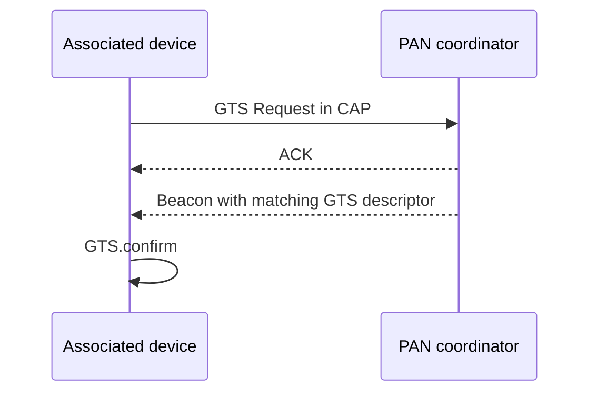

# IEEE 802.15.4 GTS allocation

Plan: [B3-02](../../../plan/pending/802154-superframe-gts-plan.md#b3-02--ieee802154-add-beacon-advertised-gts-allocation). Logical test: `Ieee802154GtsAllocation`.

The native fixture places a PAN coordinator and directly associated children on
one scalar medium. The baseline topology has two active participants; pressure
and maintenance cases use up to six hosts, and the retained-pressure case uses
thirteen. All are one hop apart. The child tracks the coordinator's BO 3/SO 1
superframe and requests a transmit reservation. The command uses the CAP; a
coordinator decision is carried by a later beacon, and the child confirms only
after receiving its matching descriptor. Capacity-boundary cases use SO 0.
Typed and raw frames run separately for each scenario.



From the checkout root, build a fresh debug library and run the complete owning
fixture with:

```sh
make MODE=debug -j4
opp_run_protocol_tests --load . -p inet -m debug --no-build -w '^tests/protocol/ieee802154$' -f 'Ieee802154GtsAllocation[.]test$'
```

The fixture selects runs 0–83: each scenario below has typed and raw runs.

| Scenarios | Setup and stimulus | Required observation |
| --- | --- | --- |
| 0–3, 34 | Associate and track; request both directions, fill the ledger, and issue stale-TRUE requests, including eight contenders while removal and relocation records are retained. | Successful requests receive matching descriptors; closure ACKs later commands without new decisions and those requests time out with NO_DATA. |
| 4–9, 13–16, 25–31, 33, 36–37 | Grow beacon content, change SO, interrupt candidate transmission or scheduled publication, and use exact CAP and external-clock boundaries. | Remove and repack only as needed, preserve old state on pre-RF failure, age published records by the selected epoch policy, and satisfy physical CAP and mandatory-beacon boundaries. |
| 7–9, 20, 22–23, 32 | Depart or recover an association using the same EUI or reused short address; change a binding during ACK or identity callbacks. | Retire old ownership, prevent stale grants, retain wire reservations until expiry, and preserve new callback-admitted work. A matching zero-start descriptor yields DENIED; absence for the new short address yields NO_DATA. |
| 10–12 | Drop the first request ACK or strip descriptors from valid beacons. | Retry retains identity; a matching later descriptor succeeds, while four beacon intervals without one produce NO_DATA at the ACK-based deadline. |
| 17–19 | Request without an allocated short address, use malformed/security parameters, or inject a valid foreign-peer command. | The native status or admission matches the selected contract; an unrelated peer cannot create a grant. |
| 24, 35, 38–41 | Cancel while unrelated DATA is active, or retire a descriptor waiter through cancellation, reset, MAC stop or PHY loss, including RESET reentry from identity publication. | Each accepted request receives exactly one terminal; old obligations precede RESET confirmation and no stale timeout completes later. |

Scenario 21 is a baseline control; the remaining scenarios include the normal
request path and the specific focused setup controls described below.

The fixture also creates additional associated children to exercise both
directions, the seven-key limit, stale permit observations, retained removal
and relocation records, and rebinding to a reused short address. It checks
that a denial is distinguishable from a missing descriptor: a retained
zero-start record matches the reused short address on the wire, while a new
short address has no such match. Expiring records do not reopen permit until
the coordinator explicitly sets it again.

Other cases grow the ordinary beacon payload, change SO, and observe the
actual descriptor-bearing beacons and resulting device indications. They
check the 440-symbol ordinary CAP boundary, rollback of a prepared replacement
before RF transmission, callback reentry, and publication and skipped-epoch
aging. The clock cases compare scheduled physical beacon and CFP boundaries,
including external clock drift and an off-grid decision. Association and
orphan rebinding, obsolete commands after an ACK, cancellation of a waiting
request, scan ownership, and reset ordering have separate native controls.

Fault cases drop the request ACK or remove descriptors while preserving valid
received beacons. The all-descriptor-loss case measures the terminal against
the actual request ACK reception plus four beacon intervals. The test records
representative MAC captures in typed and raw modes. Independent analysis of
the retained status diagnostic checked frame lengths and FCS and parsed five
positive descriptors and a zero-start denial. Capture records identify MAC
events; actual RF timing is established by radio transmission observations.

For the selected unsecured, short-source beacon, omitting payload leaves at
most 91 bytes with seven descriptors and seven extended pending addresses.
The pending-content case therefore proves payload-first omission and retention
and restoration of the pending requests; it does not claim to reach the
subsequent address-reduction branch. The initial request, pressure, maintenance,
retention, loss, and callback cases passed in separate focused diagnostics.
The complete campaign passed 1,298 of 1,300 protocol runs, six unit fixtures and fourteen
module fixtures. The two remaining runs were scenario 14's device-indication
observer; after correcting that fixture expectation, both passed against the
unchanged production library. Thus all 1,300 distinct protocol runs have
passing evidence across the campaign and focused rerun. Independent source
review returned 23 PASS, 11 N/A and no open findings. The scoped C++ gate
remains **FAIL**; its diagnostic dispositions and unchanged-line follow-up are
recorded in the execution evidence. Mermaid rendering is **NOT_RUN**.
