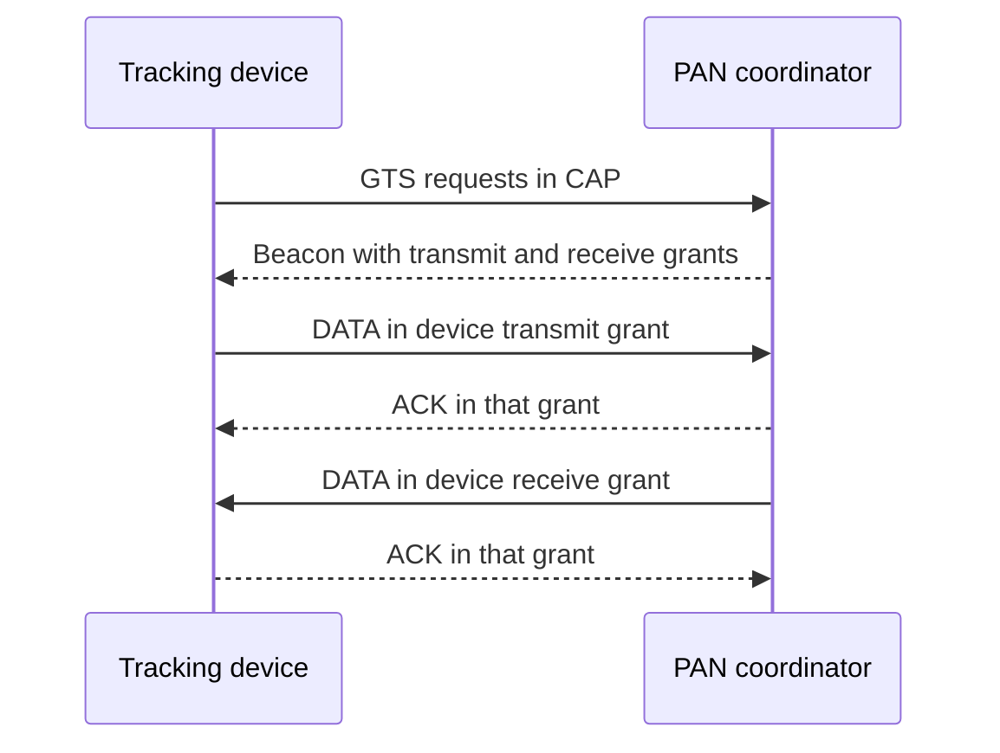

# IEEE 802.15.4 GTS DATA

Plan: [B3-03](../../../plan/pending/802154-superframe-gts-plan.md#b3-03--ieee802154-add-scheduled-gts-data-exchanges). Logical test: `Ieee802154GtsData`.

The fixture uses a PAN coordinator and an associated tracking device one metre
apart on a scalar medium. The coordinator advertises BO 3/SO 1. The device
requests a transmit and a receive grant with the native service and waits for
the corresponding received beacon descriptors. It then sends acknowledged
DATA to the coordinator; the coordinator sends acknowledged DATA in the other
grant. Typed and raw frame modes are separate runs. Additional participants
exercise rebinds and a frozen beacon layout.

This native fixture also owns the allocated-device scan and tracking cases.
`Ieee802154SlottedManagement.test` exercises the production application in
both default and GTS modes; an independent observer checks the application's
actual CFP transmissions and access activity.

From the checkout root, a fresh debug build and the owning checks are:

```sh
make MODE=debug -j4
opp_run_unit_tests --load . -p inet -m debug --no-build -f 'Ieee802154ExchangeTiming_1[.]test$'
opp_run_module_tests --load . -p inet -m debug --no-build -f 'Ieee802154(GtsAdapter|SuperframeController)_1[.]test$'
opp_run_protocol_tests --load . -p inet -m debug --no-build -w '^tests/protocol/ieee802154$' -f 'Ieee802154(GtsData|SlottedManagement)[.]test$'
```

GtsData scenarios each run with typed and raw frames:

| Scenarios | Stimulus | Required observation |
| --- | --- | --- |
| 0–8 | Bidirectional acknowledged and unacknowledged DATA, missing/wrong-peer/EUI-only reservations, invalid option combinations, whole-grant oversize and both drift signs. | Actual DATA and ACK where applicable remain inside the matching slots; no access draw occurs. Invalid requests terminate with the selected status and an oversized packet is released. |
| 9–12, 18 | Rebind an earlier owner during beacon construction, preserve an adjacent receive duty, and remove a grant while DATA waits, is submitted or awaits a lost ACK. | The actual advertised epoch remains authoritative; receiver duty lasts through its end; invalidated unstarted/retrying work gets one terminal and no stale RF. |
| 13–17 | Submit late, exactly at the last fitting start, or one tick later; drop the first or every ACK. | DATA fits exactly or defers to a later actual grant with its accepted ID and DSN; retries keep that DSN and never use contention. |
| 19–24 | Short, cancelled and long off-channel scans, PHY outage during scan, one dropped parent beacon and interrupted ED scan. | Current duties are suspended during scan; a missed beacon suppresses GTS use, four misses retire the grant, and outage recovery restores the actual channel and temporary CCA duration before use. |
| 25–36 | RESET, MAC stop and PHY loss in waiting, readiness, on-air and ACK phases. | Each accepted DATA has one correct terminal and no later retry; RESET confirmation follows its DATA terminal. |
| 37–44 | Cancel a request that fits a later occurrence; test wrong direction, broadcast, the legacy DATA default, active-RX RESET, SYNC replacement, local address change and BO15 shutdown. | Cancellation is terminal, invalid grants are rejected, default DATA still contends, and retired CFP duties cannot survive their owning context. |

The access observations cover both providers' backoff notifications and the
slotted provider's contention-window notifications. The MAC's CFP path bypasses
those providers, whose callbacks own CCA requests; the radio timestamps provide
the separate RF-boundary evidence. The adapter module test sends tagged packets
through the real gate facade to a mock service; it checks default-false and
explicit-true GTS selection, confirmation identity and packet ownership, but
does not claim a radio exchange.



For each measured DATA transmission, the test derives physical slot edges
from the actual coordinator beacon transmission or the device's actual beacon
reception. It checks the real radio transmission interval against the
corresponding grant and observes access-provider backoff and contention-window
signals during the DATA interval. The accepted packet and DSN remain owned by
the MAC while a late request waits for the next matching reservation. A packet
whose exchange cannot fit in the whole grant terminates with FRAME_TOO_LONG;
missing or wrong-peer grants terminate with INVALID_GTS.

```text
grant start                  exact latest start          grant end
    |--- readiness ---| DATA + optional ACK + IFS ----------|
                       a later start waits for the next grant
```

Focused typed/raw diagnostics passed the bidirectional exchange, exact fit and
one-tick deferral, ACK retries, clock and callback repairs, scan controls and
the twelve lifecycle combinations. The managed example completed one GTS
cycle per mode, and the production-app fixture separately checked its actual
CFP RF intervals. The matching combined campaign then passed all 1,392
protocol runs across 36 fixtures, six unit fixtures and fifteen module fixtures.
Independent review returned 23 PASS, 11 N/A and no open findings. The scoped
C++ gate remains **FAIL**; its changed-consumer follow-up found no new
diagnostics against the retained baseline. Mermaid rendering is **NOT_RUN**.
