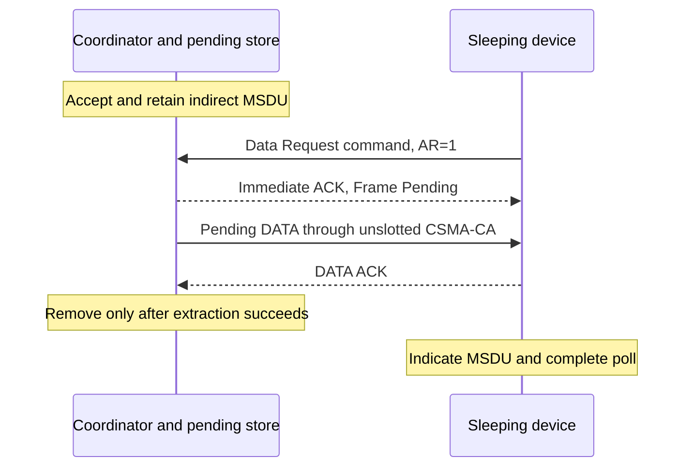

# Indirect DATA, polling and pending ownership

Series `IEEE802154-7`, companion `Ieee802154Indirect.test`. Requirements come from
IEEE Std 802.15.4-2024, 6.6.3.4, 10.22.2–5, Tables 8-33/34 and 10-112/113.
The typed local PURGED retirement is an API lifetime result, not an IEEE DATA status.



Both endpoints use the production native MAC, access provider, timed PHY and radio.
The coordinator retains one or two tracked MSDUs; the device starts with idle RX off.
The third endpoint in the two-device case has the same low 48 identity bits as the
other device. Their polls are staggered, so that case checks independent sleeping
device routing rather than contention. A separate 20-seed campaign covers contention.

Twenty-two scenarios each run on typed and raw radios: empty queue; one frame;
two FIFO frames and final empty poll; first DATA ACK lost; expiry before poll;
queue overflow; purge and unknown handle; queued cancel; retain-PIB reset; foreign
high EUI bits; short-addressed polling; all DATA responses lost; all DATA ACKs lost;
first poll ACK and first DATA lost; two sleeping devices; source-omitted DATA;
zero-length DATA; a poll exactly at expiry; polling while monitoring; ignored
IndirectTx at a non-coordinator or without a destination; and stop reentry during
two-entry reset. Clients check destruction before terminal callbacks, exact
statuses, full addresses, DSNs, Frame Pending, one DATA completion and every poll
completion. Expiration is exactly 16.36 ms for the selected one-period request.

For lost DATA/ACK cases, the retained frame has DSN 7 and no autonomous retry.
A subsequent poll is required. When all responses/ACKs are lost, a queued cancel
at 60 ms terminates the original request; missing ACK never reports DATA success.
In the combined poll-ACK/DATA-loss case, CCA observes the retried poll and the first
extraction attempt cannot access the channel. The next actual DATA is dropped;
the device reports NO_DATA after its 20-ms response bound, then succeeds following
a new poll at 35 ms. Expecting the first poll to succeed would contradict this
stimulus. The fixture checks the retry DSN 99 and new-request DSN 100 separately.

The equality case uses 1 m and 100000000 m/s propagation (exactly 10 ns). Poll
submission is 14.88799 ms; RX readiness, CCA, TX readiness, the 24-octet command and
propagation put coordinator reception at exactly 16.36 ms. The expiry timer has
lower priority. A listener proves the request is still unnotified when reception
starts processing; the MAC then expires it before generating ACK FP=0. The device's
NO_DATA arrives at exactly 16.90401 ms, rather than after a response timeout.

Two-entry reset checks all packets destroyed before the first callback, cancellation
of another retired token returns NOT_PENDING, and both RESET notifications precede
reset confirmation. In the reentrant-stop case the first callback initiates stop;
the remaining DATA receives STOPPED before reset's STOPPED confirmation. Restarted
operation subsequently returns an empty poll without reviving either transaction.

The production command after a fresh debug build is:

```sh
opp_run_protocol_tests --load . -p inet -m debug --no-build \
  -w '^tests/protocol/ieee802154$' -f 'Ieee802154Indirect\.test$'
```

Executed 2026-11-15: **44 PASS, 0 FAIL**, exit 0, seed 0. Log:
`/home/miguel/workspace/ai-logs/executions/tmp-preservation-20261115/ieee802154/ieee802154-indirect-protocol.log`; retained output and configuration:
`/home/miguel/workspace/ai-logs/executions/tmp-preservation-20261115/ieee802154/ieee802154-indirect-evidence/`. Initial combined-loss expectations were
corrected against the actual CCA/poll sequence described above; production behavior
was not changed to bypass the busy channel. Diagram rendering is unverified.

The current extension adds nine scenarios (22–30), each typed/raw: Association
Response extraction, first response ACK loss followed by a new poll, response
expiry, a PURGE whose handle must not match the command, response then DATA in
one shared FIFO, response RESET, response cancellation, response overflow behind
DATA, and a rejection response. This is a proposed **62-run** fixture until its
new result is recorded. The source higher layer supplies the response directly;
no full production association-request/device-state controller is inferred.

The wire listener checks command ID 2, extended source/destination, compressed
PAN, AR=1, Frame Pending=0, unchanged retry DSN and exact response content.
Command receipt produces ACK and POLL NO_DATA without an MCPS indication.
In the mixed FIFO case the response retains FP=0 even with DATA pending; the
second poll obtains DATA with its next DSN. Coordinator completion uses the
correlated native COMM-STATUS carrier, rather than a DATA confirmation.
Purge must leave the response queued; expiry/reset/cancel must retire it once.

This does not establish complete association, PHY waveform abort, or stop/crash
while a pending extraction is active.

The extension was executed on 2026-11-15: **62 PASS, zero FAIL**, exit 0,
`/home/miguel/workspace/ai-logs/executions/tmp-preservation-20261115/ieee802154/ieee802154-association-response-protocol.log`; copied simulation output/INI:
`/home/miguel/workspace/ai-logs/executions/tmp-preservation-20261115/ieee802154/ieee802154-association-response-evidence/`. This supersedes the 44-run result.
