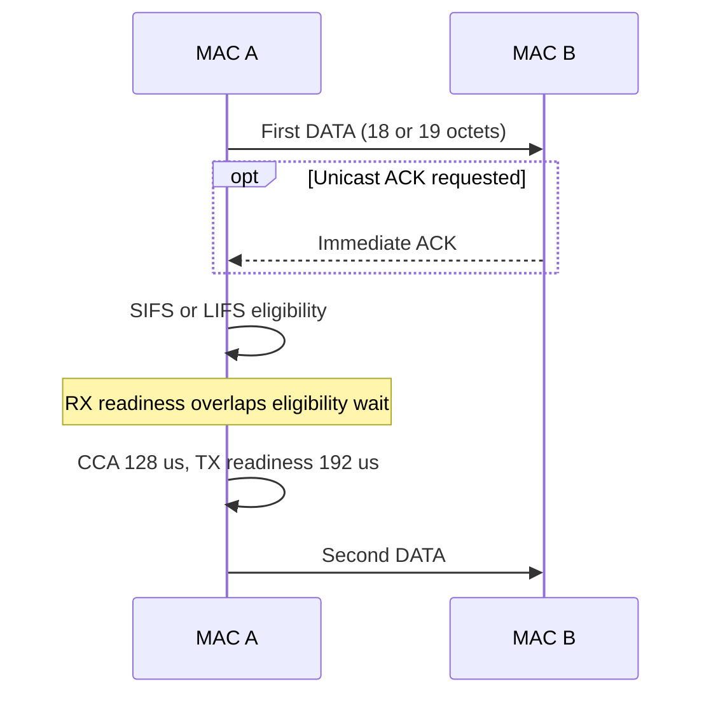

# IFS, short addressing and broadcast ACK suppression

Series `IEEE802154-6B/6C`, companion `Ieee802154InterframeSpacing.test`. IEEE Std
802.15.4-2024, 6.3.1/Figure 6-1 gives the size-dependent and post-ACK waits; 6.6.3.1
requires no ACK request for broadcast/group transmission.

Two real interfaces use short addresses 0x1001/0x1002 in PAN 0x1234. Native clients submit
two MSDUs through the production service, the second from the first terminal callback.
Seven/eight payload bytes yield complete MPDUs of 18/19 octets, crossing SIFS=192 us and
LIFS=640 us. Sixteen cases cross that boundary, requested ACK off/on, unicast/broadcast
and typed/raw radio representation. Broadcast generation clears AR even when requested.



The protocol program checks the actual separation of the two transmitted DATA frames, with
the bounded round-trip propagation allowance only for acknowledged unicast. An implementation
that adds RX turnaround after IFS would miss the upper bound by 192 us. Native callbacks
independently verify two successes, correct presence of ACK metadata, both short identities,
DSNs, unchanged payload and actual AckSent at the receiver.

Proposed command after fresh debug compilation:

```sh
opp_run_protocol_tests --load . -p inet -m debug --no-build \
  -w '^tests/protocol/ieee802154$' -f 'Ieee802154InterframeSpacing\.test$'
```

Executed 2026-11-15 in debug mode: 16 PASS, 0 FAIL, exit 0. The combined batch and artifact
paths are in the [model results](../../../doc/project/evidence/model/ieee802154/results.md).
Diagram rendering remains unverified. No baselines changed.
