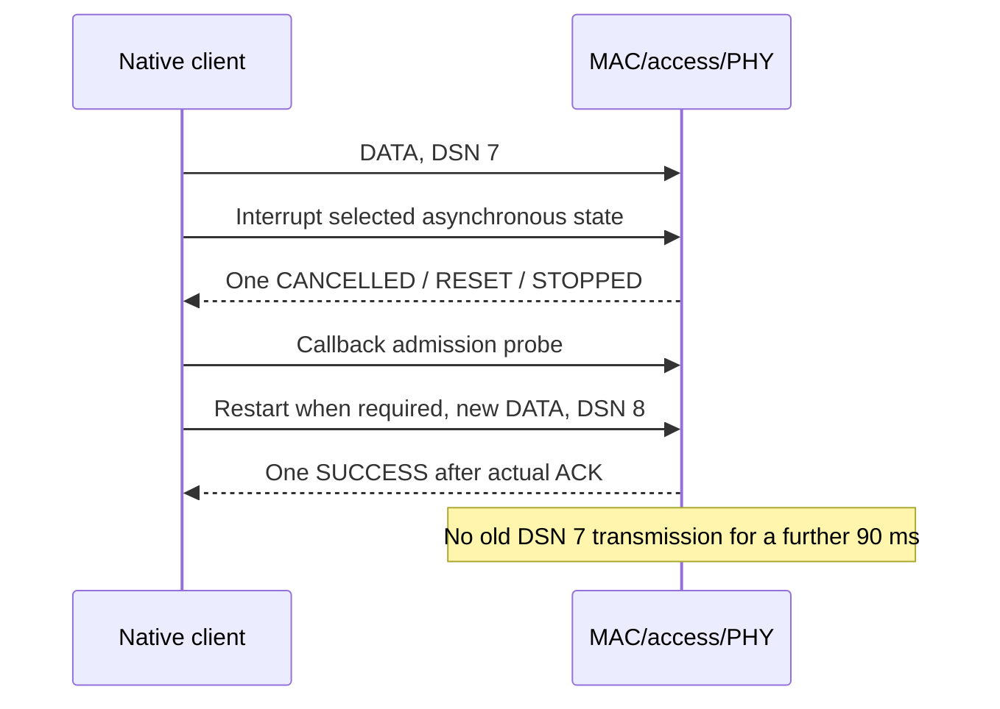

# Direct-service interruption and restart

Series `IEEE802154-5/6C`, companion `Ieee802154Lifecycle.test`. The service/lifecycle contracts
require exactly one terminal result, packet cleanup, retired timers/IDs and explicit reset/stop
admission. These are model integration obligations, not an invented IEEE status encoding.

Forty cases cross five asynchronous states (random backoff, CCA, TX readiness, on-air TX and
ACK waiting), four interruptions (cancel, reset(false), stop, crash) and typed/raw radio paths.
Two additional cases start a node DOWN and verify UNAVAILABLE before normal startup. A native
client configures DSN 7 and bounded parameters through MLME-SET; each interrupt occurs at a
fixed time inside the selected state. A tracked MSDU must be destroyed before its abort callback.
Concurrent DATA refusal retains caller ownership. Callback probes distinguish ordinary reentry,
reset BUSY and stop/crash UNAVAILABLE. IDs are not reset by restart.



The replacement request uses the same real interface and must succeed. The protocol program
checks no transmission before a pre-air interruption, the new serialized DSN 8, one success,
and a 90-ms quiet interval for any retired DSN-7 backoff/CCA/TX timer. That interval exceeds
the selected maximum 255×320-us initial backoff. Completion counts and destruction checks run
independently in the client. Initially DOWN handling reads NodeStatus only after its LOCAL
initialization, and all three production owners have enough initialization stages.

An already emitted radio signal is an indivisible packet-level medium object. The current
radio abstraction cannot retract that object when its local transmit operation is aborted.
This test does not assert disappearance of such remote energy/data; it verifies local cleanup,
admission, no stale retransmission and replacement progress. That limitation remains explicit
in the PHY/release evidence rather than being mislabeled waveform-level cancellation.

Before these owners, the replacement had no operational direct-service lifetime. Proposed
command after fresh debug compilation:

```sh
opp_run_protocol_tests --load . -p inet -m debug --no-build \
  -w '^tests/protocol/ieee802154$' -f 'Ieee802154Lifecycle\.test$'
```

Executed 2026-11-15 in debug mode: 42 PASS, 0 FAIL, exit 0. The combined batch log and
artifacts are recorded in the [model results](../../../doc/project/evidence/model/ieee802154/results.md).
Diagram rendering remains unverified. No baseline updates were performed.
