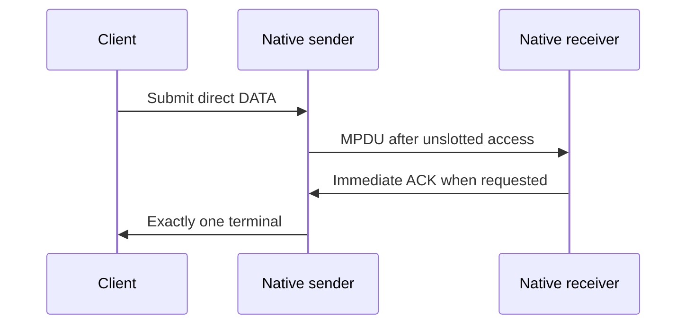

# Nonbeacon DATA and ACK publication unit

> **Kind:** report · **Status:** draft · **Seal:** none · **Owns:** — · **Stands on:** [implementation plan](../../../plan/pending/802154-implementation-plan.md#split-of-the-nonbeacon-mac-commit)

N06, proposed subject `ieee802154: add: native nonbeacon DATA and ACK services`, introduces the native direct-data transaction owner after address, service, codec and PHY preparation. Its parent has no native production MAC. That absence is a missing capability, not an observed failing-parent exchange. The candidate's runtime verification is initially NOT_RUN; the execution log records actual reconstructed source and library identities.

Two configured unsecured O-QPSK peers submit direct DATA through the native service. The sender accesses the medium through unslotted CSMA/CA, emits a serialized MPDU, waits for the matching immediate ACK when requested, and reports exactly one terminal. The receiver validates the frame and delivers native payload/identity metadata. Broadcast does not request an ACK. Lost, wrong or late ACKs must not complete an unrelated request, and retry exhaustion reports its actual failure.

The existing scenario documents own the complete input, timing and assertions: [admission](admission.md), [unslotted access](unslotted-access.md), [DATA/ACK](data-ack.md), [contention](contention.md), [interframe spacing](interframe-spacing.md), [sequence wrap](sequence-wrap.md), [receive security](receive-security.md), [lifecycle](lifecycle.md), [PHY lifecycle](phy-lifecycle.md) and [PHY PIB](phy-pib.md). Retain their matching `Ieee802154*.test` fixtures with N06, staging management-dependent extensions only at N07. PHY lifecycle cases 0–7 belong here; cases 8–9 exercise managed queues and land at N07. The separate Broadcast fixture tests queued beacon release and belongs wholly to N07; N06's ReceiveSecurity cases retain direct broadcast receive/filter checks. Broadcast emission reasoning remains source-based at this prefix. GET/SET/RESET and PHY availability are part of the direct-data ownership contract; management procedures are unavailable at this stage.

The diagram shows the successful acknowledged path. The linked scenarios also cover filtering, negative security outcomes, sequence rollover and retirement during asynchronous states. Execution and diagram rendering remain unverified until the candidate is checked. These cases do not establish managed PAN admission, indirect delivery, scheduled operation, or working cryptography. Parent comparisons may remain explicitly source-based under the accelerated execution contract.
