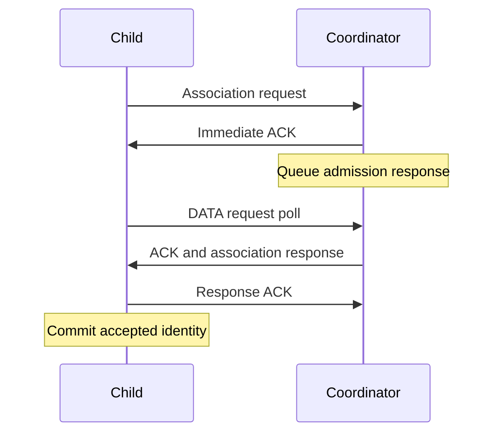

# Nonbeacon PAN management publication unit

> **Kind:** report · **Status:** draft · **Seal:** none · **Owns:** — · **Stands on:** [implementation plan](../../../plan/pending/802154-implementation-plan.md#split-of-the-nonbeacon-mac-commit)

N07, proposed subject `ieee802154: add: native nonbeacon PAN management`, extends N06's direct-data owner with management procedures. Its proposed parent supports direct DATA/ACK but has no operational start/scan/association/poll/recovery or receiver-schedule services. This is a source-based capability comparison until an actual compatible parent probe is recorded. Candidate verification is initially NOT_RUN.

For association, a child requests admission and receives the association response through the indirect poll path before committing its assigned identity. The coordinator's pending store retains response/data ownership through poll, expiration, cancellation and reset. Scanning temporarily changes PHY configuration and restores it before completion. Rejoining, orphan realignment, PAN conflicts and receiver-enable windows must retire their owned timers and requests without duplicate terminals or partial identity commits.

The existing scenarios and exact fixtures remain authoritative: [indirect transactions](indirect.md), [association](association.md), [reassociation](reassociation.md), [orphan recovery](orphan.md), [PAN conflict](pan-conflict.md), [receiver enable](receiver-enable.md) and [broadcast queue release](broadcast.md). Include the PendingTransactions unit, Start/Discovery/PassiveScan module checks and management-specific extensions of N06's shared tests. PHY lifecycle cases 8–9 extend the core cases with managed queue/reset behavior; restore the original full fixture here. Follow each document's production stimulus, actual exchanges, assertions and coverage limits. The execution log records the exact selected fixtures, source/library hashes, results and any fixture adaptation.

The diagram illustrates the successful association sequence; it is not a timing oracle for every poll/error branch. Rendering and runtime execution remain unverified until tested. Start/scan/indirect management reuse the existing transaction/receive and PHY service owners, rather than introducing a second controller. This unit does not establish beacon-enabled scheduling, GTS, enhanced frames or successful security transforms.
