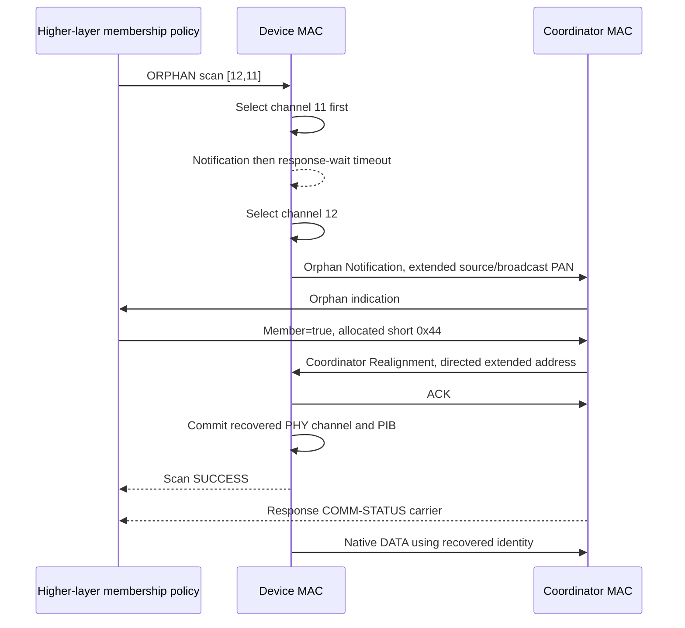

# Orphan scan and coordinator realignment

The [implementation contract](../../../doc/project/evidence/model/ieee802154/orphan-recovery.md)
identifies the 2024 clauses, ownership and configuration-commit boundary.
Two production native interfaces share a scalar medium, at 0 m and 1 m.
The coordinator starts PAN 0x2345 on channel 12, short address 1. The device's
configured last-known relationship is PAN 0x1234, channel 20, short 0x42 and
the coordinator's full EUI. This is an explicit interrupted-link fixture, not
an executed prior join. Higher-layer membership recognition is in the test client.



Sixteen typed/raw scenarios propose 32 runs: ordinary recovery, ignored unknown
member, no higher-layer response, wrong full destination, extended-only member,
first/all realignment ACK loss, cancellation during readiness, RESET during the
first notification PPDU, cancellation during the response PPDU, advertised new
channel 26, invalid advertised channel, invalid short 0xffff, ignored received
Frame Pending, protected unsupported response and an invalid unacknowledged
directed realignment. Mutations preserve physical length and recompute FCS.

The zero and maximum uint32 ScanDuration values must both be ignored; two
macResponseWaitTime periods determine per-channel listening. The first channel
has no coordinator, so a second-channel response proves actual iteration.
Success commits PAN/channel/address/coordinator fields and supports actual
DATA/ACK. Failure/cancel/reset restores channel 20 and retains the prior PIB
relationship for higher-layer recovery policy. Wrong EUI input differs only in
the high address octet, testing full native identity rather than low 48 bits.

ACK-loss cases explicitly keep the recovered receiver idle-on. A retransmitted
realignment is then received outside the scan and produces REALIGNMENT
SYNC-LOSS without reapplying configuration. With all ACKs lost the device has
recovered but the coordinator reports NO_ACK. The channel-26 input case retunes
the coordinator through its higher layer after command completion, and DATA
then verifies that both radios use the advertised channel. No waveform-abort,
authentication, enhanced-channel or beacon-tracking claim is implied.

Execute after a fresh debug build:

```sh
opp_run_protocol_tests --load . -p inet -m debug --no-build \
  -w '^tests/protocol/ieee802154$' -f 'Ieee802154Orphan\.test$'
```

Executed 2026-11-15: **32 PASS, zero FAIL**, exit 0
(`/home/miguel/workspace/ai-logs/executions/tmp-preservation-20261115/ieee802154/ieee802154-orphan-protocol.log`, copied outputs/INI in
`/home/miguel/workspace/ai-logs/executions/tmp-preservation-20261115/ieee802154/ieee802154-orphan-evidence/`). Every run emitted its native verification
signal and explicit protocol PASS; the FAIL guard prevents mixed-run false success. Mermaid
rendering and fingerprints are unverified/unchanged.
