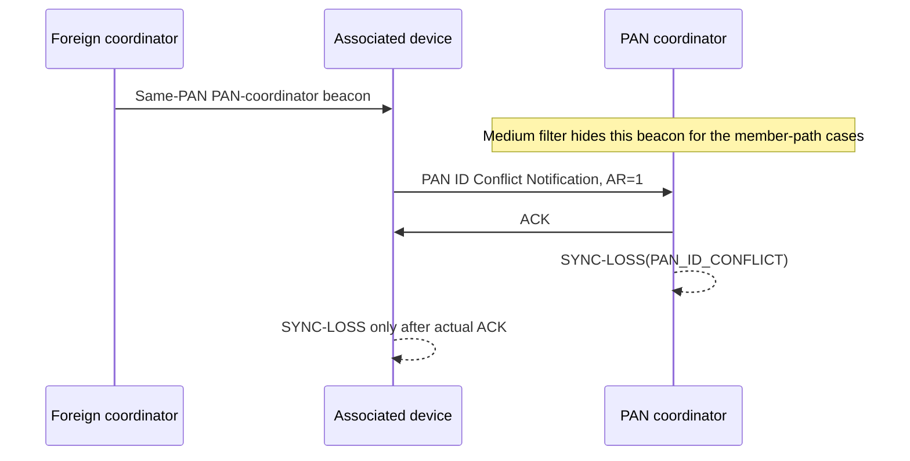

# PAN ID conflict detection and reporting

The [contract](../../../doc/project/evidence/model/ieee802154/pan-conflict.md)
maps IEEE Std 802.15.4-2024, 10.17 and Table 10-4 to the implementation.
Three real MAC/PHY interfaces are at x=0/1/2 m. The device performs default
RESET, active scan and actual association with node 0 before the conflicting
beacon is sent at 60 ms. Node 2 has a full EUI that differs above the low 48 bits.



Fourteen typed/raw scenarios propose 28 runs: device notification success,
all notification ACKs lost, coordinator-only beacon detection, foreign PAN,
non-PAN-coordinator beacon, known parent short beacon, unassociated device,
wrong full member EUI, wrong notification PAN, protected unsupported beacon,
reset from the device indication, notification queued behind busy DATA,
known parent extended beacon, and ignored received Frame Pending.

The all-ACK-loss case requires three coordinator indications but no device
indication. Unknown member/PAN input must receive no ACK and no coordinator
indication. Protected input can be reported as unavailable-security beacon
metadata, but cannot drive detection from opaque content. Known-parent and
unassociated cases exercise the exact 10.17.2 predicates rather than suppressing
all beacons. Outside-scan BEACON-NOTIFY confirms actual reception.

The busy-DATA case sets CCA threshold zero against controlled nonzero noise,
with BE=5 and five maximum backoffs. The beacon must be received/described before
DATA completes with CHANNEL_ACCESS_FAILURE. New DATA admission is BUSY while
the conflict notification waits, preserving caller ownership. The client then
restores the saved PHY threshold. The notification's actual transmission must
follow that DATA terminal event and its ACK must precede device SYNC-LOSS.
This does not prove DATA/ACK reception overlapping CCA; that remains a separate
release obligation recorded in the model contract.

Execute after a fresh debug build:

```sh
opp_run_protocol_tests --load . -p inet -m debug --no-build \
  -w '^tests/protocol/ieee802154$' -f 'Ieee802154PanConflict\.test$'
```

Execution is pending. The first fixture attempt read PHY attributes during its
own receive-readiness transition; the corrected ordering snapshots the threshold
before requesting receive readiness. Mermaid rendering and fingerprints are
unverified/unchanged. PAN reselection, periodic beacons and crypto are not implied.
