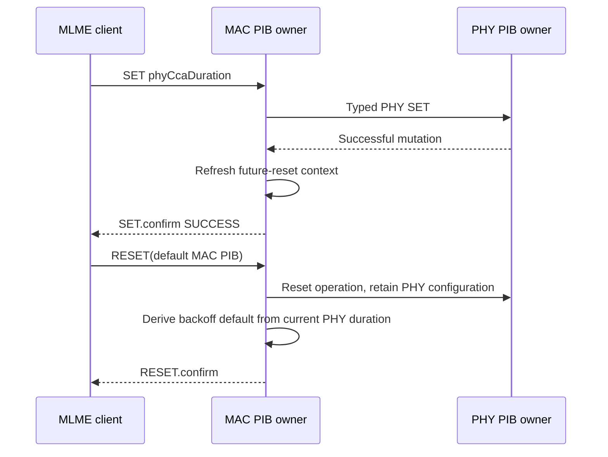

# PHY PIB management and current timing context

Series `IEEE802154-4`, companion `Ieee802154PhyPib.test`. IEEE Std 802.15.4-2024, Table 12-2
defines typed PHY attributes; 12.1 routes their access through MLME. Table 8-12 leaves PHY
reset implementation-dependent while SetDefaultPib controls MAC defaults. The selected owner
retains PHY configuration on MLME reset, refreshes the MAC reset context after a successful CCA
duration SET, and leaves the current writable backoff period unchanged until explicitly changed
or restored by default MAC reset.

Sixteen runs cross durations 1/17/128/1000000 us, startup/runtime initialization and typed/raw
radio paths. Two production interfaces switch to channel 11 or 26. The higher-layer client
uses actual MLME calls to test exact typed GET/SET, unsupported names, wrong types, readonly
precedence, invalid mode/channel/duration, and duplicate peer-power keys. Failed writes must
preserve the previous state; native peer keys retain distinct high EUI bits. The client sets
backoff period 37, requests default MAC reset, then requires `12+ceil(duration/16)` and the
retained current PHY duration/channel before restoring its static PAN.



An unacknowledged four-byte MSDU then traverses the actual access/PHY/radio path. With zero
initial backoff its transmission starts at 1 ms plus the selected CCA duration plus 192 us;
the 27-byte MPDU ends 1056 us later. The protocol matcher checks that timing and peer receipt;
the client independently checks the one terminal result. Thus a correct helper with stale
production timing cannot satisfy the fixture. Before delegation these PHY attributes were
unavailable at MLME, and runtime context refresh did not exist. No executed parent comparison
is claimed.

Proposed command after fresh debug compilation:

```sh
opp_run_protocol_tests --load . -p inet -m debug --no-build \
  -w '^tests/protocol/ieee802154$' -f 'Ieee802154PhyPib\.test$'
```

Executed 2026-11-15 in debug mode: 16 PASS, 0 FAIL, exit 0. The combined batch and artifact
paths are in the [model results](../../../doc/project/evidence/model/ieee802154/results.md).
Diagram rendering remains unverified. This fixture does not establish ED/LQI saturation;
energy without decoding has a separate module fixture. No fingerprint baselines changed.
