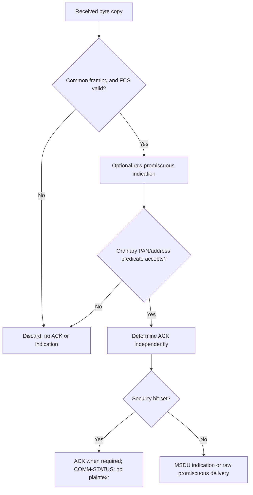

# Legacy receive decisions and unsecured-profile security policy

Series `IEEE802154-6A`, proposed subject `ieee802154: add: implement native receive decisions`.
`Ieee802154ReceiveSecurity.test` checks the audited 2024 decision table from 6.6.2,
7.2/7.3, 9.2.4(a)/(b) and 10.23.1. The independent expectations are explicit constants in
`fixtures/ReceiveCases.h`; they are not computed by calling the production receive predicate.

Two production interfaces exchange one acknowledged MSDU, with retransmissions disabled.
A medium mutator changes the receiver's byte copy before MAC processing. Twenty-four variants,
each on typed and raw radio paths, isolate PAN/native-address filtering, broadcast PAN and
address, group reception, source-only/coordinator and implicit-broadcast branches, ignored
reserved bit 7, malformed legacy flags/address mode, version 2, truncation, bad FCS,
promiscuous monitoring and secured version 0/1 common framing.



The protocol program checks ACK/no-ACK and DATA/monitor/COMM-STATUS presence independently.
The native client checks exact original payload, full source identity, DSN, AckSent, invalid
timestamp/security metadata and one sender terminal result. The secured cases retain opaque
remainders, ACK valid AR traffic and return UNSUPPORTED_LEGACY or UNSUPPORTED_SECURITY without
parsing keys or declaring crypto support. Promiscuous foreign frames gain monitor visibility,
never ACK eligibility. Bad FCS gains neither. Group AR=1 is deliberately injected to exercise
the receive rule; a conforming transmitter would clear it.

The mutator can shorten a byte copy while the underlying signal keeps the original duration;
these cases prove receive decisions, not new PHY airtime. Actual unmodified DATA/ACK timing
is covered by `Ieee802154DataAck.test`. No original mixed-format PCAP is reclassified as a
standards oracle. Before this receive path the replacement discarded received packets;
that is a source-based expectation, not an executed parent comparison.

Proposed execution after a fresh debug build:

```sh
opp_run_protocol_tests --load . -p inet -m debug --no-build \
  -w '^tests/protocol/ieee802154$' -f 'Ieee802154ReceiveSecurity\.test$'
```

Executed 2026-11-15, debug mode, one selected/executed file: **48/48 General runs successful**,
48 explicit PASS and zero FAIL protocol verdicts, seed 0, exit 0. Raw log:
`/home/miguel/workspace/ai-logs/executions/tmp-preservation-20261115/ieee802154/ieee802154-receive-protocol.log`; retained simulation output and INI:
`/home/miguel/workspace/ai-logs/executions/tmp-preservation-20261115/ieee802154/ieee802154-receive-evidence/`. Initial custom packet-valued fixture signals were not
normalized by the framework. The final fixture emits scalar callback counters after checking
the packet/metadata directly. An explicit negative-verdict guard prevents a mixed batch from
passing on the strength of one successful run. Production behavior was unchanged by that fix.

Diagram rendering is unverified. Lifecycle, sequence wrap and contention remain
separate gates; no fingerprint baseline changes.
