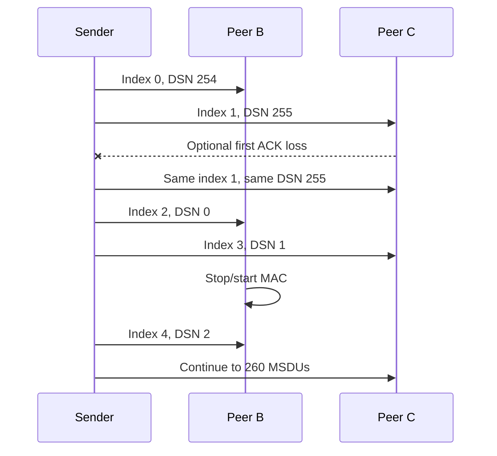

# Device-wide DSN and restart

Series `IEEE802154-6C`, companion `Ieee802154SequenceWrap.test`. IEEE Std 802.15.4-2024,
6.6.1 assigns one device-wide DSN; 6.6.3.4 retains it for retransmissions. The eight-bit DSN
does not establish exactly-once delivery or a universal duplicate-cache algorithm.

One production sender submits 260 acknowledged four-byte MSDUs, alternating between two
native destinations. All three EUI-64 identities share their low 48 bits. A test client sets
DSN 254 through MLME-SET after ordinary randomized initialization. Each payload carries its
global index. The receiver checks DSN `(254+index) mod 256`, destination parity, full source
identity and actual AckSent. This exposes a per-destination counter even when each peer alone
would see a plausible increasing sequence. The sender checks one correlated SUCCESS per request,
MSDU-handle wrap and final PIB DSN 2, including submission from ordinary terminal callbacks.



The peer restart occurs through the real lifecycle controller after index 3 completes.
The test crosses typed/raw radio representation with optional first-255 ACK loss. Each peer
must receive all its 130 unique indices; only the deliberately retried index may be indicated
twice. No duplicate suppression is enabled or claimed. The protocol matcher observes the
serialized 254→255→0→1 boundary, restart, subsequent delivery and final completion count.

Before the replacement transaction owner, no operational service existed. The change allocates
DSN once per accepted valid MSDU and reuses the immutable frame on retry. This is a source-based
expectation; no parent run is claimed. Proposed focused command after a fresh debug build:

```sh
opp_run_protocol_tests --load . -p inet -m debug --no-build \
  -w '^tests/protocol/ieee802154$' -f 'Ieee802154SequenceWrap\.test$'
```

Executed 2026-11-15, debug mode: one selected/executed file, **4/4 General runs successful**,
four explicit PASS and zero FAIL protocol verdicts, seed 0, exit 0. Each run completed all 260
MSDUs. Runner log `/home/miguel/workspace/ai-logs/executions/tmp-preservation-20261115/ieee802154/ieee802154-sequence-protocol.log`; retained output and INI:
`/home/miguel/workspace/ai-logs/executions/tmp-preservation-20261115/ieee802154/ieee802154-sequence-evidence/`. An initial fixture incorrectly held LifecycleController
as a member; using it as the module mixin required by its current context contract fixed setup.

Diagram rendering is unverified. Channel contention, every lifecycle interruption
state and malformed input are separate fixtures. No fingerprint baseline changes.
