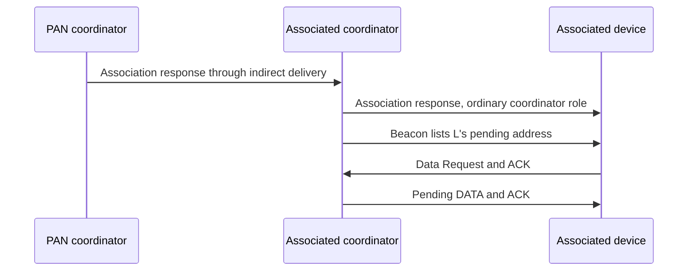

# IEEE 802.15.4 managed beacon CAPs

Plan: [B2-03](../../../plan/pending/802154-superframe-gts-plan.md#b2-03--ieee802154-add-managed-exchanges-in-beacon-caps),
`ieee802154: add: managed exchanges in beacon CAPs`.

[Ieee802154SlottedManagement.test](Ieee802154SlottedManagement.test) runs the
production management application with a native BO3/SO1 coordinator and a
device. Both typed and serialized radio paths must complete two scan, SYNC,
association, DATA, poll and leave cycles. The device selects the advertised
PAN and the application uses service confirmations rather than scheduling MAC
CAPs. The companion [managed example](../../../examples/wireless/ieee802154managed/README.md)
also has an explicit default-off beacon configuration.

[Ieee802154SlottedManagementBoundary.test](Ieee802154SlottedManagementBoundary.test)
uses native MACs and PHYs, with a third node for actual root-to-child-to-leaf
association. A controlled radio-medium tap drops a selected ACK in the
lost-ACK case. In the foreign-PAN collision case it changes the PAN fields of
the test poll and returned DATA copies, recomputing each FCS, to expose the
alias check while retaining native MAC and PHY exchanges. Every scenario
selects both typed and serialized radio paths.

The boundary fixture checks:

- Scans suspend scheduled coordinator beacon transmission and resume at a
  future phase. A child scanning across four missed beacons reports loss;
  cancellation, reset, MAC stop/restart, PHY stop/restart and BUSY admission
  have separate controls. A nonzero-offset clock at both drift signs checks
  first-PPDU-symbol scan and BEACON-NOTIFY timestamps while tracking is
  suspended.
- Idle receive duty follows actual incoming or outgoing CAP duty even when
  `macRxOnWhenIdle` is true. PHY-only restart inside a coordinator CAP restores
  its remaining duty; an unavailable controller cannot leave an unscheduled
  CAP duty active.
- RX-ENABLE uses the observed superframe anchor, including a window crossing
  the active/inactive boundary, ON_TIME_TOO_LONG, PAST_TIME and permitted
  deferral. Actual RX-end indication timing is compared with the public future
  clock inverse for both drift signs and the internal clock-event backend.
- An FP0 beacon is constructed before a broadcast is queued from its send
  callback. The broadcasts wait for actual later FP1 beacons, one per CAP.
  A separate high-backoff case carries the first broadcast into a later CAP
  and verifies that the second cannot consume another grant in that CAP.
  A queued indirect frame expires on its admission-time BO3 deadline even if
  BO changes; physical deadlines are also checked at opposite clock drifts
  and with the internal backend.
- An associated sleeping device wakes for a real pending-address beacon and
  automatically polls without an upper-layer POLL request, using the address
  mode advertised in that beacon. A pending automatic
  poll is retired on PHY-down or MAC stop; after restart, a public DATA
  admission confirms that no stale internal request occupies the MAC.
- A greater-than-18-octet extended-address Data Request produces a DATA RF
  start on the actual backoff grid between SIFS and SIFS plus one backoff
  period after ACK end, with zero coordinator backoff draws. The physical
  start also matches an independently calculated future clock inverse at both
  drift signs. A late poll leaves insufficient CAP time and uses slotted
  access in the next CAP. Dropping the first DATA ACK retains the same DSN
  until a fresh poll; separate cases cancel, reset, or stop the PHY after a
  future quick start is reserved and require one terminal and no DATA RF.
- A device associated through an ordinary coordinator has a real parent
  binding while `macAssociatedPanCoord` is false. Changing a public parent
  reference invalidates that binding; a failed association cannot create it.
  Orphan recovery retains the ordinary-parent role. A real scanned and
  synchronized ordinary-coordinator beacon overrides a default-true caller
  declaration. Requests for a different acquired PAN, channel or peer are
  refused without retuning. A foreign-PAN response sharing a local parent's
  short address cannot complete the foreign POLL through local aliasing. A
  leaf hearing its PAN root does not report a conflict against
  its ordinary parent. A received parent departure retires a deferred child
  realignment before its terminal callback; RESET is BUSY during that
  retirement and succeeds when retried afterwards.

The preceding focused checkpoints passed the two production-app fixture runs
and the individual boundary cases. The combined boundary fixture passed all
88 typed and raw runs in the acceptance campaign. That campaign had four
reconfiguration fixture failures, subsequently addressed by explicit receive
windows and verified in the eight affected runs; it was not rerun in full.
The B3-03 extension runs the production application with GTS disabled and
enabled in typed and raw modes. Its observer checks actual DATA radio intervals
against the two advertised slots and requires no access-provider activity.
The B3-06 observer also compares those intervals with the coordinator's
installed CFP signal details and checks the CAP signal's physical start
against the transmitted beacon's actual PPDU end. Window observations describe
reservations, while the radio supplies RF proof. All four original focused
runs and the later B3-06 combined acceptance passed. The allocated-device
scan, cancellation, missed-beacon and PHY-outage cases are owned by the native
[GTS DATA fixture](gts-data.md). Mermaid rendering is **NOT_RUN**. These tests
do not claim security transforms, enhanced frames, or network-layer forwarding.
