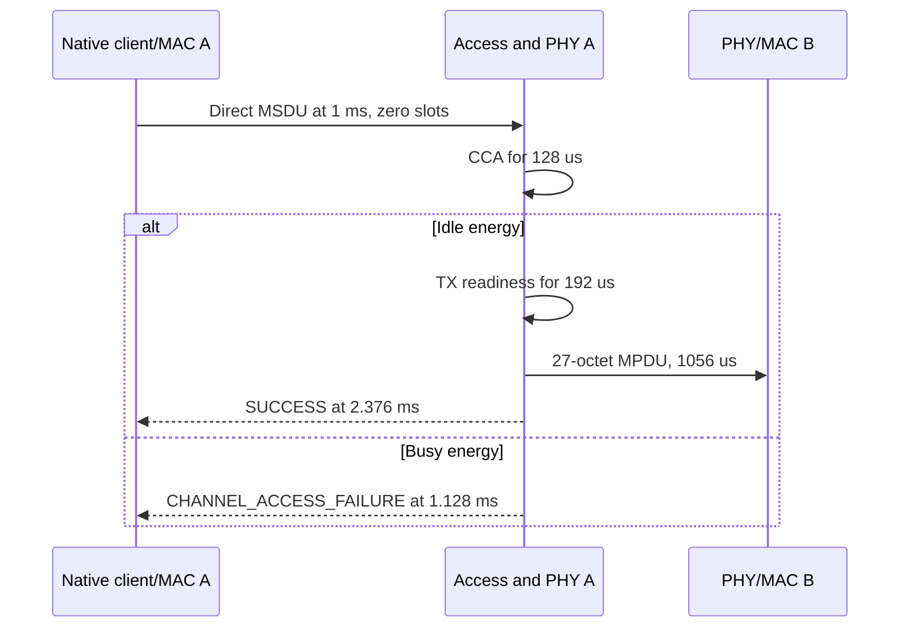

# Native unslotted channel access

Series `IEEE802154-5`, proposed subject `ieee802154: add: implement unslotted channel access`.
The companion is `Ieee802154UnslottedAccess.test`; its real frame path also exercises `IEEE802154-2`'s
native codec. IEEE Std 802.15.4-2024, 6.3.2.1/Figure 6-2 requires CCA after backoff and
failure when NB exceeds the selected limit. Frame fields follow 7.2/7.3; O-QPSK timing follows
13.1/13.3. The selected profile is unsecured static-PAN direct data, not managed operation.

Two interfaces one metre apart use production native MAC, access, PHY and radio components.
A test-local higher-layer client sets BE=0, maximum busy backoffs=0 and DSN=7 through MLME-SET,
then submits a four-byte MSDU at 1 ms. Both full EUI-64 identities have equal low 48 bits.
The test runs typed and raw-byte radio paths, each with idle and continuously busy energy
thresholds, fixed General seed 0. It does not script CCA outcomes inside the MAC.



The protocol program observes the production backoff signal, exact earliest transmission
interval, decoded full source/destination, version, DSN, PAN compression, actual length and FCS,
then receipt through the peer's real radio. The busy branch observes no transmitted frame;
the higher-layer client independently requires its one failure result at the CCA end. The idle
client requires one SUCCESS at actual PPDU completion. Production recorders write PCAPs for
external inspection. Duplicate/random contention, ACKs, receive delivery and security remain
separate tests. The access module fixture supplies additional NB/BE/cancellation boundary checks.

Before the new production wiring, replacement DATA returned UNSUPPORTED_OPERATION and no frame
crossed the radio. That is a source-based expectation, not an executed parent comparison.
The change gives the MAC one direct transaction, routes each access CCA through its sole PHY
client, and submits a complete native frame only after access and readiness. Results remain
pending until the recorded execution below; a passing helper fixture is insufficient.

Proposed execution from the repository root after a fresh debug build:

```sh
opp_run_protocol_tests --load . -p inet -m debug --no-build \
  -w '^tests/protocol/ieee802154$' -f 'Ieee802154UnslottedAccess\.test$'
```

Executed 2026-11-15 from `/home/miguel/workspace/inet-ieee802154-standard`, fresh debug build,
the command above: one selected/executed test file, **4/4 General runs successful**, seed 0,
all four protocol verdicts PASS, exit 0. Raw runner log:
`/home/miguel/workspace/ai-logs/executions/tmp-preservation-20261115/ieee802154/ieee802154-access-protocol.log`; retained simulation output, INI and captures:
`/home/miguel/workspace/ai-logs/executions/tmp-preservation-20261115/ieee802154/ieee802154-access-evidence/`. The initial test filename contained a hyphen, exposing
a runner build-directory mismatch; renaming the test to its current identifier fixed setup.
The first initialized fixture also exposed a fixed client binding in the composition; making
the native adapter binding a default permits explicit typed clients to replace it.

Scapy 2.8.0 independently decoded the idle typed/raw production captures and checked both
complete EUI-64 addresses, PAN, version, DSN, payload bytes and CRC. Command is the tracked
`tests/validation/ieee802154/check_captures.py --data-capture <pcap>` per retained idle capture;
log `/home/miguel/workspace/ai-logs/executions/tmp-preservation-20261115/ieee802154/ieee802154-data-independent-decoder.log`, exit 0. A receive record can occur at
multiple observed layers; capture record count is not an application delivery count.

Diagram rendering is unverified. No fingerprint baselines change in this package.
